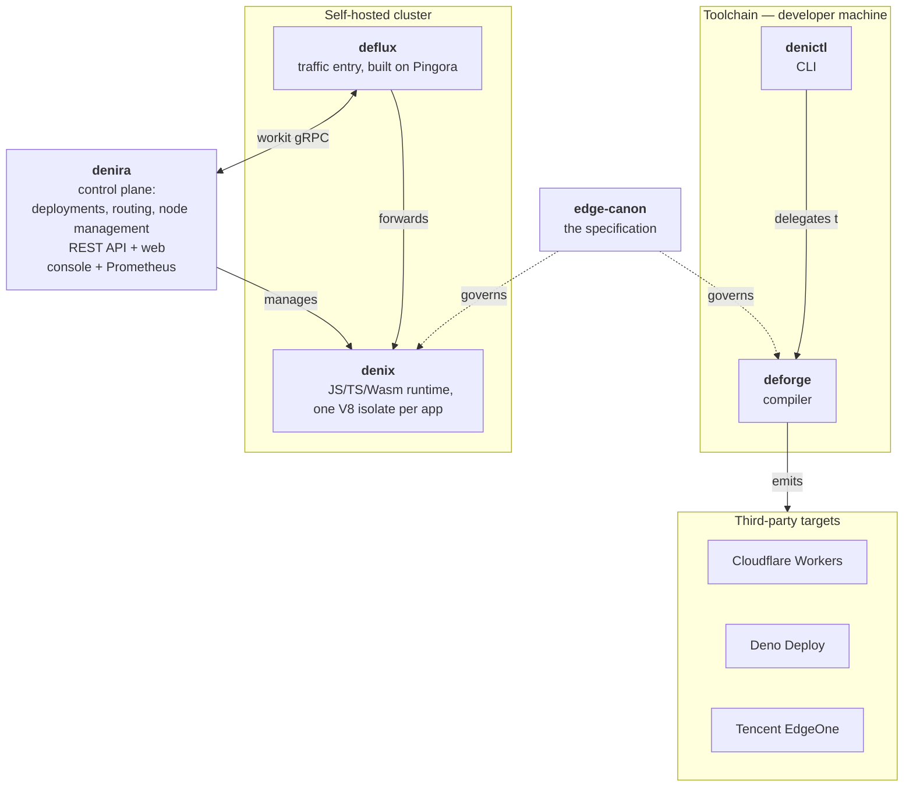

# Deislet

A small self-hosted edge computing platform, built around Deno as the execution engine.

Write an edge function once against the [Edge Canon](https://github.com/deislet/edge-canon) specification, then either compile it for a third-party platform (Cloudflare Workers, Deno Deploy, Tencent EdgeOne) or deploy it to your own cluster. Both paths are first-class.

Think of it as a miniature Cloudflare Workers and Pages that you run yourself.

> **Status: work in progress.** The traffic and control planes are functional; storage services, versioned deployments and static asset hosting are designed but not yet implemented. See [docs/architecture.zh.md](docs/architecture.zh.md) for the full design and the current gaps.

## Architecture



A request travels **client → deflux → denix**. deflux terminates TLS, picks the certificate by SNI, resolves the application by `x-deis-app-id` or Host, and load-balances across runtime nodes.

The control plane runs in two directions: deflux connects out to denira as a managed worker, while denix is autonomous and waits to be called by denira.

## Components

| Crate | Role |
|---|---|
| [`deforge`](crates/deforge) | Compiler. Translates Edge Canon code into platform-specific output via SWC and rolldown. Translation only — it does not deploy. |
| [`denictl`](crates/denictl) | Developer CLI. Project scaffolding, local dev server, validation, build. Delegates all parsing and compilation to deforge. |
| [`deflux`](crates/deflux) | Traffic entry. Pingora-based proxy with TLS termination, per-app SNI certificates, host-based routing, load balancing and zero-downtime upgrades. |
| [`denix`](crates/denix) | Runtime. Multi-tenant JS/TS/Wasm execution on deno_core, one isolate per application, autonomous via local SQLite. |
| [`denira`](crates/denira) | Control plane. Worker authentication and registration, configuration distribution, node health, web console, metrics. |
| [`workit`](crates/workit) | The gRPC protocol SDK shared by denira and its workers. |

## Quick start

```bash
scripts/demo.sh start
curl -H 'x-deis-app-id: demo' http://127.0.0.1:8087/hello
scripts/demo.sh stop
```

This builds all components, starts denira, denix and deflux, deploys a sample application through the control plane, and serves it through the data plane.

Building denira requires its web console assets, which are not checked in:

```bash
cd crates/denira/web && npm ci && npm run build
```

## Documentation

- [System design](docs/architecture.zh.md) — architecture, data model, request path, roadmap
- [Demo walkthrough](DEMO.md)
- [WAF proposal](WAF_PROPOSAL.md) — integrating the Coraza engine at the edge
- Per-component documentation lives under each crate.

## Related repositories

| Repository | Purpose |
|---|---|
| [edge-canon](https://github.com/deislet/edge-canon) | The edge function specification. Public. |
| coraza | A Rust port of the Coraza WAF engine, intended to run in front of deflux. |
| capkit | Capability-based multi-cloud abstraction, used for provisioning external resources. |

## License

Apache-2.0
