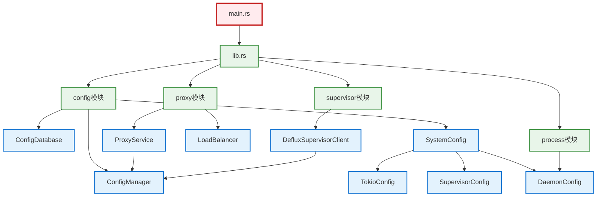
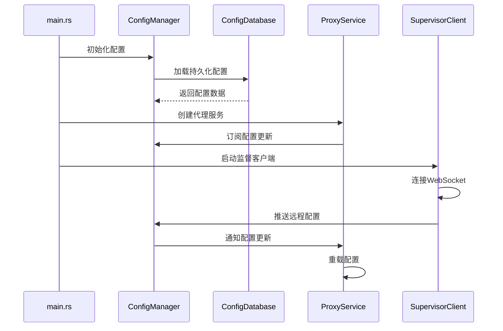

# Deflux 项目结构可视化

## 模块层次结构

```
deflux/
├── main.rs (程序入口)
├── lib.rs (库根)
│   ├── cli (命令行参数)
│   ├── config (配置管理)
│   │   ├── system/ (系统配置)
│   │   │   ├── balancing (负载均衡策略)
│   │   │   ├── cache (缓存配置)
│   │   │   ├── compression (压缩配置)
│   │   │   ├── https (HTTPS配置)
│   │   │   ├── log (日志配置)
│   │   │   ├── mime (MIME类型)
│   │   │   ├── tokio (Tokio运行时配置)
│   │   │   └── upstream (上游服务器配置)
│   │   ├── default.rs (默认配置)
│   │   ├── error.rs (配置错误)
│   │   ├── loader.rs (配置加载器)
│   │   ├── manager.rs (配置管理器)
│   │   └── storage.rs (配置存储)
│   ├── process (进程管理)
│   ├── proxy (代理服务)
│   │   ├── admin (管理接口)
│   │   ├── balancer (负载均衡器)
│   │   ├── service (代理服务)
│   │   └── mod.rs
│   └── supervisor (监督客户端)
│       ├── client (WebSocket客户端)
│       └── state (状态管理)
```

## 核心结构体关系图



## 数据流向图



## 主要组件说明

### 1. **配置系统** (config/)
- **ConfigManager**: 统一的配置管理接口，支持三层配置（默认、本地、监督）
- **ConfigDatabase**: SQLite持久化存储
- **SystemConfig**: 系统级配置的聚合

### 2. **代理系统** (proxy/)
- **ProxyService**: 基于Pingora的HTTP/HTTPS代理实现
- **LoadBalancer**: 负载均衡算法实现（轮询、随机、IP哈希等）
- **AdminInterface**: 管理API接口

### 3. **监督系统** (supervisor/)
- **DefluxSupervisorClient**: WebSocket客户端，接收动态配置
- **StateManager**: 管理连接状态和重连逻辑

### 4. **进程管理** (process.rs)
- **DaemonConfig**: 守护进程配置
- **daemonize()**: 守护进程化功能

## 使用可视化工具

1. **查看 Graphviz 图表**:
   ```bash
   sudo apt-get install graphviz
   dot -Tpng project_structure.dot -o project_structure.png
   xdg-open project_structure.png
   ```

2. **查看 Mermaid 图表**:
   - 将 `project_structure.mmd` 内容复制到 [Mermaid Live Editor](https://mermaid.live/)
   - 或使用支持 Mermaid 的 Markdown 编辑器查看本文件

3. **VSCode 扩展推荐**:
   - rust-analyzer: 代码结构树形视图
   - Mermaid Preview: 直接预览 Mermaid 图表
   - GraphViz Preview: 预览 DOT 文件

4. **其他工具**:
   ```bash
   # 安装 cargo-modules 查看模块依赖
   cargo install cargo-modules
   cargo modules generate tree --with-types
   
   # 使用 cargo-depgraph 查看依赖关系
   cargo install cargo-depgraph
   cargo depgraph --all-deps | dot -Tpng > dependencies.png
   ```