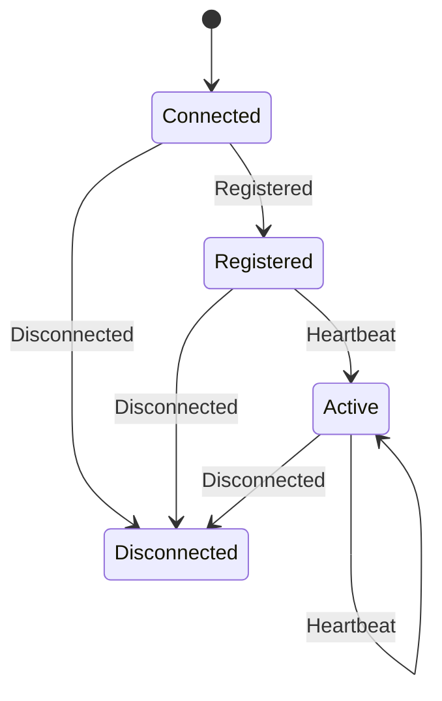
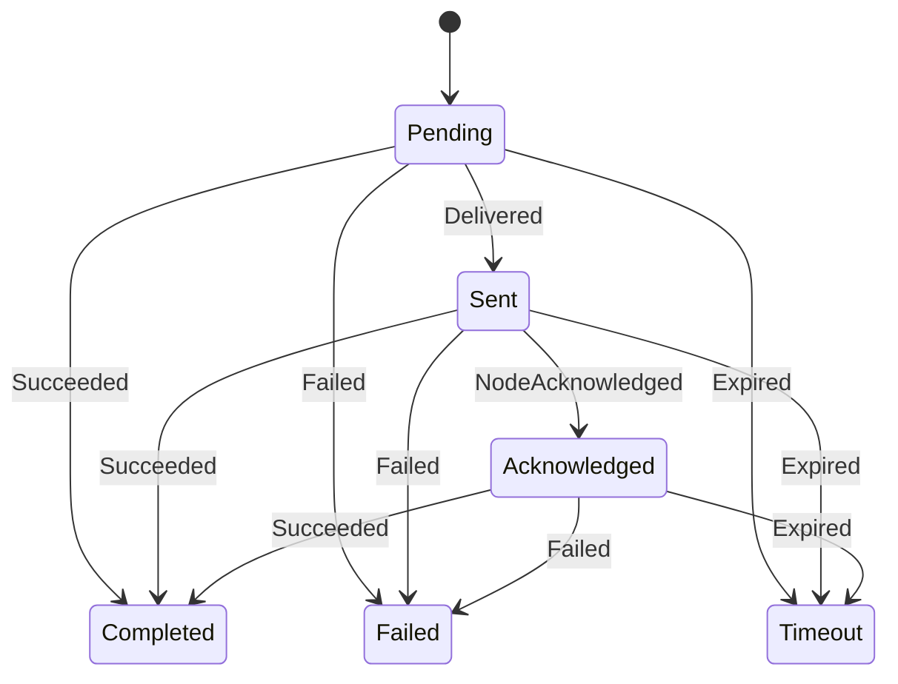

# deis-control architecture

> This document covers deis-control internals only. For the platform-wide design —
> data model, deployment and versioning, request path — see
> [`docs/architecture.zh.md`](../../docs/architecture.zh.md). For the HTTP
> surface and how to run it, see [README.md](README.md).

---

## 📐 Overview

deis-control is the platform's control plane: the single authority on what
should be running where. It stores the catalog (applications, versions,
environments, deployment pointers, routes, encrypted secrets), keeps track of
the fleet, pushes every change out to the nodes, and fires cron. It carries no
data plane traffic — a request from a browser never passes through it.

It is a single process on a single port, serving HTTP and gRPC together.

```
┌──────────────────────────────────────────────────────────────┐
│                        deis-control                          │
├──────────────────┬───────────────────┬───────────────────────┤
│  gRPC server     │  HTTP API         │  Embedded console     │
│  (deis-proxy     │  (deis CLI and    │  (React 19, built by  │
│   dials in)      │   the console)    │   Vite, served at /)  │
└────────┬─────────┴─────────┬─────────┴───────────────────────┘
         │                   │
         ▼                   ▼
┌──────────────────────────────────────────────────────────────┐
│                      Core services                           │
│  ┌───────────┐  ┌───────────┐  ┌───────────┐  ┌───────────┐  │
│  │ Catalog   │  │ Delivery  │  │ Scheduler │  │ Sessions  │  │
│  │ (product) │  │ (push)    │  │ (cron)    │  │ (gRPC)    │  │
│  └───────────┘  └───────────┘  └───────────┘  └───────────┘  │
│  ┌───────────┐  ┌───────────┐  ┌───────────┐                 │
│  │ ConfigMgr │  │ CommandEx │  │ Metrics   │                 │
│  └───────────┘  └───────────┘  └───────────┘                 │
└──────────────────────────┬───────────────────────────────────┘
                           ▼
                   ┌───────────────┐
                   │   SQLite      │
                   └───────────────┘
                           │
         ┌─────────────────┴──────────────────┐
         ▼                                    ▼
   deis-proxy (dials in over gRPC)   deis-runtime nodes
                                     (control plane dials out)
```

The two node types are reached in opposite directions, and mixing them up is
the single most common misreading of this component:

- **deis-proxy dials in.** It opens a bidirectional gRPC stream
  (`EstablishChannel`) and holds it: authenticate, register, heartbeat, receive
  configuration and commands. Those open streams are what `/api/sessions`
  lists.
- **A runtime node is dialled out to.** deis-control is the gRPC *client* of
  the node's own management service. It also serves the node three HTTP
  endpoints the node calls itself — registration, assignment list, bundle
  download. The fleet those make up is what `/api/runtime` lists.

WebSocket is not used anywhere in this component. Earlier versions of this
document described the node link as WebSocket; it is gRPC over HTTP/2.

---

## 🏗️ Modules

### 1. gRPC server (`src/server.rs`)

Accepts and holds node streams, over a Tonic bidirectional stream defined by
the `deis-wire` SDK.

**Responsibilities**
- Accept node gRPC streams
- Authenticate (see *Security* below — it is a SHA-256 construction, not HMAC)
- Manage session lifecycle
- Receive heartbeats and status updates
- Handle command responses

**Message flow**
```
Node → gRPC stream → Server → Handler → SessionManager / Database
Node ← gRPC stream ← Server ← CommandExecutor
```

**Key types**: `ControlServer`, `MessageHandler`, `NodeSession`.

### 2. HTTP API (`src/api/`)

Two routers with two different credentials — see README.md, *Two audiences,
two credentials*.

| File | Surface |
|---|---|
| `mod.rs` | routing and startup |
| `catalog/` | apps, versions, environments, deployments, routes, secrets, assignments |
| `apps.rs` | the runtime fleet (`/api/runtime`) |
| `nodes.rs` | open gRPC control channels (`/api/sessions`) |
| `registration.rs` | a node putting itself on the fleet list |
| `configs.rs`, `commands.rs`, `events.rs`, `metrics.rs` | operations |
| `middleware.rs` | API-key auth for humans, node auth for nodes |
| `static_files.rs` | the embedded console |

Axum, Tower HTTP, axum-server (for TLS).

### 3. Session management (`src/session.rs`)

```rust
pub struct SessionManager {
    sessions: Arc<DashMap<String, Arc<NodeSession>>>,
}
```

`DashMap` for concurrent access, `Arc<RwLock<_>>` around mutable state.

A session's own state is the `NodeFSM` table, and the diagram below is
generated from it by `yasm` — a test in this crate fails if the two stop
agreeing. `NodeSession::apply` takes the event on the arrow and the table
answers with the state; there is no setter that takes a state.



Two rules are worth reading off it. There is no arrow from `Connected` to
`Active`: a heartbeat from a node that never registered is acknowledged and
then ignored, so it is not counted among the live nodes by `src/metrics/` and
not shown as active by `/api/sessions`. And nothing leaves `Disconnected`: a
session whose stream closed stays closed, whatever arrives after it.

### 4. Catalog (`src/catalog/`)

The product model, and the reason this component exists. Applications,
immutable versions addressed by their bundle's sha256, environments,
deployment pointers, routes, and secrets encrypted with AES-256-GCM under a
master key read from `secret_key_file`. `bundle.rs` stores and serves the
uploaded archives.

A version is never mutated and never says it is current — an environment
points at it. That is what makes a rollback a pointer move.

### 5. Delivery (`src/delivery/`)

Turns a catalog change into an `ApplyDeployment` call on every node in the
fleet: app, version, environment, bundle URL, digest, and the env map
(manifest variables plus secrets decrypted at send time). The bundle itself is
fetched by the node over HTTP. Deploy, rollback and secret change all end here,
and the response says which nodes took it and which did not.

### 6. Scheduler (`src/scheduler/`)

Cron for applications. A trigger belongs to an app, never to a node.

```rust
pub struct CronScheduler {
    store: Arc<CatalogStore>,
    nodes: Arc<RuntimeNodeManager>,
    tasks: Arc<DashMap<CronKey, Vec<CronTask>>>,   // key: (app_id, environment)
    tick_interval: Duration,
    rotation: AtomicUsize,
}
```

1. Rebuild the task list from the catalog: the expressions are whatever
   `manifest.cron` of each environment's currently deployed version declares,
   so they follow deploys and rollbacks and are never persisted separately.
2. Fire everything due, one occurrence to exactly one node, trying the next
   node when one refuses; an occurrence nobody takes is skipped, not retried.
3. Advance to the next occurrence.

A handler that throws is *not* retried on another node: the same code would
fail the same way elsewhere, and it may already have had side effects.

### 7. Runtime client (`src/runtime_client/`)

The client half of a node's management service: `ApplyDeployment`,
`UnloadApp`, `GetStatus`, `HealthCheck`, `StartInspect`, and
`Trigger.OnScheduled`. Also the fleet list — configured entries plus
self-registrations, with health polled on a timer.

### 8. Configuration management (`src/config_manager/`)

Per-node configuration with storage, version history and push.

```rust
pub struct ConfigManager {
    configs: Arc<ArcSwap<HashMap<String, HashMap<String, JsonValue>>>>,
    versions: Arc<RwLock<HashMap<String, DateTime<Utc>>>>,
    db: Arc<Database>,
    sessions: Arc<SessionManager>,
}
```

Lock-free reads through `ArcSwap`; an update writes the database in a
transaction, swaps the whole tree atomically, then pushes to the target node
over its open gRPC stream.

### 9. Command execution (`src/command/`)

```rust
pub struct CommandExecutor {
    pending_commands: Arc<DashMap<Uuid, Arc<Mutex<CommandTracker>>>>,
    sessions: Arc<SessionManager>,
    db: Arc<Database>,
}
```

An API call creates a tracker with a UUID, sends the command down the node's
stream, and waits on a `oneshot`. A background task expires trackers whose
deadline passed. History is kept in the database.

The status in that history is the `CommandFSM` table in
`src/database/command_status.rs`. The diagram is generated from it by `yasm`,
and a test in this crate fails if the two stop agreeing.



Three things this table says that the code used to leave to whichever writer
finished last:

* **`Completed`, `Failed` and `Timeout` have no arrows out.** The first
  ending is the one that stands. Two writers race by design — the API call
  writes its own timeout while the response handler writes the node's answer
  — and the record now agrees with whichever of them the caller was told
  about.
* **Every ending is reachable straight from `Pending`.** The `Sent` write is
  issued *after* the message is already on the stream, so a node that answers
  inside one database round trip is recorded as finished before it is
  recorded as sent; the late `Sent` is then dropped rather than walking the
  command backwards and blanking `completed_at`.
* **`Acknowledged` has arrows out but nothing produces it.** The wire has no
  acknowledgement message, only `CommandResponse`. The status stays because
  it is a value an existing database may hold and has always parsed, and its
  outgoing arrows are what let such a row still reach an ending.

The status strings in the `commands.status` column are these state names
exactly. Renaming one would make every command in an existing database
unreadable, which is why `CommandStatus::as_str` is pinned to the state list
by a test.

### 10. Persistence (`src/database/`)

SQLite, with rusqlite calls run on `spawn_blocking` so no synchronous SQL
executes on an async thread. Schema in `src/database/schema.rs`, which is the
authority; it is not reproduced here because a column list in a document is a
column list that drifts.

### 11. Metrics (`src/metrics/`)

Prometheus text format at `/api/metrics`, JSON summary at
`/api/metrics/summary`.

---

## 🔒 Security

**Node authentication.** A pre-shared key from `node_preshared_keys`.

On the gRPC handshake the node sends `sha256(secret ‖ node_id ‖ timestamp)`
together with the timestamp, and this side recomputes it; a timestamp more than
300 seconds old is rejected. Note what that is and is not: it is a
secret-prefix SHA-256, **not** HMAC-SHA256, even though the comment beside it
in `deis-wire/src/models/auth.rs` says "HMAC". Documents here have called it
HMAC before; they were wrong, and the difference matters if anyone ever reasons
about its resistance to length extension. Changing the construction is a
protocol change on both sides, so it is not something to do quietly.

On the node-facing HTTP endpoints the same list is presented directly as a
bearer credential, with no signature step.

The process refuses to run without a credential: if the configuration names
none, one is generated at startup and printed once, because an empty list would
let anyone who can reach the port register a node — and a registered node is
handed every environment's decrypted secrets.

**Human API authentication.** An API key (`Authorization: Bearer` or
`X-API-Key`), enabled by `api_auth_enabled`, which defaults to **off**. It does
not gate the node endpoints, on purpose.

**TLS.** Rustls, TLS 1.2/1.3, self-signed or a real certificate.

**Authorization.** Flat: every API key has the same rights. There are no users
and no roles.

---

## 🔄 Flows

### A runtime node joining and being fed

```
Node                         deis-control
  │                                │
  │── PUT  registration ──────────→│  (node credential)
  │                                │  on the fleet list, eligible for
  │←── 200 + lease ────────────────│  pushes and cron
  │                                │
  │── GET  assignments ───────────→│  (node credential)
  │←── [ {app, env, version,       │  secrets decrypted at send time
  │       bundle_url, sha, env} ]  │
  │                                │
  │── GET  bundle_url ────────────→│  streamed, sha256 verified by the node
  │                                │
  │   (loads everything, only      │
  │    then reports healthy)       │
  │                                │
  │←── ApplyDeployment ────────────│  every later deploy, as a push
```

The paths are `deis_wire::conventions::NODE_REGISTRATION_ROUTE` and
`NODE_ASSIGNMENTS_ROUTE`. They live in deis-wire because nothing checks that
two crates spell an HTTP path the same way, and they did not once: a node asked
for `/register` while this control plane served `/registration`, both compiled,
and the only symptom was a fleet that never learned about its own nodes.

### deis-proxy connecting

```
deis-proxy                   deis-control
  │                                │
  │── gRPC EstablishChannel ──────→│
  │── authenticate ───────────────→│  verify PSK
  │←── auth response ──────────────│
  │── register ───────────────────→│  create session, persist, record an event
  │←── register response ──────────│
  │── heartbeat (loop) ───────────→│
  │←── heartbeat ack ──────────────│
  │←── config update / command ────│  pushed down the same stream
```

### A deploy

```
deis CLI                deis-control            nodes
  │                          │                    │
  │── POST versions (zip) ──→│  sha256, store     │
  │── POST deployments ─────→│  move the pointer  │
  │                          │── ApplyDeployment →│  (pointer only)
  │                          │←── ack ────────────│
  │←── delivery report ──────│                    │
```

A node that did not take it is named in the response, and `deis deploy` exits
non-zero: the pointer moved, but that machine is still serving what it had.

---

## 🧪 Testing

- Unit tests per module, with the router exercised through `tower::ServiceExt`
  so handler tests are real HTTP round-trips.
- `tests/` for cross-module checks.
- `scripts/demo.sh` at the repository root is the end-to-end run: this
  component against a real node, a real proxy, and the three data-plane
  services.

---

## 🔧 Technology choices

| Concern | Choice | Why |
|---|---|---|
| Async runtime | Tokio | mature, well understood |
| Node transport | Tonic (gRPC over HTTP/2) | typed messages, bidirectional streaming |
| HTTP framework | Axum | shares the listener with Tonic |
| Database | SQLite | embedded, no operator to run |
| Lock-free config reads | ArcSwap | hot path is read-only |
| Concurrent maps | DashMap | |
| TLS | Rustls | no OpenSSL dependency |
| Console | React 19 + Vite + Tailwind | embedded in the binary at compile time |

---

## 🚀 Not done

- **High availability.** One process, one SQLite file. No clustering, no
  consensus. The whole design assumes a single control plane, which is also
  why cron needs no leader election.
- **RBAC, mTLS, audit log.**
- **No ACME.** The routing table now reaches deis-proxy — see
  `GET /api/routing-table` below — so path-prefix routing and an automatic
  per-environment address both work. What this control plane cannot do is get
  the certificate those addresses need: the `*.<zone>` record and the
  `*.<zone>` certificate are placed and renewed by a person.
- **Only deis-runtime ships logs to deis-telemetry.** This component still
  writes to its own stdout.

---

**License**: Apache-2.0
