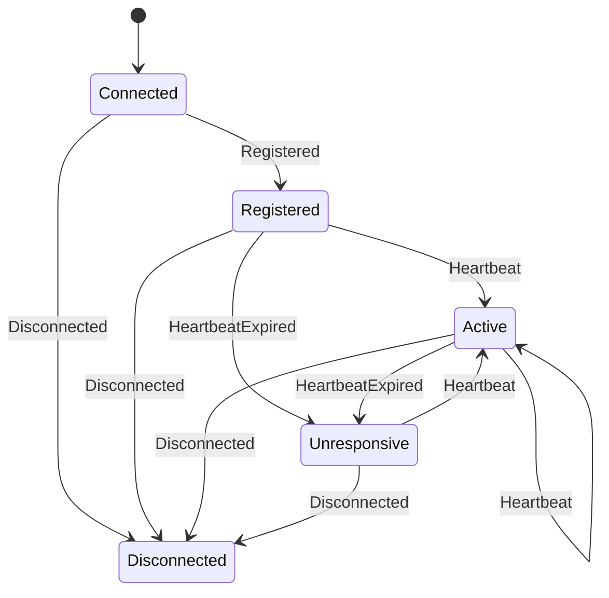
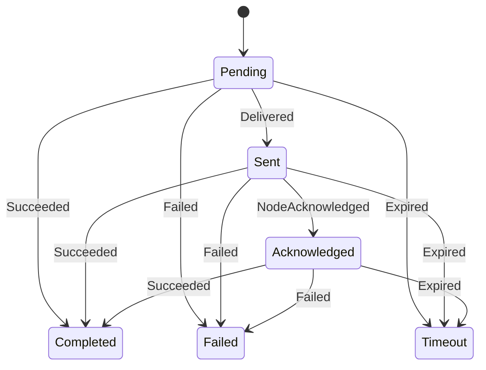

# deis-control architecture

> This document covers deis-control internals only. For the platform-wide design —
> data model, deployment and versioning, request path — see
> [`docs/architecture.zh.md`](../../docs/architecture.zh.md). For the HTTP
> surface and how to run it, see [README.md](README.md).

---

## 📐 Overview

deis-control is the platform's control plane: the single authority on what
should be running where. It stores the catalog (applications, versions,
environments, deployment pointers, routes, encrypted secrets), keeps track of
the fleet, pushes every change out to the nodes, and fires cron. It carries no
data plane traffic — a request from a browser never passes through it.

It is a single process on two listeners: the human one serves HTTP and gRPC
together, and a second, `[machine]`, serves nothing but what a node or
a proxy calls, over mutual TLS - see *Security* below. That second listener
is not optional; a control plane with no `[machine]` table refuses to start.

```
┌──────────────────────────────────────────────────────────────┐
│                        deis-control                          │
├──────────────────┬───────────────────┬───────────────────────┤
│  gRPC server     │  HTTP API         │  Embedded console     │
│  (deis-proxy     │  (deis CLI and    │  (React 19, built by  │
│   dials in)      │   the console)    │   Vite, served at /)  │
└────────┬─────────┴─────────┬─────────┴───────────────────────┘
         │                   │
         ▼                   ▼
┌──────────────────────────────────────────────────────────────┐
│                      Core services                           │
│  ┌───────────┐  ┌───────────┐  ┌───────────┐  ┌───────────┐  │
│  │ Catalog   │  │ Delivery  │  │ Scheduler │  │ Sessions  │  │
│  │ (product) │  │ (push)    │  │ (cron)    │  │ (gRPC)    │  │
│  └───────────┘  └───────────┘  └───────────┘  └───────────┘  │
│  ┌───────────┐  ┌───────────┐  ┌───────────┐                 │
│  │ ConfigMgr │  │ CommandEx │  │ Metrics   │                 │
│  └───────────┘  └───────────┘  └───────────┘                 │
└──────────────────────────┬───────────────────────────────────┘
                           ▼
                   ┌───────────────┐
                   │   SQLite      │
                   └───────────────┘
                           │
         ┌─────────────────┴──────────────────┐
         ▼                                    ▼
   deis-proxy (dials in over gRPC)   deis-runtime nodes
                                     (control plane dials out)
```

The two node types are reached in opposite directions, and mixing them up is
the single most common misreading of this component:

- **deis-proxy dials in.** It opens a bidirectional gRPC stream
  (`EstablishChannel`) and holds it: authenticate, register, heartbeat, receive
  configuration and commands. Those open streams are what `/api/sessions`
  lists.
- **A runtime node is dialled out to.** deis-control is the gRPC *client* of
  the node's own management service. What the node calls itself — its
  registration, its assignment list, its bundle download — is answered on
  the machine listener instead, where the node proves a certificate naming
  itself rather than a value copied into a file. The fleet those make up is
  what `/api/runtime` lists.

WebSocket is not used anywhere in this component. Earlier versions of this
document described the node link as WebSocket; it is gRPC over HTTP/2.

---

## 🏗️ Modules

### 1. gRPC server (`src/server.rs`)

Accepts and holds node streams, over a Tonic bidirectional stream defined by
the `deis-wire` SDK.

**Responsibilities**
- Accept node gRPC streams
- Authenticate (see *Security* below — a proved certificate on the machine
  channel, a plain secret comparison on the human one)
- Manage session lifecycle
- Receive heartbeats and status updates
- Handle command responses

**Message flow**
```
Node → gRPC stream → Server → Handler → SessionManager / Database
Node ← gRPC stream ← Server ← CommandExecutor
```

**Key types**: `ControlServer`, `MessageHandler`, `NodeSession`.

### 2. HTTP API (`src/api/`)

Two listeners with two different credentials — see README.md, *Two audiences,
two credentials*.

| File | Surface |
|---|---|
| `mod.rs` | routing and startup |
| `catalog/` | apps, versions, environments, deployments, routes, secrets, assignments |
| `apps.rs` | the runtime fleet (`/api/runtime`) |
| `nodes.rs` | open gRPC control channels (`/api/sessions`) |
| `registration.rs` | unused: a node used to put itself on the fleet list here; that RPC is `src/machine/service.rs`'s `Register` now |
| `configs.rs`, `commands.rs`, `events.rs`, `metrics.rs` | operations |
| `middleware.rs` | API-key auth for humans; the fallback node-key check on the human listener's copy of the gRPC control channel |
| `static_files.rs` | the embedded console |

`src/machine/` (`listen.rs`, `accept.rs`, `service.rs`) is the other listener:
it accepts only a connection that proves a certificate this fleet signed, and
serves `Register`, `Deregister`, `FetchAssignments` and `FetchRoutingTable`
plus the bundle download.

Axum, Tower HTTP, axum-server (for TLS).

### 3. Session management (`src/session.rs`)

```rust
pub struct SessionManager {
    sessions: Arc<DashMap<String, Arc<NodeSession>>>,
}
```

`DashMap` for concurrent access, `Arc<RwLock<_>>` around mutable state.

A session's own state is the `NodeFSM` table, and the diagram below is
generated from it by `yasm` — a test in this crate fails if the two stop
agreeing. `NodeSession::apply` takes the event on the arrow and the table
answers with the state; there is no setter that takes a state.



Three rules are worth reading off it. There is no arrow from `Connected` to
`Active`: a heartbeat from a node that never registered is acknowledged and
then ignored, so it is not counted among the live nodes by `src/metrics/` and
not shown as active by `/api/sessions`. Nothing leaves `Disconnected`: a
session whose stream closed stays closed, whatever arrives after it.

And `Active` is a claim with an expiry date rather than a resting place.
`HeartbeatExpired` is sent by `src/reaper/` once a node has been silent for
longer than the configured `heartbeat_timeout`, which is what makes a frozen,
partitioned or powered-off node stop being reported as live — none of those
closes a TCP connection, so without that arrow nothing about the session ever
changed again. `Unresponsive` is told apart from `Disconnected` on purpose:
that node hung up, this one is still holding a channel open and has stopped
answering, and the two send an operator to different places. The way back is
an ordinary heartbeat, because a resumed host or a healed partition arrives on
the same stream and would otherwise be stranded — from the node's side nothing
ever broke.

### 4. Catalog (`src/catalog/`)

The product model, and the reason this component exists. Applications,
immutable versions addressed by their bundle's sha256, environments,
deployment pointers, routes, and secrets encrypted with AES-256-GCM under a
master key read from `secret_key_file`. `bundle.rs` stores and serves the
uploaded archives.

A version is never mutated and never says it is current — an environment
points at it. That is what makes a rollback a pointer move.

### 5. Delivery (`src/delivery/`)

Turns a catalog change into an `ApplyDeployment` call on every node in the
fleet: app, version, environment, bundle URL, digest, and the env map
(manifest variables plus secrets decrypted at send time). The bundle itself is
fetched by the node over HTTP. Deploy, rollback and secret change all end here,
and the response says which nodes took it and which did not.

### 6. Scheduler (`src/scheduler/`)

Cron for applications. A trigger belongs to an app, never to a node.

```rust
pub struct CronScheduler {
    store: Arc<CatalogStore>,
    nodes: Arc<RuntimeNodeManager>,
    tasks: Arc<DashMap<CronKey, Vec<CronTask>>>,   // key: (app_id, environment)
    tick_interval: Duration,
    rotation: AtomicUsize,
    holder_id: String,                              // this process on the lease
    lease_ttl: Duration,                            // three ticks
}
```

1. Rebuild the task list from the catalog: the expressions are whatever
   `manifest.cron` of each environment's currently deployed version declares,
   so they follow deploys and rollbacks and are never persisted separately.
2. Take or refresh the scheduler lease (`scheduler_lease`, one row). A
   process that finds it held by another, fresh within three ticks, fires
   nothing this tick and records the due occurrences as fired elsewhere, so
   it does not fire a backlog when it takes over. It logs that once, at
   `warn`.
3. Fire everything due, one occurrence to exactly one node, trying the next
   node when one says it *cannot* run it; an occurrence nobody takes is
   skipped, not retried.
4. Advance to the next occurrence.

A handler that throws is *not* retried on another node: the same code would
fail the same way elsewhere, and it may already have had side effects. The
node says which of the two happened — it prefixes the error with
`handler-failed: ` when the application's own handler ran and threw — and the
walk over the fleet stops there.

### 7. Runtime client (`src/runtime_client/`)

The client half of a node's management service: `ApplyDeployment`,
`UnloadApp`, `GetStatus`, `HealthCheck`, `StartInspect`, and
`Trigger.OnScheduled`. Also the fleet list — configured entries plus
self-registrations, with health polled on a timer.

`Trigger.OnQueue` is the one RPC of a node that this control plane does not
call and will not: nodes lease their messages straight from deis-queue, and
this process holds no queue client and no lease it could hand on. See the
`trigger` module's own note for what it *is* for.

A self-registration that runs out is remembered, not forgotten. A node that
stopped refreshing is exactly a node that is still serving what it last
received and is not reconciling either, so every fleet-wide answer — a deploy,
an application deletion — names it as unreached instead of describing only the
half of the fleet that still answers. It clears itself when the node registers
again, or when `node_registration_ttl_secs` passes with no refresh. There is
no operator-initiated way to clear one sooner: `Deregister` on the machine
channel only admits a caller proving the exact certificate of the node being
withdrawn, which a machine that is really gone cannot present.

### 8. Configuration management (`src/config_manager/`)

Per-node configuration with storage, version history and push.

```rust
pub struct ConfigManager {
    configs: Arc<ArcSwap<HashMap<String, HashMap<String, JsonValue>>>>,
    versions: Arc<RwLock<HashMap<String, DateTime<Utc>>>>,
    db: Arc<Database>,
    sessions: Arc<SessionManager>,
}
```

Lock-free reads through `ArcSwap`; an update writes the database in a
transaction, swaps the whole tree atomically, then pushes to the target node
over its open gRPC stream.

### 9. Command execution (`src/command/`)

```rust
pub struct CommandExecutor {
    pending_commands: Arc<DashMap<Uuid, Arc<Mutex<CommandTracker>>>>,
    sessions: Arc<SessionManager>,
    db: Arc<Database>,
}
```

An API call creates a tracker with a UUID, sends the command down the node's
stream, and waits on a `oneshot`. A background task expires trackers whose
deadline passed. History is kept in the database.

The status in that history is the `CommandFSM` table in
`src/database/command_status.rs`. The diagram is generated from it by `yasm`,
and a test in this crate fails if the two stop agreeing.



Three things this table says that the code used to leave to whichever writer
finished last:

* **`Completed`, `Failed` and `Timeout` have no arrows out.** The first
  ending is the one that stands. Two writers race by design — the API call
  writes its own timeout while the response handler writes the node's answer
  — and the record now agrees with whichever of them the caller was told
  about.
* **Every ending is reachable straight from `Pending`.** The `Sent` write is
  issued *after* the message is already on the stream, so a node that answers
  inside one database round trip is recorded as finished before it is
  recorded as sent; the late `Sent` is then dropped rather than walking the
  command backwards and blanking `completed_at`.
* **`Acknowledged` has arrows out but nothing produces it.** The wire has no
  acknowledgement message, only `CommandResponse`. The status stays because
  it is a value an existing database may hold and has always parsed, and its
  outgoing arrows are what let such a row still reach an ending.

The status strings in the `commands.status` column are these state names
exactly. Renaming one would make every command in an existing database
unreadable, which is why `CommandStatus::as_str` is pinned to the state list
by a test.

### 10. Persistence (`src/database/`)

SQLite, with rusqlite calls run on `spawn_blocking` so no synchronous SQL
executes on an async thread. Schema in `src/database/schema.rs`, which is the
authority; it is not reproduced here because a column list in a document is a
column list that drifts.

### 11. Metrics (`src/metrics/`)

Prometheus text format at `/api/metrics`, JSON summary at
`/api/metrics/summary`.

---

## 🔒 Security

**Machine authentication.** Mutual TLS. A node or a deis-proxy proves a
certificate whose one URI SAN is a SPIFFE name naming exactly itself
(`spiffe://<trust domain>/deislet/node/<id>` or `.../proxy/<id>`); the name it
proved is the only thing that decides which machine it may act as, and there
is no field in a request that can ask for another one's. `[machine]` is not
optional - a control plane started with no `[machine]` table refuses to start,
because registration, the assignment list, the bundle download and the
routing table are served nowhere else. The certificate, private key and trust
root are re-read every `identity_reload_seconds`, so a renewal needs no
restart. What that certificate reaches - every environment's decrypted
secrets, every node's management plane - is stated once, in
[docs/trust-boundaries.md](../../docs/trust-boundaries.md).

The one thing still reachable on both listeners is the gRPC control channel
deis-proxy holds open (`EstablishChannel`). Arriving over the machine channel,
a connection is admitted by the certificate name it already proved during the
TLS handshake, and whatever it sends as `secret` in the `Authenticate` message
is not read. Arriving on the human listener there is no certificate, so that
`secret` is compared with a constant-time equality check against every value
in `node_preshared_keys` - a plain comparison, with no signature and no
timestamp step. An empty `node_preshared_keys` there is not "no check
required": it means this control plane cannot tell a node from anyone else, so
it admits neither.

**`node_preshared_keys` is optional now**, and does less than it used to: with
`[machine]` configured and the list left empty, no fleet-wide value is minted
at all, because every peer proves a certificate instead and there is nothing
left for a shared value to decide. What the list still does, only while a
fleet is mid-migration: the fallback above for a proxy with no
`[machine_identity]` yet, and the bearer this control plane presents on a
node's own plaintext management plane when that node has none either. The
node-facing HTTP endpoints it used to guard - registration, the assignment
list, the bundle download - are not served on the human listener at all any
more; they answer `404` there regardless of what is presented.

**Human API authentication.** An API key (`Authorization: Bearer` or
`X-API-Key`), enabled by `api_auth_enabled`, which defaults to **off**. It
does not gate the machine channel, on purpose.

**TLS.** Rustls, TLS 1.2/1.3, self-signed or a real certificate, on the human
listener (`[tls]`). The machine listener runs its own mutual TLS, configured
by `[machine]` rather than `[tls]`.

**Authorization.** Flat on the human surface: every API key has the same
rights, and there are no users and no roles. The machine surface has one rule
instead: a caller may only ask for the machine it proved.

---

## 🔄 Flows

### A runtime node joining and being fed

```
Node                    deis-control (machine channel)
  │                                │
  │── mTLS handshake, naming ─────→│  certificate proved
  │    itself                      │
  │── Register ───────────────────→│
  │                                │  on the fleet list, eligible for
  │←── registration + lease ───────│  pushes and cron
  │                                │
  │── FetchAssignments ───────────→│
  │←── [ {app, env, version,       │  secrets decrypted at send time
  │       bundle_url, sha, env} ]  │
  │                                │
  │── GET bundle_url ─────────────→│  streamed, sha256 verified by the node
  │                                │
  │   (loads everything, only      │
  │    then reports healthy)       │
  │                                │
  │←── ApplyDeployment ────────────│  every later deploy, as a push - a
  │                                │  separate call deis-control makes on the
  │                                │  node's own management service, not on
  │                                │  this channel
```

`Register`, `Deregister` and `FetchAssignments` are RPCs of
`deis.machine.MachineChannel`, defined in `deis-wire`'s machine proto; the
bundle download is the one HTTP call on this listener, built by
`deis_control::delivery::bundle_url()`. All of it runs on the machine
listener, over the mutual TLS handshake above - a connection that cannot
prove a certificate this fleet signed never reaches any of these calls.

### deis-proxy connecting

```
deis-proxy                   deis-control
  │                                │
  │── gRPC EstablishChannel ──────→│
  │── authenticate ───────────────→│  a proved certificate name is admitted
  │                                │  outright; on the human listener with no
  │                                │  certificate, the secret it sent is
  │                                │  checked against node_preshared_keys
  │←── auth response ──────────────│
  │── register ───────────────────→│  create session, persist, record an event
  │←── register response ──────────│
  │── heartbeat (loop) ───────────→│
  │←── heartbeat ack ──────────────│
  │←── config update / command ────│  pushed down the same stream
```

### A deploy

```
deis CLI                deis-control            nodes
  │                          │                    │
  │── POST versions (zip) ──→│  sha256, store     │
  │── POST deployments ─────→│  move the pointer  │
  │                          │── ApplyDeployment →│  (pointer only)
  │                          │←── ack ────────────│
  │←── delivery report ──────│                    │
```

A node that did not take it is named in the response, and `deis deploy` exits
non-zero: the pointer moved, but that machine is still serving what it had.

---

## 🧪 Testing

- Unit tests per module, with the router exercised through `tower::ServiceExt`
  so handler tests are real HTTP round-trips.
- `tests/` for cross-module checks.
- `scripts/demo.sh` at the repository root is the end-to-end run: this
  component against a real node, a real proxy, and the three data-plane
  services.

---

## 🔧 Technology choices

| Concern | Choice | Why |
|---|---|---|
| Async runtime | Tokio | mature, well understood |
| Node transport | Tonic (gRPC over HTTP/2) | typed messages, bidirectional streaming |
| HTTP framework | Axum | shares the listener with Tonic |
| Database | SQLite | embedded, no operator to run |
| Lock-free config reads | ArcSwap | hot path is read-only |
| Concurrent maps | DashMap | |
| TLS | Rustls | no OpenSSL dependency |
| Console | React 19 + Vite + Tailwind | embedded in the binary at compile time |

---

## 🚀 Not done

- **High availability.** One process, one SQLite file. No clustering, no
  consensus. The whole design assumes a single control plane. The one place
  two control planes on one database are tolerated rather than assumed away
  is cron: a lease row (`scheduler_lease`, `src/scheduler/lease.rs`) makes
  exactly one of them fire, and the other stands aside until the holder stops
  refreshing it or releases it on shutdown. That is a guard against an
  overlap - a manual start beside a service unit, a cut-over - not
  leader election: the task list is not shared, and an occurrence that comes
  due during the hand-over is skipped, as it is when no control plane runs.
- **RBAC, audit log.** Mutual TLS is done for the machine channel - see
  *Security* above - but not for the human surface, which is still a flat API
  key with no users or roles.
- **No ACME.** The routing table now reaches deis-proxy — over
  `FetchRoutingTable` on the machine channel — so path-prefix routing and an
  automatic per-environment address both work. What this control plane cannot
  do is get the certificate those addresses need: the `*.<zone>` record and
  the `*.<zone>` certificate are placed and renewed by a person.
- **Only deis-runtime ships logs to deis-telemetry.** This component still
  writes to its own stdout.

---

**License**: Apache-2.0
