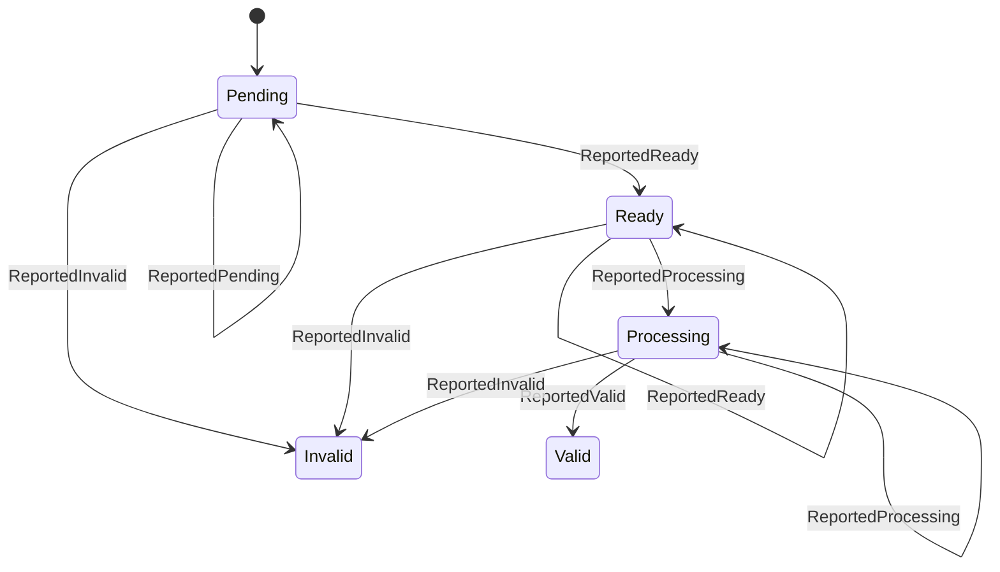

# Proxy

Managed multi-site reverse proxy and load balancer for the Deislet platform.

Proxy is the traffic entry point: it terminates HTTP/1.1, HTTP/2 and TLS,
decides which application a request belongs to, and forwards it to a
[deis-runtime](../deis-runtime) node from a shared, health-checked upstream pool. Its
configuration is layered from a local file and from the control
([deis-control](../deis-control)), and the binary can be upgraded without dropping
connections.

The data plane is [Pingora](https://github.com/cloudflare/pingora). Proxy
adds application routing, configuration management and the control
integration on top of it; it does not implement its own HTTP parsing,
socket handling or process model.

## Request flow

1. **Resolve the application**, from two sources with a fixed precedence.
   The **catalog's routing table**, polled from the control plane, is the
   one an operator can change without touching a machine, so where both
   can answer "which application", the catalog wins. The **local
   application list** is still here and still matters, for a different
   question: certificates, the cache policy, the enabled flag — what to do
   with a request once the application is known.

   A non-empty `x-deis-app-id` header names the application and nothing
   else, so it is answered first: the local list, then the catalog's
   default environment for that id. Without the header, the catalog is
   matched on host **and path prefix** — exact host, then `*.wildcard`
   (longest suffix first, so `*.eu.example.com` beats `*.example.com`),
   then an automatic per-environment address, then a route naming no host
   at all, which the catalog means as "any domain". Within one host,
   candidates are ordered by `priority` and then by prefix length, so
   `/api/v2` beats `/api` beats `/` and an operator can still override
   that. If the catalog claims nothing, the local list is matched on host.

   What a request that matches nothing means depends on where this
   instance's routing comes from, which is a different question in each of
   three states:

   * **No `[control]` section and no applications of its own** — a plain
     reverse proxy. The request is forwarded unchanged, with both routing
     headers **stripped** from it first: deis-proxy decided neither, so
     neither may reach a node as though it had.
   * **A control plane configured and a table fetched from it** — `404`,
     including when that table turned out to be empty. The control plane is
     the authority on what is routed here, and "nothing" is an answer.
   * **A control plane configured and no table ever fetched** — `503`. This
     instance has been told where its routing comes from and has not got
     it, so it cannot place the request; forwarding it would route it by
     the client's own `x-deis-app-id`. A poll that fails *after* one
     succeeded is a different thing entirely — the last table stays in
     force and traffic is unaffected. Only a proxy that has never once
     heard from its control plane refuses.
2. **Apply policy.** Disabled applications get a `403`. Plain HTTP requests
   for an application whose certificate is loaded (or that has a
   certificate configured and `tls.default_certificate` to fall back on)
   are redirected to HTTPS when `https.auto_redirect_to_https` is set —
   and only to a name this instance actually holds a certificate for,
   because the `Location` is built from the request's own `Host` and a
   request that named its application by header never had that `Host`
   checked against anything. An application whose certificate failed to
   load stays reachable over plain HTTP instead of being redirected to a
   handshake that cannot succeed.
3. **Pick a backend** from the upstream pool using the configured strategy
   and forward the request, after taking the whole `x-deis-` namespace away
   from the client. Every header under that prefix is dropped — not only the
   two below, but `x-deis-caller`, `x-deis-tenant`, `x-deis-storage-token`
   and anything a later component adds. Then `x-deis-app-id` is set to the id
   deis-proxy decided on and `x-deis-environment` to that application's
   environment, so deis-runtime only sees values that passed the checks above.
   With `https.auto_offload_https = false` the upstream leg keeps TLS.

   The prefix is the platform's own, in both directions: deis-bundle refuses
   a bundle that sets an `x-deis-` header on a *response* for the same reason
   this hop refuses to carry one on a request. The whole namespace is
   evidence one component produced for another, and evidence a client can
   write is not evidence. The cost is that an application cannot invent a
   header of its own under `x-deis-` and expect it to arrive; any other
   prefix works. A client sending one is logged at `warn` with the count and
   the names, because nothing legitimate on this path does it.

Because the header is validated — and the namespace cleared outright when
nothing was resolved — deis-runtime's own targets such as `_inspect:<app>`
and `_system` cannot be reached through deis-proxy in any of its modes; the
inspector is meant to be used on deis-runtime's own port, where its
`x-deis-inspect-token` never crosses this hop.

A request body larger than `max_request_body_bytes` is refused rather than
carried. A connection that has **completed** an upgrade is exempt, because
its frames are a stream and not a body — the test is whether the node
actually answered `101`, not whether the client asked for an upgrade. That
distinction is the fix for a real hole: while it asked the request headers
instead, an ordinary chunked upload that named an `Upgrade` it never
completed was carried to the node unbounded.

TLS certificates belong to applications. During the handshake the SNI name
is looked up in the route table and that application's certificate is
presented; `tls.default_certificate` covers names no application claims.

## Automatic certificates

Certificates can be obtained and renewed here instead of being placed by
hand. It is off unless `[tls.acme]` turns it on: an instance with its own
certificate files keeps exactly the behaviour above and never contacts an
authority.

- **`http-01`, not `dns-01`.** This proxy already owns port 80 for every name
  it serves, so it answers the authority's fetch of
  `/.well-known/acme-challenge/<token>` itself — no DNS provider credentials
  and no per-provider integration. The price is wildcards, which RFC 8555
  issues only against `dns-01`, so a preview zone still wants one wildcard
  certificate placed by hand, or `include_preview_addresses` turned on to
  certify each address on its own.
- **The names are derived, never listed.** They come from the domains of the
  applications configured here plus the exact hosts in the catalog's routing
  table, so a domain added through the control plane gets a certificate with
  nothing edited on this machine. A name an operator has already named a
  certificate file for stays theirs; a wildcard, an address literal and a
  single label are left out because `http-01` cannot certify them.
- **The account key and the certificates live under `storage_dir`,** split by
  the authority's host so switching from staging to production obtains
  everything again rather than serving staging certificates nobody trusts.
  A restart loads what is there and orders nothing.
- **Renewal is a background pass** every `check_interval_secs`, ordering a
  name once it is within `renew_before_days` of expiry. A failure is logged
  at `WARN` while there is slack and at `ERROR` once the certificate is
  within `alarm_before_days` of expiry, always saying when the next attempt
  is, and retried with a doubling backoff up to `max_retry_backoff_secs`.
- **The default authority is Let's Encrypt staging** and the startup log says
  so. Set `directory_url` to production only once a name has been issued
  successfully: production's rate limits are counted per registered domain
  per week and cannot be given back. `max_names` bounds how many names this
  instance will ever order for, for the same reason.

Turning it on needs port 80 reachable from the internet at every name being
certified, an email address the authority writes to when a certificate is
about to expire, and an explicit `terms_of_service_agreed = true` — this
process will not agree to an authority's terms on an operator's behalf.

### What an order is allowed to do

The status of an order belongs to the authority; this instance only watches
it. What this instance does hold an opinion about is the *order* those
statuses may come in, which RFC 8555 section 7.1.6 fixes. It is the
`OrderFSM` table in `src/acme/status.rs`, and the diagram is generated from
it — a test fails if the two stop agreeing.



Each arrow is the authority reporting a status, and the self-loops are what
an ordinary poll looks like: nothing has changed yet. The steps the table
does *not* have are the point. An authority that answers `processing` to a
finalize request and then reports the order as `ready` again has gone
backwards, and this instance says so on the first poll that shows it —
naming the two statuses — instead of polling for the whole
`order_timeout_secs` and then reporting a stall, which would blame the
authority for being slow rather than for breaking the protocol.

The polling starts from whatever the finalize answer says, not from where the
order began. An order is created `pending` and moves to `ready` once its
authorizations pass, and this instance posts finalize without re-reading it,
so that step happens between two of its own requests and is never observed.
Watching from the finalize answer is what keeps a step nobody saw from
looking like a step nobody was allowed to make.

## Configuration

See [`config.toml.example`](config.toml.example) for every key. Values are
layered: built-in baseline, then the file given with `-c`, then whatever
the control pushes. Notable behaviour:

- `balancing_strategy` (`round_robin`, `random`, `ip_hash`,
  `header_hash(<Header>)`) is fixed for the lifetime of the process. The
  `upstreams` list is re-read on every `health_check_interval_secs` tick,
  so backends can be added and removed without a restart.
- `listen_ports` are plain HTTP, `tls.ports` terminate TLS; a port may not
  appear in both. `[tls.acme]` is refused with an empty `tls.ports`: a
  certificate nothing can present is a rate limit spent for nothing.
- `log.access_log` writes one line per request in the field order given by
  `format`; `log.error_log.path` redirects diagnostics to a file.
  `RUST_LOG` overrides the configured level.
- Relative paths (`database`, `pid_file`, `upgrade_sock`, log paths,
  certificate files) are resolved against the directory deis-proxy was started
  from, and a `reload` starts the replacement from that same directory, so
  they keep resolving the same way across upgrades. Certificate paths in
  application configurations pushed by the control are used as given;
  make them absolute.
- `[cache]` is parsed and validated but not applied to traffic yet: nothing
  implements `request_cache_filter` and pingora is built without its `cache`
  feature, so no response is stored and no `X-Cache-Status` is emitted.
- `[routing]` is where the catalog's routing table is configured:
  `control_poll_interval_secs` (5 by default), `max_table_bytes`, and
  `preview_zone`. The poll uses the `[control]` address and secret. Leaving
  `preview_zone` unset turns automatic addresses off entirely; setting it to,
  say, `preview.example.com` puts every environment at
  `<env>--<app>.preview.example.com`, with the default environment also at
  `<app>.preview.example.com`. The separator is `--` inside one DNS label
  rather than a dot because a wildcard certificate matches exactly one label:
  `*.preview.example.com` covers `pr-42--shop.preview.example.com` and would
  not cover `pr-42.shop.preview.example.com`. Point a wildcard DNS record at
  this instance and give it a certificate for the zone, or those names resolve
  to nothing and the handshake fails.
- **A failed poll changes nothing.** The last table this process accepted keeps
  routing indefinitely, because a data plane that starts refusing traffic when
  its control plane is unreachable turns a management outage into a
  customer-visible one. Each failure logs at `ERROR` saying which table is
  still routing and how old it is. An instance that has never once fetched the
  table has nothing to keep and falls back to the locally configured
  applications.

Applications (`id`, `description`, `domains`, `certificates`, `enabled`,
`cache`) are not part of the file. They are pushed by the control and persisted in `database`
(SQLite), so they survive restarts.

### Control protocol

Proxy registers with deis-control over deis-wire and then accepts:

| Push | Effect |
|---|---|
| `ConfigUpdate { key = "apps" }` | Replace the whole application list with the JSON array in `value_json`. |
| `ConfigUpdate { key = "app.<id>" }` | Insert or update one application. |
| `ConfigUpdate { key = "system" }` | Layer a traffic-policy overlay onto the system configuration (listeners, daemon settings, logging and the control connection are ignored). |
| Command `shutdown` | Stop accepting connections, exit when in-flight requests finish. |
| Command `restart` / `reload` | Zero-downtime upgrade (see below). |
| Command `get_status` | Answer with instance state and uptime. |

`get_metrics` is answered with an explicit "not implemented".

If the control is unreachable, at startup or later, deis-proxy keeps
serving traffic and keeps retrying the connection (1 s doubling to 30 s
between attempts) until it succeeds or the process stops; a rejected secret
is logged at ERROR on every attempt.

## Running

```bash
deis-proxy -c /etc/deis-proxy/config.toml        # foreground
deis-proxy -c /etc/deis-proxy/config.toml -d     # daemon, writes pid_file
deis-proxy -c /etc/deis-proxy/config.toml -t     # check the configuration and exit
deis-proxy -c /etc/deis-proxy/config.toml -s reload
```

In daemon mode set `log.error_log.path`: pingora detaches stderr, so
otherwise nothing after startup is logged. `user`/`group` make pingora
switch identity *before* it binds any listener, which requires starting as
root and ports the target user may bind; the recommended way to run
unprivileged is to leave them unset and let the service manager do it
(systemd `User=` with `AmbientCapabilities=CAP_NET_BIND_SERVICE`). A
listener that cannot be bound terminates the process rather than leaving a
daemon running without one.

`-s` signals the daemon named by `pid_file`:

| Signal | Effect |
|---|---|
| `stop` | Exit immediately. |
| `quit` | Stop accepting connections, exit when in-flight requests finish. |
| `reload` | Zero-downtime upgrade. |

### Zero-downtime upgrade

`reload` (or the control's `restart`) starts a second `deis-proxy --upgrade`
process with the same configuration and from the same working directory,
waits for it to report that its startup succeeded (configuration, database,
logs and certificates loaded), then sends `SIGQUIT` to the running one.
Pingora hands the listening sockets over the `upgrade_sock` Unix socket; the
new process starts accepting on them while the old one finishes its
in-flight requests and exits. No connection is refused in between. If the
replacement exits before it is ready, the running process logs the exit
status and keeps serving.

`scripts/test_graceful_restart.sh` at the repository root exercises this
end to end against a local backend while keeping requests flowing, in the
foreground and as a daemon started with relative paths.

## Development

```bash
cargo test -p deis-proxy
cargo clippy -p deis-proxy --all-targets
../../scripts/test_graceful_restart.sh
../../scripts/demo.sh start              # full stack: deis-control + deis-runtime + deis-proxy
```

`src/control/mock.rs` is an in-process control that the client tests
register against, so retry and reconnect behaviour is covered without deis-control.

## Layout

| Path | Contents |
|---|---|
| `src/main.rs` | Builds the pingora server from the configuration. |
| `src/proxy/` | `ProxyHttp` implementation, upstream pool, access log. |
| `src/tls.rs` | Certificate loading and SNI selection. |
| `src/acme/` | Automatic certificates: the RFC 8555 client, the `http-01` responder the data plane answers from, the on-disk store and the renewal task. |
| `src/config/` | Configuration model, layering, persistence, route table. |
| `src/catalog/` | The control plane's routing table: the poller, the wire shape, and the compiled table a request is matched against. |
| `src/control/` | Control client and its background service. |
| `src/restart.rs` | Upgrade and shutdown via pingora's signals. |
| `src/cli.rs` | Command line parsing. |
