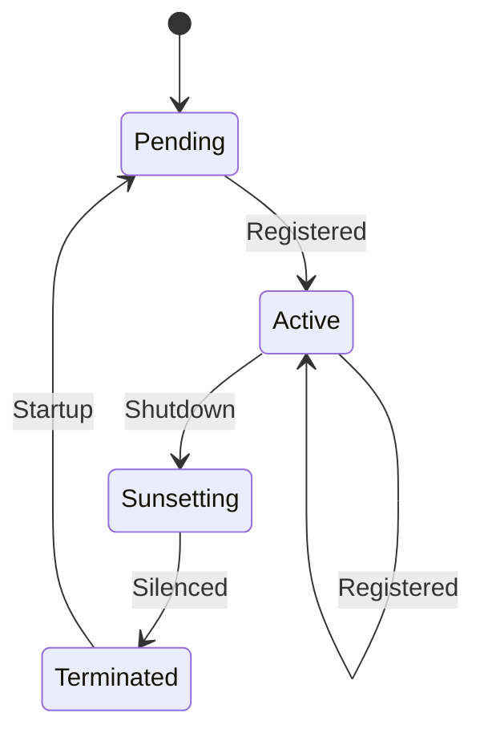

# deis-wire — the wire between the control plane and its nodes

Two things live here, and they have different audiences:

1. **The node link.** The gRPC protocol (`proto/control.proto`, package
   `deis.control`), the message models, and [`WireClient`] — the client side a
   node uses to dial deis-control, authenticate, register, heartbeat, and take
   commands. `deis-proxy` is what uses this today.
2. **[`conventions`]** — the handful of names every component in the platform
   must spell identically. This is why deis-store, deis-queue and
   deis-telemetry depend on this crate at all: they carry no control-plane
   concepts and use nothing but that module.

Chinese: [README.zh.md](README.zh.md).

## conventions — the part most components need

These are plain constants and small functions on purpose. Six independent
binaries have to agree, and a disagreement here does not fail to compile; it
fails at runtime, days later, as a request rejected for the wrong reason or a
fleet that never learns about its own nodes.

| Name | What it fixes |
|---|---|
| `APP_ID_HEADER` (`x-deis-app-id`) | which application an inbound request is for |
| `ENVIRONMENT_HEADER` (`x-deis-environment`) | which environment of it; absent means `DEFAULT_ENVIRONMENT` |
| `DEFAULT_ENVIRONMENT` (`production`) | so a caller that predates environments still lands somewhere sensible |
| `BINDING_HEADER` (`x-deis-binding`) | which namespace inside the tenant a storage call wants; the tenant itself is the one the call's capability names |
| `tenant_id(app, env)` / `split_tenant` / `is_valid_tenant_part` | the `demo.production` label telemetry attributes records to; storage keys by `CanonicalTenantId` instead |
| `MAX_GRPC_MESSAGE_BYTES` (16 MB) | one ceiling, both directions, every service |
| `STREAM_CHUNK_BYTES` (1 MB) | blob upload and download chunking |
| `STORE_ENDPOINT_ENV` / `QUEUE_ENDPOINT_ENV` | reserved env keys carrying the storage addresses, lifted out before an application sees them |
| `NODE_REGISTRATION_ROUTE` / `NODE_ASSIGNMENTS_ROUTE` | the axum `:id` route templates |
| `node_registration_path(id)` / `node_assignments_path(id)` | the client-side halves |
| `ASSIGNMENTS_COMPLETE_HEADER` / `ASSIGNMENTS_WITHHELD_HEADER` | whether an assignment list is the whole truth for that node |

The route constants exist because they once did not: a node asked for
`/register` while the control plane served `/registration`, both sides
compiled, and the only symptom was a fleet with no nodes in it.

## The node link

Transport is gRPC over HTTP/2 (Tonic). It is **not** WebSocket — earlier
versions of this file said it was, and the client's own doc comments still
mention "WebSocket connection" in one or two places.

```rust
use deis_wire::{ControlConfig, NodeInfo, NodeRole, WireClient};

#[tokio::main]
async fn main() -> Result<(), Box<dyn std::error::Error>> {
    let config = ControlConfig::new(
        "node-001".to_string(),
        "http://127.0.0.1:8085".to_string(),
    );

    let node_info = NodeInfo::new(
        NodeRole::Proxy("1.0.0".to_string()),
        "127.0.0.1".to_string(),
        vec![8087],
    );

    let mut client = WireClient::new(config, node_info);

    client.connect().await?;        // opens the bidirectional stream
    client.authenticate().await?;
    client.register().await?;
    client.run().await?;            // heartbeats and inbound messages

    Ok(())
}
```

`ControlConfig::addr` is passed to Tonic as given, so use `http://` (or
`https://`). Anything that is not `https` connects in plain text, which is why
the `ws://` still hardcoded in `tests/integration_*_control.rs` happens to
work; it is a leftover, not a supported form.

### Authentication, stated precisely

[`ControlConfig`] carries no secret. Its fields are `associated_id`, `addr`,
`heartbeat_interval`, `request_timeout` and `retry_count`, and that is the
whole struct - there is nothing here for a caller to configure a credential
into. What admits a channel is decided beneath this crate entirely, at the
handshake of the connection the caller built, before this crate's own
protocol messages exist.

[`WireClient::authenticate`] still sends an `AuthenticateRequest` with a
`secret` field on it, and always sends that field empty: there is no longer
anything to put there. The field stays on the wire because dropping it from
the proto is a change both ends have to make in the same instant, and this
crate cannot know when the other side has made it. The control plane does
not read it either way - its whole admission decision is
`let valid = proved.is_some();`, where `proved` is the name (a SPIFFE ID,
such as `spiffe://<trust domain>/deislet/node/<id>`) the connection's own
certificate proved during its mutual-TLS handshake. A connection that proved
no name is refused, whatever it sent in `secret`; one that proved a name is
admitted on that name alone. There is no second path left to fall back to.

[`AuthData::new`] and [`AuthData::validate`], in
[`src/models/auth.rs`](src/models/auth.rs), still implement
`sha256(secret ‖ associated_id ‖ timestamp)`: `new` computes it, `validate`
recomputes it and rejects anything more than 300 seconds old. Read on their
own, that is a secret-prefix SHA-256 construction - **not** HMAC-SHA256, and
the comment beside the hasher says so explicitly, since the construction has
no inner/outer pad. But neither function sits on the real wire path any
more: nothing outside this module calls either one, and the only callers
left are this module's own unit tests. The algorithm is described
accurately here; describing it as how a node is admitted today would not
be.

The fleet-wide preshared key this section used to describe no longer exists
as something a caller here can carry: `ControlConfig` has no field for it,
and deis-control refuses to start if a configuration file still sets
`node_preshared_keys`. A machine is admitted by certificate or not admitted
at all. What each certificate opens, which ports must be kept off the public
internet, and which credentials this installation still shares between
machines are stated once, in
[docs/trust-boundaries.md](../../docs/trust-boundaries.md).

### Message types

Core: `AuthMessage`, `RegisterMessage`, `HeartbeatMessage`, `CommandMessage`,
`CommandResponseMessage`, `StatusUpdateMessage`, with `HeartbeatAckMessage` and
the two response messages coming back.

Per-role extensions live in `models::messages::{control, deis_proxy,
deis_runtime}`. Adding your own message type is documented in
[docs/extensible-messages.md](docs/extensible-messages.md).

The protobuf definitions are in [`proto/control.proto`](proto/control.proto)
and are compiled by `build.rs` into `deis_wire::pb`.

### Instance lifecycle

`InstanceStatus` — what a node's own instance is doing — is not a bare enum.
It is the `InstanceFSM` table in
[`src/models/instance.rs`](src/models/instance.rs), and it is the *only*
statement of what an instance may do next: deis-proxy drives its lifecycle
straight off it rather than keeping a second copy, which is what a second copy
had done, and had drifted from.

The picture below is generated from that table by `yasm`, and a test in this
crate fails if the two stop agreeing. What the caller supplies is the event on
each arrow; where it lands is the table's answer, never the caller's.



The `Active --> Active` arrow is a proxy re-registering after the control
plane went away and came back: it never stopped serving, so it stays active.

Heartbeats are left out of the picture on purpose. `_Heartbeat` is spelled
with a leading underscore, which is how `yasm` marks an input as not part of
the story: a heartbeat holds `Active` at `Active` and `Sunsetting` at
`Sunsetting`, so drawing it adds two self-loops and hides the four steps that
are the lifecycle.

## Layout

```
deis-wire/
├── proto/control.proto     # the gRPC service and its messages
├── src/
│   ├── conventions.rs      # what every component must spell identically
│   ├── client.rs           # WireClient
│   ├── config/             # ControlConfig, NodeInfo, NodeRole
│   ├── models/             # auth, register, heartbeat, instance, messages
│   └── error.rs
└── docs/extensible-messages.md
```

## Development

```bash
cargo test -p deis-wire
cargo clippy -p deis-wire --all-targets
```

## License

Apache-2.0. See [LICENSE](LICENSE).
