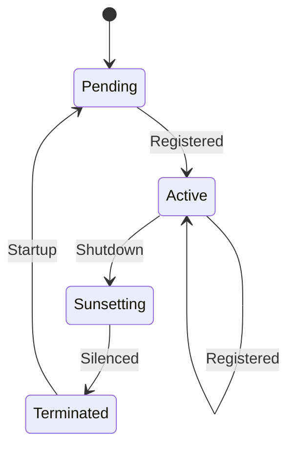

# deis-wire —— 控制面与节点之间的那条线

这个 crate 里有两样东西，面向的人不一样：

1. **节点链路**：gRPC 协议（`proto/control.proto`，包名 `deis.control`）、消息模型，
   以及 [`WireClient`]——节点用来主动连 deis-control 的客户端：认证、注册、心跳、
   接命令。今天用它的是 `deis-proxy`。
2. **[`conventions`]**：平台里每个组件都必须拼得一模一样的那几个名字。deis-store、
   deis-queue、deis-telemetry 依赖这个 crate，就只是为了这一个模块——它们不认识任何
   控制面概念。

English: [README.md](README.md)。

## conventions —— 大多数组件真正需要的那部分

这里刻意只放常量和小函数。六个独立的二进制要就同一件事达成一致，而这里不一致**不会
编译失败**：它会在运行时、几天之后，以「一个请求被用错误的理由拒了」或者「一支机队
永远学不会自己有哪些节点」的形式炸出来。

| 名字 | 它钉住了什么 |
|---|---|
| `APP_ID_HEADER`（`x-deis-app-id`） | 进来的请求是给哪个应用的 |
| `ENVIRONMENT_HEADER`（`x-deis-environment`） | 是这个应用的哪个环境；不带就是 `DEFAULT_ENVIRONMENT` |
| `DEFAULT_ENVIRONMENT`（`production`） | 让还不知道有「环境」这回事的调用方也能落到一个说得通的地方 |
| `BINDING_HEADER`（`x-deis-binding`） | 存储调用要租户里的哪个命名空间；租户本身由调用携带的 capability 决定 |
| `tenant_id(app, env)` / `split_tenant` / `is_valid_tenant_part` | 记录展示时用的可读标签 `demo.production`；存储与 telemetry 都按 `CanonicalTenantId` 归属数据 |
| `MAX_GRPC_MESSAGE_BYTES`（16 MB） | 一个上限，两个方向，全部服务通用 |
| `STREAM_CHUNK_BYTES`（1 MB） | blob 上传下载的分块大小 |
| `STORE_ENDPOINT_ENV` / `QUEUE_ENDPOINT_ENV` | 装存储地址的保留 env 键，进 Isolate 之前会被取走 |
| `ASSIGNMENTS_COMPLETE_HEADER` / `ASSIGNMENTS_WITHHELD_HEADER` | 这份清单是不是这个节点的全部真相 |

## 节点链路

传输是 gRPC over HTTP/2（Tonic），**不是 WebSocket**——本文件的旧版本说是，而且
`src/models/auth.rs` 的注释里至今还留着「WebSocket connection」的字样。

```rust
use deis_wire::{ControlConfig, NodeInfo, NodeRole, WireClient};

#[tokio::main]
async fn main() -> Result<(), Box<dyn std::error::Error>> {
    let config = ControlConfig::new(
        "node-001".to_string(),
        "a1b2c3d4e5f67890123456789012345678901234567890123456789012345678".to_string(),
        "http://127.0.0.1:8085".to_string(),
    );

    let node_info = NodeInfo::new(
        NodeRole::Proxy("1.0.0".to_string()),
        "127.0.0.1".to_string(),
        vec![8087],
    );

    let mut client = WireClient::new(config, node_info);

    client.connect().await?;        // 打开双向流
    client.authenticate().await?;
    client.register().await?;
    client.run().await?;            // 心跳与收消息

    Ok(())
}
```

`ControlConfig::addr` 原样交给 Tonic，所以写 `http://`（或 `https://`）。凡是不是
`https` 的都按明文连——`tests/integration_*_control.rs` 里那个写死的 `ws://` 之所以
能用就是因为这个，但那是历史遗留，不是受支持的写法。

### 认证：把它说准

节点发过去的是 `sha256(secret ‖ node_id ‖ timestamp)` 加上那个时间戳；控制面自己算一
遍对比，超过 300 秒的一律拒。

这里的 `secret` 是整支机队共用的一把凭据，不是某个节点的身份：拿到它就能读到全部环境的
明文密钥、驱动每个节点的管理面。它能开什么、谁持有它、怎么轮换，都写在
[docs/trust-boundaries.md](../../docs/trust-boundaries.md)（英文）。

这是一个 **secret-prefix 的 SHA-256 构造，不是 HMAC-SHA256**，尽管
`src/models/auth.rs` 里紧挨着它的注释写着「HMAC」，而且文档一直照抄。这个区别对任何
要论证它抗不抗长度扩展的人都要紧；换构造是两侧同改的协议变更。

### 消息类型

核心：`AuthMessage`、`RegisterMessage`、`HeartbeatMessage`、`CommandMessage`、
`CommandResponseMessage`、`StatusUpdateMessage`，回来的是 `HeartbeatAckMessage`
与两个 response 消息。

按角色分的扩展在 `models::messages::{control, deis_proxy, deis_runtime}`。要加自己的
消息类型，看 [docs/extensible-messages.md](docs/extensible-messages.md)。

protobuf 定义在 [`proto/control.proto`](proto/control.proto)，由 `build.rs` 编译进
`deis_wire::pb`。

### 实例的生命周期

`InstanceStatus` 说的是一个节点自己这个实例正处在哪一步，它不是一个普通的枚举。
它是 [`src/models/instance.rs`](src/models/instance.rs) 里那张 `InstanceFSM` 表，
而且是关于"实例下一步能去哪里"的唯一一份说法：deis-proxy 直接照着这张表走，不再
自己另写一份。以前它确实另写过一份，两份也确实对不上了。

下面这张图是 `yasm` 从那张表里生成出来的。本 crate 有一个测试，一旦图和表不再一致
就会失败。调用方给出的是箭头上的那个事件，最终落到哪个状态由表来回答，调用方说了
不算。



`Active --> Active` 这条自环，说的是控制面掉线后又回来、代理重新注册的那一次：它
中间一直在正常处理请求，所以还是 Active。

心跳故意没有画进去。`_Heartbeat` 名字前面那个下划线，是 `yasm` 用来标记"这个输入
不属于主线剧情"的写法：心跳只是把 `Active` 按在 `Active`、把 `Sunsetting` 按在
`Sunsetting`，画出来会多两条自环，反而把真正的四步盖住。

## 目录

```
deis-wire/
├── proto/control.proto     # gRPC 服务与它的消息
├── src/
│   ├── conventions.rs      # 每个组件都必须拼一样的那些名字
│   ├── client.rs           # WireClient
│   ├── config/             # ControlConfig、NodeInfo、NodeRole
│   ├── models/             # auth、register、heartbeat、instance、messages
│   └── error.rs
└── docs/extensible-messages.md
```

## 开发

```bash
cargo test -p deis-wire
cargo clippy -p deis-wire --all-targets
```

## License

Apache-2.0，见 [LICENSE](LICENSE)。
