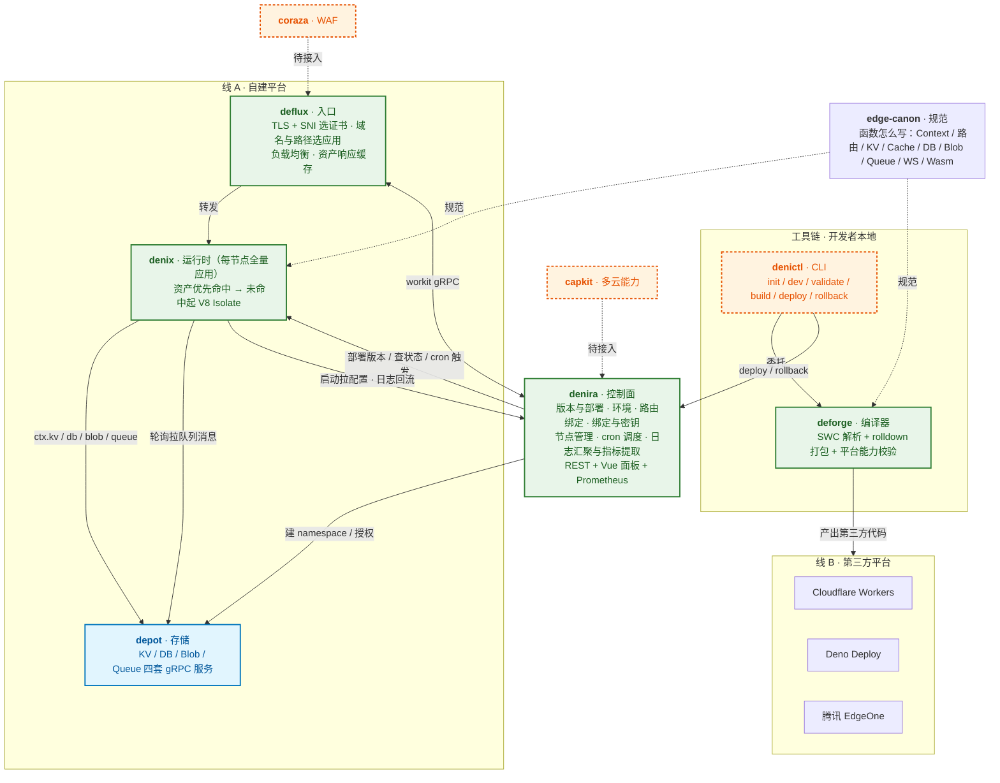
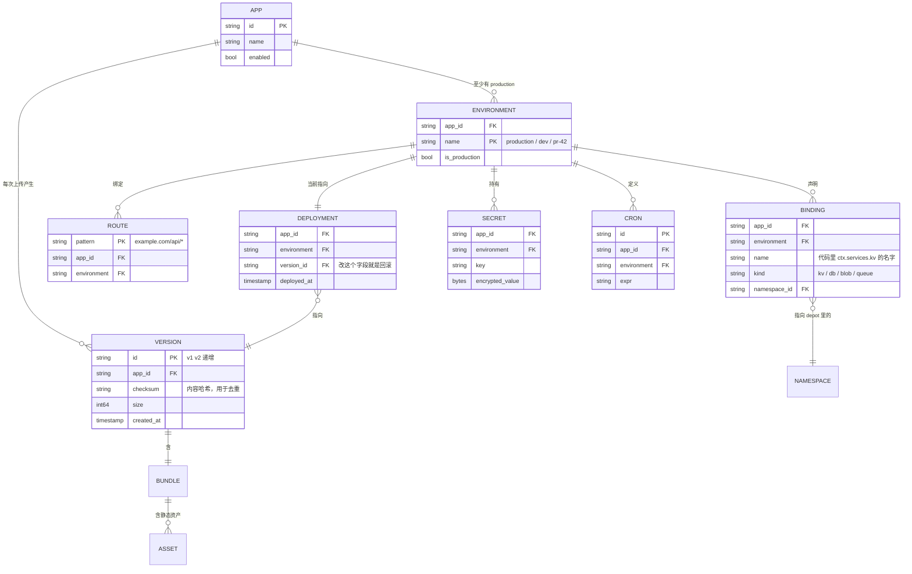
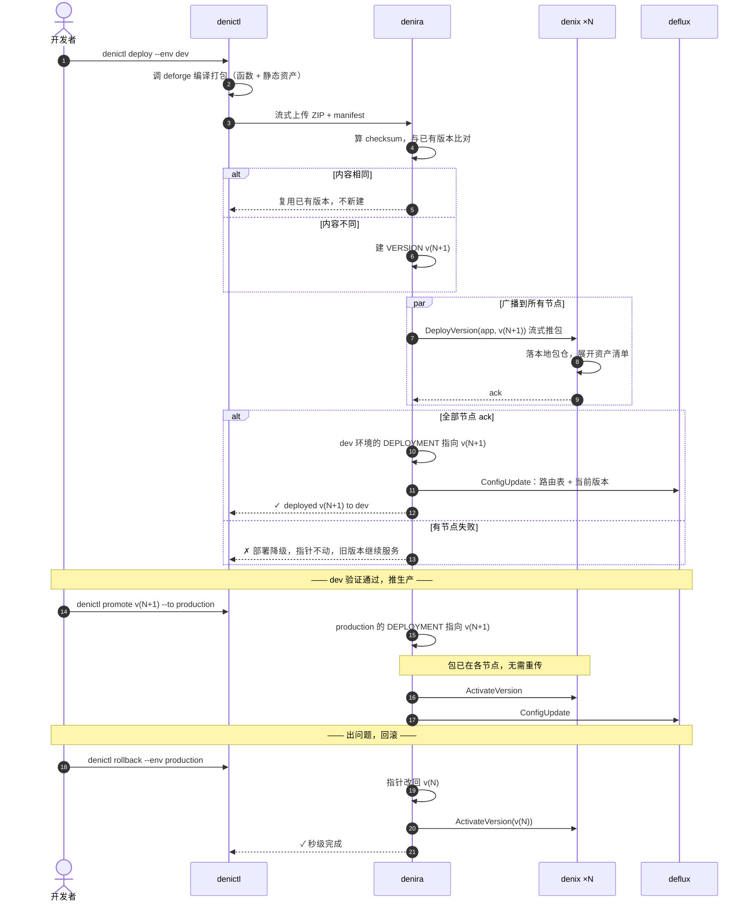
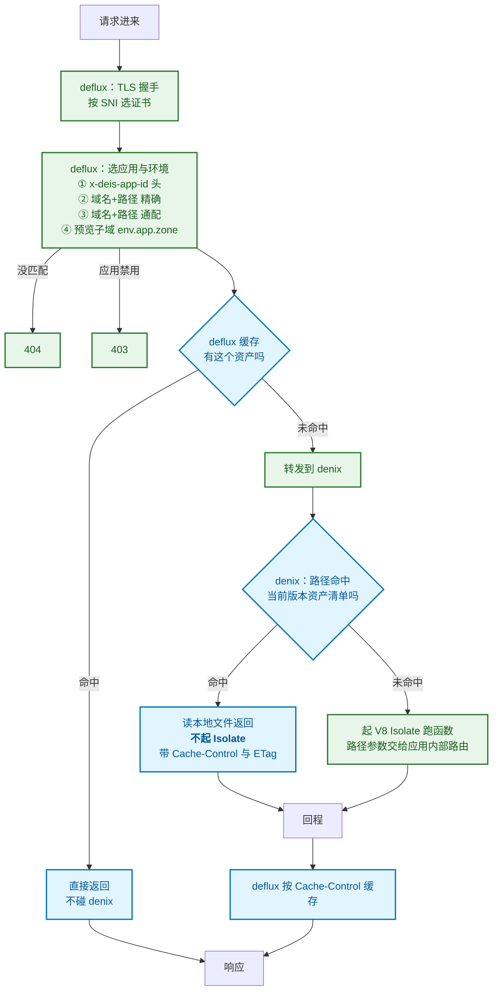
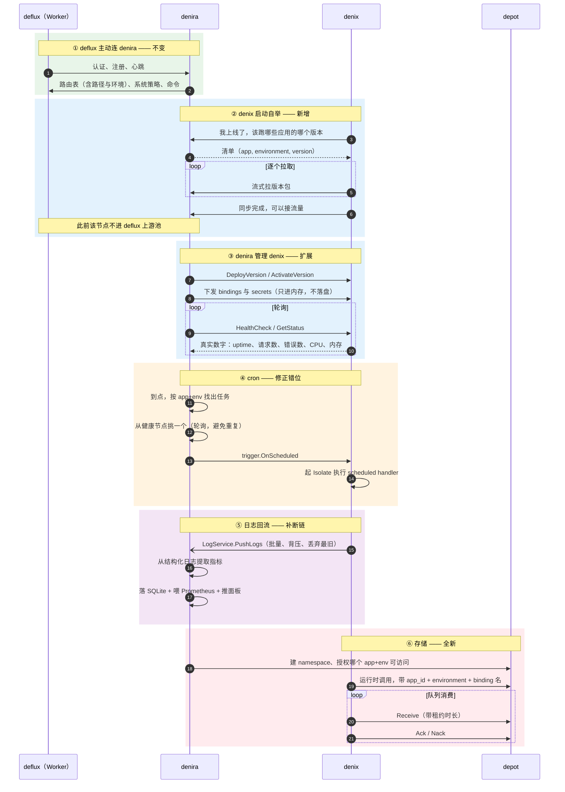

# Deislet 系统设计

> v0.3 · 2026-08-28
> 定位：**mini 版 Cloudflare Workers + Pages，执行引擎换成 Deno（deno_core）**，面向自己/团队内部使用。

---

## 0. 已定的设计原则

这些是拍过板的前提，后面所有结构都从这里推出来：

| # | 原则 | 含义 |
|---|---|---|
| 1 | **资产优先** | 静态文件先命中先返回，未命中才落到函数。Workers 和 Pages 两半都做 |
| 2 | **全量复制** | 每个 denix 节点都跑全部应用，与 CF 的边缘模型一致。不做按应用调度 |
| 3 | **存储自建** | KV / DB / Blob / Queue 由独立组件 depot 提供，不外接 Redis/PG/MinIO，也不塞进控制面 |
| 4 | **版本不可变** | 每次部署产生不可变版本，部署是指向版本的指针，回滚即改指针 |
| 5 | **资产随包走** | 静态资产打进版本包，由 denix 服务，deflux 只做缓存。保证回滚天然覆盖资产 |
| 6 | **cron 归属应用** | 定时任务挂在应用上，由 denira 挑一个健康节点直连 denix 触发 |
| 7 | **大对象流式传输** | 应用包与 Blob 走流式分块；KV/DB 保持一次性调用，消息上限提到 16MB |
| 8 | **节点主动拉** | denix 启动时向 denira 拉取「我该跑哪些应用的哪个版本」，拉完才报健康 |
| 9 | **队列轮询消费** | denix 定期向 depot 拉自己该消费的消息，靠租约避免重复。depot 保持无状态 |
| 10 | **环境维度** | 每个应用有 production 与任意多个预览环境，各自独立的版本指针、绑定与密钥 |

---

## 1. 组件全景



### denix 的定位变化

原先 denix 是纯被动的自治节点：不主动连任何人，等 denira 调它的管理面。现在**多了两条它主动发起的连接**：

- 启动时向 denira 拉应用清单（原则 8）
- 日志批量回流给 denira

自治性本身没变——拉完之后本地 SQLite 就能撑住，denira 挂了照常服务。但「denix 从不外连」这条不再成立，配置里需要有 denira 的地址。

---

## 2. 数据模型



**环境是第二主键。** 部署指针、路由、绑定、密钥、定时任务全部挂在「应用 + 环境」上，不挂在应用上。这样预览环境用自己的 KV namespace，测试数据不会写脏生产。版本本身跨环境共享——同一个包可以先部署到 dev 验证，再把 production 的指针指向它，不用重新上传。

**存储位置**：以上全部是 denira 的 SQLite，denira 是元数据的唯一权威。denix 本地 SQLite 只缓存「本节点当前该跑哪些应用的哪个版本」，用于断网自治。

### 与现有代码的差距

| 对象 | 现状 |
|---|---|
| APP | 有（`AppManifest`） |
| ENVIRONMENT | 没有 |
| VERSION | 没有。`AppManifest.version` 是用户手写字符串，不是平台生成的版本 |
| DEPLOYMENT | 没有。`DeployApp` 直接热替换 |
| ROUTE | 半个。deflux 只有域名级，没有路径段 |
| BINDING | 没有。`AppManifest.resources: Vec<String>` 是雏形，含义未定义、无人消费 |
| SECRET | 没有。只有明文 `env` |
| CRON | 有但接错了，挂在 worker 上 |
| ASSET | 没有。整个静态资产层不存在 |

---

## 3. 应用生命周期



- **版本保留**：每应用默认保留最近 10 个包，超出即删。回滚只在保留窗口内秒级完成。
- **去重**：checksum 相同不新建版本，避免反复 deploy 同样代码堆出一堆版本。
- **部署失败不切指针**：任一节点没 ack，指针不动，旧版本继续服务。比「切了再回滚」安全。
- **不做百分比灰度**。全量复制下灰度需要 denix 同时驻留两个版本的 Isolate，本轮不做，但模型留了口子。

---

## 4. 请求路径



**路由表结构**要从「域名 → 应用」扩展成「域名 + 路径前缀 → 应用 + 环境」。匹配顺序：先长路径后短路径，同长度下精确域名优先于通配域名。这样 `example.com/api/*` 给 API 应用、`example.com/*` 给站点应用可以共存。

**预览子域**：预览环境靠自动子域访问，形如 `<env>.<app>.<zone>`。这不是可选项——每个预览环境手工配域名不现实，所以自动子域是预览环境的前置依赖。需要一张泛域名证书（`*.<zone>`）或 ACME 自动签发。

---

## 5. 控制面



**cron 为什么这么改**：任务在概念上属于应用，不属于节点。全量复制下每个节点都有这个应用，谁执行由 denira 决定——挑一个健康节点触发，天然避免重复。denira 本来就是单点，不需要 leader 选举。

---

## 6. depot：存储组件

新 crate（`crates/depot`），四套 gRPC 服务。proto 复用 denix 现有的 `storage.proto`、`blob.proto`、`queue.proto`——客户端已经写好，接口基本不用重新设计。

| 服务 | 底层 | 隔离 | proto 改动 |
|---|---|---|---|
| **KV** | SQLite 表（key, value, metadata, expires_at） | namespace | 无 |
| **DB** | 每 namespace 一个独立 SQLite 文件 | 文件级 | 无 |
| **Blob** | 本地磁盘 `<数据目录>/<namespace>/<key>`，元数据进 SQLite | 目录级 | **Get/Put 改流式** |
| **Queue** | SQLite 表做持久队列 | namespace | **补 Receive / Ack / Nack** |

### 队列语义

现在 `queue.proto` 只有 `Send` 和 `SendBatch`，**没有任何消费接口**。补齐后的语义：

- **拉模式**：denix 定期 `Receive(queue, max, lease_secs)`，depot 把消息标记为「租约中」并返回。
- **租约**：租约期内其他节点看不到这条消息。超时未 Ack 则重新可见。全量复制下多个 denix 拉同一队列，靠这个防重复消费。
- **至少一次**：Ack 之前的崩溃会导致重投。应用侧需要幂等。
- **死信**：重试超过 N 次（默认 5）进死信队列，不再投递，留待人工处理。

### 其他取舍

- **先单机**。SQLite + 本地盘对内部使用够用。接口层不暴露单机假设，以后换后端不动 proto。
- **授权由 depot 自己校验**，不信任调用方。调用带 app_id + environment + binding 名，depot 查授权表。否则拿到地址就能读所有数据。
- **不做跨节点复制**。depot 单实例，是全量复制模型下唯一的有状态点，也是单点。内部使用先接受，需配定期快照备份。
- **地址由 denira 下发**给 denix，不写死在 denix 配置里。

---

## 7. 绑定与密钥

**Bindings**：把 `AppManifest.resources: Vec<String>` 这个未定义字段改成结构化声明：

```json
{
  "bindings": [
    { "name": "MY_KV",  "kind": "kv",   "namespace": "foo-prod" },
    { "name": "MY_DB",  "kind": "db",   "namespace": "foo-main" },
    { "name": "ASSETS", "kind": "blob", "namespace": "foo-files" }
  ]
}
```

代码里 `ctx.services.kv` 拿到的就是绑到该 namespace 的客户端。denira 在部署时确保 namespace 存在并授权，denix 起 Isolate 时按 binding 注入。**绑定按环境分**——预览环境指向自己的 namespace，不碰生产数据。

**Secrets**：与普通 env 彻底分开。

- denira 用主密钥（从环境变量或文件读，不进代码不进库）加密后存 SQLite。
- 下发给 denix 时经 TLS 传明文，denix **只放内存**，不落本地 SQLite。节点重启后重新拉。
- 面板和 CLI 只能写和删，不能读回。
- 现状是明文 env 经 gRPC 下发、明文落 SQLite，属于必须改的。

---

## 8. 限额

现状全部写死在代码里（30 秒超时、1000 ops/s、堆上限），改成三层：平台默认（denix 配置）→ 应用覆盖（denira 下发）→ 硬上限（应用覆盖不能突破）。

两项现在完全没有的：

- **CPU 时间**：现在只有 30 秒 wall-clock，一个死循环能占满线程 30 秒。需要 V8 层面的 CPU 时间限制。
- **出网控制**：函数能 `fetch` 到任意地址，包括内网。至少要能配黑名单（默认禁内网段）。

---

## 9. 落地顺序

| 阶段 | 内容 | 说明 |
|---|---|---|
| **一 · A** | depot：四套服务 + 授权 + namespace 管理；补队列消费接口；denira 加 namespace 与 binding 管理 | 完全独立可测，不动现有组件 |
| **一 · B** | deforge 增加 `Platform::Deislet` 与 adapter：产出含函数入口、路由表、资产清单的应用包；`ctx.params` 随之成立 | 与 A 并行。它是路由参数、静态资产、版本包结构的共同前提，晚做会拖住阶段二和三 |
| **二** | 版本、环境与部署模型：数据表、流式传包、DeployVersion / ActivateVersion、节点自举拉取、denictl deploy/promote/rollback | 依赖一·B 定下的包结构 |
| **三** | 静态资产：包内带资产、denix 资产优先命中、deflux 路径级路由与缓存、自动子域 | 依赖阶段二的版本包结构 |
| **四** | 可观测：真实状态上报、日志回流、指标提取、面板展示 | 前三阶段跑通后才有真数据 |
| **五** | cron 修正、secrets、限额三层化、出网控制 | 收尾的正确性与安全项 |

---

## 10. 尚未决定

**边做边定**

- 证书自动签发（ACME）。自动子域需要泛域名证书，届时一并考虑。`examples/pingap` 有现成模块可参考。
- `denictl dev` 怎么执行用户代码。现在返回假响应。三条路：起本地 denix、调 deno CLI、把 deno_core 嵌进 denictl。
- 日志保留时长，以及从结构化日志里提取哪些字段成为指标。
- 实时日志流（类似 `wrangler tail`）要不要。
- 出网控制用黑名单还是白名单。
- depot 的备份周期与保留策略。

**涉及对外承诺，需单独处理**

- **WebSocket 端到端从未验证**。pingora 内置支持 upgrade 隧道，denix 也有 WS 桥接，但两头从没连起来测过；HTTP/2 下还需要 extended CONNECT。而 `PLATFORM_MATRIX.md` 已写 ✅ Native。
- **`edge-canon/PLATFORM_MATRIX.md` 过度承诺**。Deislet 一列几乎全 ✅，实际大半为空。这是公开仓库，要么加「实现状态」列，要么把未实现的降级为「计划中」。
- **denira 面板认证是 API Key 且默认关闭**（`api_auth_enabled` 默认 false），没有用户与角色概念。

**明确推迟**

百分比灰度、Durable Objects、depot 多副本高可用、计费与配额。

---

## 11. 能力矩阵对账

`edge-canon/PLATFORM_MATRIX.md` 里 Deislet 一列写的是**目标**，不是现状。下表是 2026-08-29 按代码逐项核对的结果，用来指导补齐，也用来修正那张公开的表。

### 基础特性（规范要求全平台必须支持）

| 特性 | 表里 | 实况 | 缺什么 |
|---|---|---|---|
| HTTP Handler | ✅ | 成立 | — |
| Request / Response | ✅ | 部分成立 | `JsRequest` 只有 url / method / headers / body，且 body 是 `String`。二进制请求体与响应体不支持，需要改成字节 |
| 环境变量 | ✅ | 成立 | manifest 的 env 经 `EnvStore` 注入，`ctx.env` 可读 |
| 路由参数 | ✅ | **不成立** | `JsRequest` 结构体里没有 params 字段，`ctx.params` 恒为空对象。根因见下方「工具链缺口」 |
| KV 存储 | ✅ | **不成立** | op 齐全，但需要 OpState 里有 `KvClient`；无服务端时运行时返回 "KV service not available" |
| Cache API | ✅ | 成立 | moka 进程内缓存，`globalThis.caches` 已挂。语义上是单节点缓存，与 CF 的 per-colo 缓存接近 |
| 生命周期 `waitUntil` | ✅ | 成立 | `runtime.js` 中已实现 |
| 结构化日志 | ✅ | 部分成立 | 本地 `op_log` → 环形缓冲正常；回流上报是空壳 |
| Web 标准 | ✅ | 成立 | deno_web / fetch / crypto / net / websocket / tls 均已注册 |

### 扩展特性

| 特性 | 表里 | 实况 | 缺什么 |
|---|---|---|---|
| SQL 数据库 | ✅ Remote gRPC | **不成立** | 只有客户端，无服务端 |
| 对象存储 | ✅ Remote gRPC | **不成立** | 只有客户端，无服务端；proto 无流式接口 |
| Node.js 运行时 | ✅ Native | **不成立** | `build_runtime_extensions()` 中**没有注册 `deno_node`**，仅从中借用了一个 TLS op。`require`、`Buffer`、`node:` 模块均不可用 |
| 服务端渲染 | ✅ Native | **不成立** | 依赖 Node 兼容、npm 包解析、静态资产三者，均不具备 |
| 增量静态再生 | ⚠️ Planned | 与表一致 | — |
| WebAssembly | ✅ Native | 成立 | V8 自带 |
| 定时任务 | ✅ Native | **不成立** | 链路三段错位，见 §5 |
| 消息队列 | ✅ Native (Memory) | **不成立** | 运行时只有 `op_queue_send`，无消费 op；无服务端 |
| Durable Objects | ⚠️ Planned | 与表一致 | — |
| WebSocket | ✅ Native | 未验证 | denix 有 `ws_server_ops`；deflux 侧 pingora 内置 upgrade 隧道支持，但两端从未端到端验证；HTTP/2 下还需 extended CONNECT |
| BroadcastChannel | ✅ Native | 成立（单进程） | `InMemoryBroadcastChannel`，跨节点不通。全量复制下同一应用在多节点各有一份，广播不互通 |
| Workers AI | ❌ | 与表一致 | — |

### 矩阵没体现的缺口：工具链没有自家平台目标

`deforge` 的 `Platform` 枚举只有 `Cloudflare` / `Deno` / `Tencent`，**没有 Deislet**。编译器不能为自家平台产出代码。

后果：

- 「两条线并重」目前只有线 B 有工具链。线 A 的应用只能手写单文件——demo 里那个应用就是 `demo.sh` 用 Python 手工打的 zip。
- edge-canon §5 的自动路由（文件路径映射到 URL 路径）在自家平台上编译不出来。**这也是 `ctx.params` 恒为空的根因**：文件路由的参数本该由编译器生成的分发代码填充，而自家平台没有编译目标，所以没人填。
- 静态资产（§4）要求包里带资产清单，同样需要编译器产出。

**补齐路径**：`deforge` 增加 `Platform::Deislet` 与对应 adapter，产出包含函数入口、路由表、资产清单的应用包，`denictl deploy` 直接上传该包。这项应排进落地顺序的阶段二，它是版本包结构的前提。

### 补齐工作量分组

| 组 | 项目 | 说明 |
|---|---|---|
| **随阶段一自然补齐** | KV、SQL 数据库、对象存储、消息队列 | 客户端和 proto 都在，缺的就是 depot |
| **随阶段二、三自然补齐** | 路由参数、静态资产、SSR 的前置条件 | 需要 deforge 的 Deislet 目标与版本包结构 |
| **独立小项** | 二进制请求体、WebSocket 端到端验证、cron 接线 | 各自一两天，互不依赖 |
| **真正的硬骨头** | Node.js 运行时、服务端渲染 | 见下 |

**Node.js 兼容与 SSR 已定为「有限支持」。** 注册 `deno_node` 扩展，明确列出可用的 `node:` 模块白名单，**不做 npm 包解析**——`node_modules` 布局、CJS/ESM 互操作、npm 包进版本包这三项成本过高，且 Cloudflare 自己也只做到 `nodejs_compat` 的有限支持。原先在矩阵里标 `Native` 比 CF 承诺得还满，已改。SSR 跟随降级：能跑不依赖 npm 生态的服务端渲染，框架级 SSR 不承诺。

`edge-canon/PLATFORM_MATRIX.md` 已按本节结论修正（提交 `b5a7239`）：未实现项从 ✅ 降为 ⚠️ Planned，实现一项改回一项。
