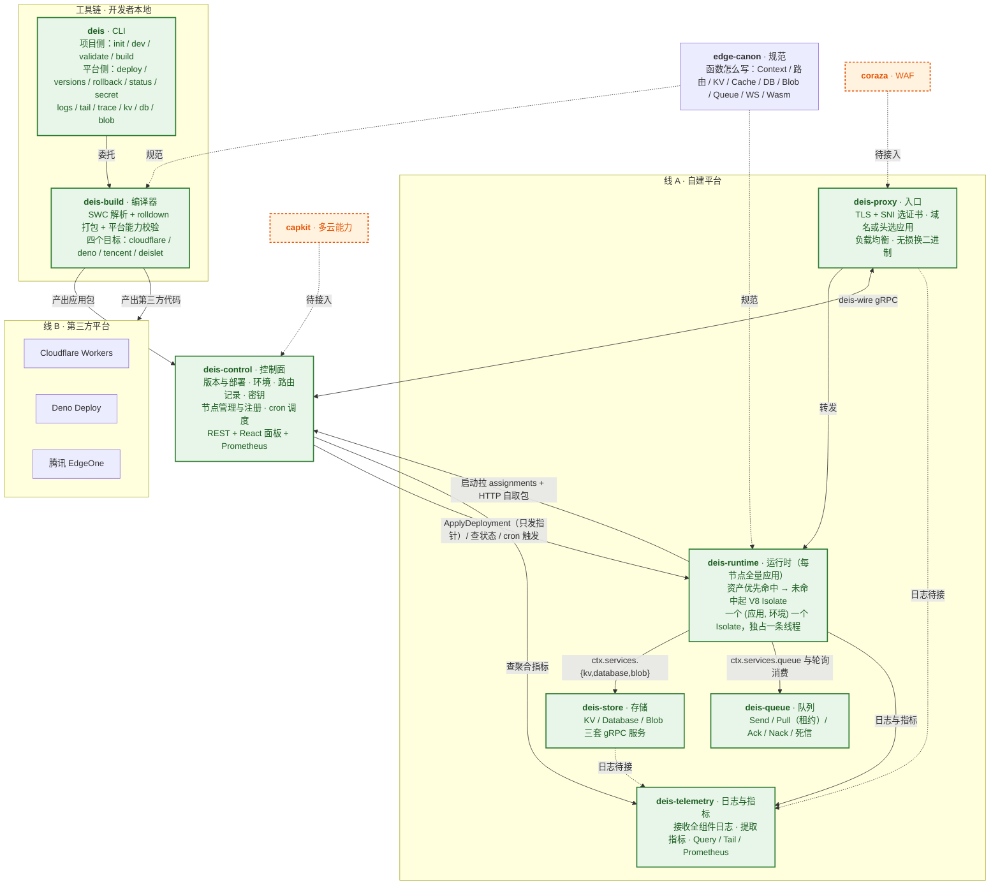
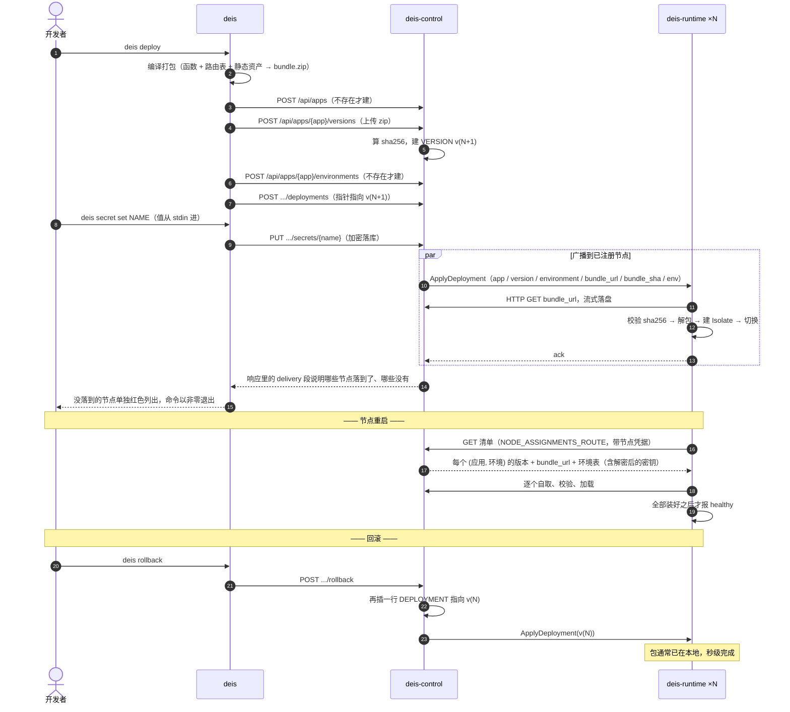
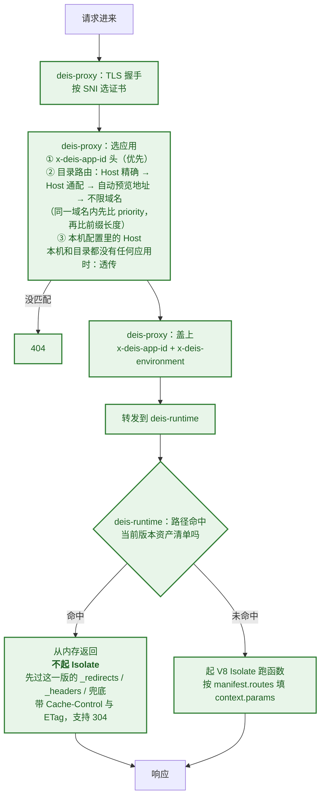
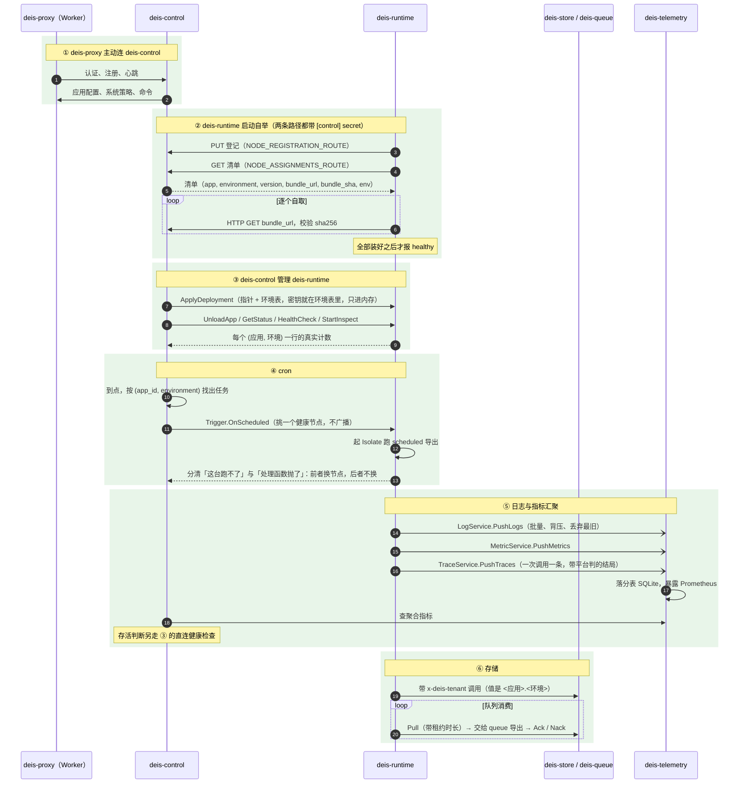
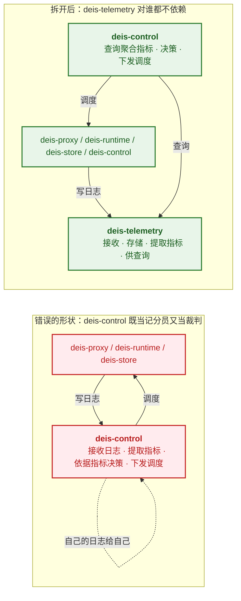

# Deislet 系统设计

> v0.4 · 2026-08-29
> 定位：**mini 版 Cloudflare Workers + Pages，执行引擎换成 Deno（deno_core）**，面向自己/团队内部使用。
> 配套 [`implementation-plan.zh.md`](implementation-plan.zh.md)：那份讲「照着写什么」，这份讲「为什么这么分」。

**现在这套东西是通的。** 波次 A 与波次 B 已经合入：`deis build --vendor deislet`
产出应用包，控制面把它存成不可变版本，环境指针指向版本，节点自己把包拉下来对外服务；
静态资产先于任何 Isolate 命中；`ctx.services.{kv,database,blob,queue}` 真的走到
deis-store 与 deis-queue；cron 到点在**一个**节点上执行；日志进 deis-telemetry；
回滚就是把指针挪回去。同一个应用的两个环境能在同一台节点上并行，各用各的版本与存储。
`scripts/demo.sh` 走完这一整条线，并逐项验证十二条性质。

下文每一节都标了**哪些已经成立、哪些还没有**。没有标注的段落是设计意图，与现状一致。

---

## 0. 已定的设计原则

这些是拍过板的前提，后面所有结构都从这里推出来：

| # | 原则 | 含义 | 现状 |
|---|---|---|---|
| 1 | **资产优先** | 静态文件先命中先返回，未命中才落到函数。Workers 和 Pages 两半都做 | 节点侧成立；deis-proxy 的资产缓存还没做 |
| 2 | **全量复制** | 每个 deis-runtime 节点都跑全部应用，与 CF 的边缘模型一致。不做按应用调度 | 成立 |
| 3 | **存储自建** | KV / DB / Blob 由 deis-store 提供、Queue 由 deis-queue 提供，不外接 Redis/PG/MinIO，也不塞进控制面 | 成立 |
| 4 | **版本不可变** | 每次部署产生不可变版本，部署是指向版本的指针，回滚即改指针 | 成立 |
| 5 | **资产随包走** | 静态资产打进版本包，由 deis-runtime 服务，deis-proxy 只做缓存。保证回滚天然覆盖资产 | 打包与服务成立；proxy 缓存未做 |
| 6 | **cron 归属应用** | 定时任务挂在应用上，由 deis-control 挑一个健康节点直连 deis-runtime 触发 | 成立 |
| 7 | **大对象流式传输** | 应用包走 HTTP 自取、Blob 走流式分块；KV/DB 保持一次性调用，消息上限提到 16MB | 成立 |
| 8 | **节点主动拉** | deis-runtime 启动时向 deis-control 拉取「我该跑哪些应用的哪个版本」，拉完才报健康 | 成立 |
| 9 | **队列轮询消费** | deis-runtime 定期向 deis-queue 拉自己该消费的消息，靠租约避免重复。deis-queue 保持无状态判断 | 成立 |
| 10 | **环境维度** | 每个应用有 production 与任意多个预览环境，各自独立的版本指针、服务声明与密钥 | 成立 |
| 11 | **观测独立** | 日志汇聚与指标提取由独立组件 deis-telemetry 承担，不放进控制面。存活判断走直连健康检查，质量判断才查 deis-telemetry | 成立 |

原则 3 与 9 的措辞改过：队列最初挂在 deis-store 名下，落地时拆成了独立的
deis-queue（理由见 §6）。

---

## 1. 组件全景



绿色是已经跑通的；虚线橙色是还没接进来的：只剩 coraza 与 capkit 两个外部件。

`deis` 也是绿的：它已经补全到平台侧（deploy / versions / rollback / status /
secret / logs / tail），后来又加了读调用轨迹的 `trace` 和数据面的 `kv` / `db` /
`blob`。`scripts/demo.sh` 的部署动作全部走 CLI，脚本里没有一处对控制面 REST 的
`curl`。

### deis-runtime 的定位变化

原先 deis-runtime 是纯被动的自治节点：不主动连任何人，等 deis-control 调它的管理面。
现在**多了三条它主动发起的连接**：

- 启动时向 deis-control 拉应用清单，并逐个 HTTP 取包（原则 8）
- 日志与指标批量投递给 deis-telemetry
- 按 manifest 声明的队列，定期向 deis-queue 拉消息

自治性本身没变——拉完之后本地 SQLite 就能撑住，deis-control 挂了照常服务。但
「deis-runtime 从不外连」这条不再成立，配置里必须有 deis-control 的地址与节点凭据
（`[control] endpoint` 与 `[control] secret`）。

---

## 2. 数据模型


**环境是第二主键。** 部署指针、路由、密钥全部挂在「应用 + 环境」上，不挂在应用上。
预览环境用自己的存储租户，测试数据不会写脏生产。版本本身跨环境共享——同一个包可以先
部署到 dev 验证，再把 production 的指针指向它，不用重新上传。

**服务、cron、队列消费不在库里。** 它们是**包的属性**，写在 `manifest.services` /
`manifest.cron` / `manifest.queues` 里，随版本走。这是与早前设计的一处出入：原本
打算建一张 `bindings` 表把「代码里的名字 → namespace」映射存进控制面，落地时没有
建，理由见 §8。控制面读包内 manifest 来决定下发什么、调度什么。

**存储位置**：以上全部是 deis-control 的 SQLite，deis-control 是元数据的唯一权威。
deis-runtime 本地 SQLite 只缓存「本节点当前该跑哪些应用的哪个版本」，用于断网自治。

### 与现有代码的对照

| 对象 | 现状 |
|---|---|
| APP | 有。`apps` 表 + `/api/apps` |
| ENVIRONMENT | 有。`environments` 表；名字必须满足 `is_valid_tenant_part`（不许含 `.` `/` `\`，半边不超 64 字节），否则存储租户会被拆成三段而全废 |
| VERSION | 有。`versions` 表，写入后永不修改；包体存控制面本地，`bundle_sha` 是内容哈希 |
| DEPLOYMENT | 有。`deployments` 表只追加；某环境的当前版本 = 该 env 下最新一行 |
| ROUTE | 有，且被消费了。`routes` 表存 host + path_prefix + priority；`GET /api/routes` 给控制台看，另一条 `GET /api/routing-table` 给数据面看（多带环境名、所有存在的环境、整表版本号），deis-proxy 每 5 秒拉一次并按它选应用（见 §4） |
| SECRET | 有。AES-256-GCM 落库，主密钥从 `secret_key_file` 读；面板与 CLI 只能写和删，读不回来 |
| CRON | 有，且挂对了对象：调度器按 `(app_id, environment)` 维护，到点调某一个节点的 `Trigger.OnScheduled` |
| ASSET | 有。打进包里，节点建内存索引，命中直接返回并带 ETag。同一份包里还带着这个站点自己的规则——`_redirects`、`_headers` 和「路径谁都没认领时答什么」，构建期解析、装载时编译（见 §4） |
| BINDING / NAMESPACE | 控制面**没有**这张表，也不打算建——具名绑定是**包的属性**，`bindings` 块写在 manifest 里随版本走，形状由 `deis-bundle` 唯一定义。所以「一个应用一个环境只有一份 KV」这条限制早已不在，见 §8 |
| ACCOUNT / API_TOKEN | 有。`accounts`（名字、角色、停用时刻）与 `api_tokens`（所属账号、来源、作用域、是否无作用域、最后使用与吊销时刻）。token 在库里只留密的那一半的 sha256，所以读到这两张表的人手上没有一把能用的钥匙 |
| AUDIT_LOG | 有，且**只增不改**：全仓没有一处 UPDATE 或 DELETE 它，`DELETE /api/audit` 是 405（连没有作用域的那把 key 也一样）。改状态的调用和被拒的调用一样记，被拒的那条还记下「本来需要什么作用域」 |
| RETIRED_APP_NAME | 有。删掉一个应用并不能删掉它在 deis-store / deis-queue 里的数据（两个服务都没有「丢掉一个租户」这个动作），所以名字被扣下而不是放回去：`retired_app_names` 记着它铺到过哪些租户，有人明确放出来之前，没有第二个应用能用这个名字接手那些数据 |

---

## 3. 应用生命周期



- **包从不进 gRPC 消息**。控制面只发指针，节点自己 HTTP 取。早前的 `DeployApp`
  把整个 zip 塞进一次调用，撞 tonic 的消息上限，已删除。
- **去重**：`bundle_sha` 相同不新建版本。
- **部署失败不切指针**：任一节点没 ack，响应里 delivery 段会说明，指针语义由调用方
  决定是否回退。
- **不做百分比灰度**。全量复制下灰度需要 deis-runtime 同时驻留两个版本的 Isolate，
  本轮不做，但模型留了口子。
- **换版先装好再切**：`RuntimePool::stage_app` 在另一条线程上把新版本建好、预热完，
  `activate` 才把流量换过去，旧版本在这期间一直在应答。所以换版没有可用性空档。

---

## 4. 请求路径



**环境怎么定**：deis-proxy 认出应用的同时也就认出了环境——目录里的一条路由指向的是
一个 `(应用, 环境)`，自动预览地址更是一个环境一个地址；只有走 `x-deis-app-id` 头这条
路时环境是补上去的默认值 `production`，因为那个头只说了应用。选中之后原样盖成
`x-deis-environment`，客户端自己带的同名头会被覆盖，不能借它跳到别的环境。节点收到
不带这个头的请求时也按 `production` 处理，所以早于环境模型的调用方仍然落到生产。

**目录和本机配置都能答「这是哪个应用」时，目录赢**，因为目录是运维不碰机器就能改的
那一份。本机的应用列表没有作废，它答的是另一个问题：这个应用的证书、缓存策略、有没有
被停用——也就是「认出来之后怎么处置」。

**原来卡住的两件事已经通了**：

- **路径级路由**。deis-proxy 现在每 5 秒向控制面拉一次 `GET /api/routing-table`，
  按拉到的表选应用，所以 `example.com/api/*` 给 API 应用、`example.com/*` 给站点
  应用可以共存了。这条链路的三个关键取舍：**用轮询不用推送**，因为轮询自愈——不管
  是断连、控制面重启还是某次校验没过，下一次拉取都会修好，而推送方案最后都得再配
  一个周期性全量对齐才敢信；**控制面不可达时最后一张表无限期继续生效**，一次管理面
  故障不该变成一次用户可见的故障（只有从来没拉成功过的 proxy 例外，它退回本机配置里
  的应用列表）；**一张表要么整份换上、要么整份不要**，半张路由表会把线上请求发给错的
  应用，比一张旧表更糟，所以是整份解析、整份校验、整份编译，最后靠一次指针交换换上。
- **预览子域**。运维在 proxy 配置里写 `routing.preview_zone`，每个环境就有了
  `<环境>--<应用>.<域>`，默认环境另有一个短名 `<应用>.<域>`。分隔符是一个 DNS 标签
  里的 `--` 而不是点，为的是证书：一张通配证书只覆盖一层标签，`*.<域>` 盖得住
  `pr-42--shop.<域>`，盖不住 `pr-42.shop.<域>`。**仍然要人手做的只剩那条通配 DNS
  记录**：证书这一半 ACME 已经接上了（`crates/deis-proxy/src/acme/`，`[tls.acme]`
  打开，默认关）。它走 `http-01`——代理本来就替它服务的每个域名占着 80 端口，自己
  就能答挑战——代价是**签不出通配证书**：RFC 8555 只允许 `dns-01` 签通配。所以预览
  地址有两条路：把 `include_preview_addresses` 打开，让每个环境地址各签一张（省事，
  但每张各占一次颁发额度）；或者仍然人手放一张 `*.<域>` 的通配证书（一张管全部）。
  见 §11。

**deis-proxy 的资产缓存仍然没做**：原则 1 里「proxy 只做缓存」的那一半没有实现，
每个资产请求都会走到节点，由节点从内存索引里回。配置里的 `[cache]` 段目前没有任何
读者——`DeisProxy` 没有实现 `request_cache_filter`，pingora 也是不带 `cache` 特性
编的。

---

## 5. 控制面



**cron 为什么这么改**：任务在概念上属于应用，不属于节点。全量复制下每个节点都有这个
应用，谁执行由 deis-control 决定——挑一个健康节点触发，天然避免重复。deis-control
本来就是单点，不需要 leader 选举。原先 `CronTask` 挂在 `node_id` 上，是挂错了对象。

**一次触发只跑一个节点**，失败换一个节点重试——但只在「这台跑不了」的时候换。处理
函数自己抛异常时不换：同一段代码在别处会以同样方式失败，而它在失败前可能已经产生了
副作用（发过队列、写过库），每换一个节点就重放一次。节点用
`deis_runtime::trigger::HANDLER_FAILED_PREFIX` 这个错误前缀表达这一区分，因为
`TriggerResponse` 里没有「处理函数已被调用」这一位。

**节点注册**：节点凭 `node_preshared_keys` 里的凭据向控制面登记自己，登记过期就要
再来一次。方法是 `PUT`：登记是在陈述「这个节点是什么」，不是请求创建一条记录，所以
掉线又回来的节点原样再说一遍就行；同一条路径上的 `DELETE` 是节点主动离场。注册不是
拿活的方式——没注册的节点照样自取并服务它拉到的每个应用，只是收不到推送、也不会被
选中跑 cron。

**这把凭据是整支机队共用的一把，不是每个节点一把。** 拿到其中任意一个值，就能读到
任意节点的 assignments（也就是全部环境的明文密钥与每个租户的存储 capability token）、
下载任意 bundle、以及驱动每个节点的管理面；deis-proxy 也持有同一个值。节点的数据端口
绑在 `0.0.0.0`，本身就是一道信任边界。这些事实、各端口该对谁开放、每个配置文件的权限
要求、以及不停机轮换的步骤，只在一处写全：
[docs/trust-boundaries.md](trust-boundaries.md)（英文）。

**这两条路径不在文档里写死。** 它们是
`deis_wire::conventions::{NODE_REGISTRATION_ROUTE, NODE_ASSIGNMENTS_ROUTE}`
（服务端注册路由用的 `:id` 模板）与 `node_registration_path` /
`node_assignments_path`（客户端拼一个具体节点的路径）。放进 deis-wire 是因为没有
任何东西会检查两个 crate 有没有把同一条 HTTP 路径拼成一样：节点请求 `/register`
而控制面提供 `/registration`，两边都编译得过，唯一的症状是一支永远学不会自己有哪些
节点的机队——这件事已经发生过一次。上面时序图里的中文标注是为了看得懂，真值以那两个
常量为准。

---

## 6. deis-store 与 deis-queue：存储与队列

两个独立组件（`crates/deis-store`、`crates/deis-queue`）。队列**没有**放进存储里——
队列不是存储，它的语义（租约、重投、死信）与键值/对象读写完全不同，混在一个组件里
名不副实。

| 组件 | 服务 | 底层 | proto |
|---|---|---|---|
| **deis-store** | KV | SQLite 表（tenant, key, value, metadata, expires_at） | `storage.proto` 的 `KvStore` |
| | Database | 每租户一个独立 SQLite 文件 `db/<tenant>.sqlite` | `storage.proto` 的 `Database` |
| | Blob | 内容寻址落盘 `blob/<tenant>/…` + SQLite 元数据 | `blob.proto`：`Get`（可带 `Range`）/ `Head` / `List`（前缀、分隔符、游标）/ `Put` / `Delete`，Get 与 Put 流式分块；`Put` / `Delete` 可带 `Precondition`（`if_match` / `if_none_match`，版本标识就是对象的 sha256） |
| **deis-queue** | Queue | SQLite 表做持久队列，另有死信表 | `queue.proto`：`Send` / `SendBatch` / `Pull` / `Ack` / `Nack` / `ListDeadLetters` / `ReplayDeadLetters` |

### 租户维度只有一个，值是「应用 + 环境」

两个组件都只认**一个**租户维度，**不认版本、不认部署，也不知道「环境」是什么**。
它们收到的租户 id 是一个不透明的字符串，走带外的 `x-deis-tenant` 头传递
（gRPC metadata），所以 proto 消息里没有租户字段。

这个串由调用方用 `deis_wire::conventions::tenant_id(app, environment)` 拼出来，形如
`demo.production`；服务端用同一个 crate 的 `split_tenant` 校验，只接受恰好两段合法
部分，因此没有哪个取值能拼出上级目录（租户 id 会变成磁盘路径 `db/<tenant>.sqlite`、
`blob/<tenant>/…`）。缺头、非可打印 ASCII、或校验不过（裸 app id、三段、空段、含
`.` `/` `\`、半边超 64 字节）一律回 `PermissionDenied`，绝不退回某个默认命名空间。

**为什么把环境揉进这把钥匙**：原则 10 说每个环境有自己的数据。如果预览环境和生产共用
一个命名空间，预览的一次写就能覆盖掉生产的键——而这是回滚救不回来的，回滚只换代码，
不还数据。所以这里宁可让钥匙长一点，也不让两个环境有机会撞在一起。

服务端刻意**不提供**拆开后两半的访问器：存储是按租户存的，不是按应用存的，代码里不该
有任何地方能因为「前缀一样」把两个租户当成一个。

`x-deis-app-id` 仍然存在，但只在数据面表示「这是哪个应用」（配合
`x-deis-environment`），不再是存储租户；只带它来调存储的调用会被拒绝。

### 队列语义

- **拉模式**：deis-runtime 定期 `Pull(queue, max, lease_secs)`，deis-queue 把消息标记
  为「租约中」并返回。
- **租约**：租约期内其他节点看不到这条消息。超时未 Ack 则重新可见。全量复制下多个
  节点拉同一队列，靠这个防重复消费。
- **至少一次**：Ack 之前的崩溃会导致重投，应用侧需要幂等。消息带 `attempts`，大于 1
  就意味着应用见过它。
- **租约令牌**：每条被领走的消息带一个 `lease_token`，租约每次续期都换新的。Ack 与
  Nack 必须原样带回来，所以租约过期、消息被别人领走之后，先前那个消费者的 Ack 不再
  作数——否则它会把别人正在处理的那条销掉。
- **死信**：重试超过阈值进死信表，不再投递。`ListDeadLetters` 与 `ReplayDeadLetters`
  两个 RPC 让人能看见它们、并把它们放回队列，不必直接读库；命令行这一头是 `deis queue
  dead-letters` 和 `deis queue replay`。每条死信还记着是哪一种失败把它送进来的：消费者
  自己报了失败（处理函数跑过了，拒掉了这条消息体），还是租约一次次到期、始终没人应答
  （处理函数比租约慢，或者节点握着消息挂了）。这两种要修的地方不一样，而光看重试次数
  它们长得一模一样，所以原因写在行上，不只写进日志——等有人来看这张表的时候，那条日志
  多半已经滚没了。
- **批量投递**：`SendBatch` 一次收一整批，落库是**一个事务**——要么整批都进去，要么一
  条都没有。所以被拒的批次不会留下半批，调用方把同一个数组原样重发是安全的。一批装多
  少条由服务端的 `max_batch_messages`（默认 100）说了算，不由调用方说了算。
- **在手的批次数**：清单里的 `queues[].maxConcurrency` 限的是节点同时**握着**几个批
  次——已经拉下来、还没结清的——不是同时在跑几个。一个应用在一个环境里、在每个节点上
  就是一条线程上的一个 isolate，处理函数只能一批一批地跑。多握一个的好处是上一批还在
  跑时下一批已经拉回来了；代价是每一个在手的批次从拉下来那一刻就在花租约，花过头租约
  到期、消息被交给别人，同一份活做两遍。默认 1，节点夹在 8 以内，启动那条日志会把「不
  是并行」这句话直接写出来。

不做成 deis-queue 主动推给节点——那需要队列知道哪个节点跑哪个应用，会破坏「哑服务」
这条边界。

### 授权：调用方要证明自己有资格声称这个租户

**这里写清楚，免得被上面那段租户校验误导**：`split_tenant` 只检查
`x-deis-tenant` 的**形状**（两段合法部分，不含 `.` `/` `\`）。这一节说的是**身份**
——凭什么相信提出这个租户的调用方真的有权代表它。

做法是能力令牌：调用方在 `x-deis-storage-token` 头里带一个
`base64(HMAC-SHA256(auth_secret, tenant))`（`deis_wire::conventions::storage_token`
/ `storage_token_matches`）。deis-store 与 deis-queue 各自配一份 `auth_secret`，
控制面配同一份 `storage_auth_secret`——三处必须是同一个字符串，改一处就要三处一起
改，改完之前旧令牌全部失效。控制面在给节点下发一次部署时，用这份密钥给部署所属的
租户现算一个令牌，塞进 `env` 表里保留键 `DEIS_STORAGE_TOKEN`（`bindings.rs` 在应用
看到自己的环境变量之前把它取走，应用摸不到自己的令牌，更摸不到别的租户的）；节点侧
每一次 KV / SQL / Blob / Queue 调用都把它带上（`crates/deis-store/src/auth.rs`、
`deis-queue` 的对应实现）。

验证的顺序刻意是「先看调用方声称的租户，再用这个租户算出期望的令牌，最后才比较」，
而不是反过来拿令牌去查它对应哪个租户——这样一份从某个应用那里泄漏出去的令牌，换到
别的租户身上立刻算不出正确答案，包括同一个应用的另一个环境。令牌不过期、也不是
会话；轮换 `auth_secret` 是唯一的失效手段，一轮换全部令牌同时作废。

**未配置 `auth_secret` 时到底发生什么，两种情况刻意不同**：

- **回环地址 + 未配置**：照旧工作，也就是曾经唯一的机制——相信调用方声称的租户，
  唯一的收敛手段是网络层，端口够不到就调不了。不是静默的：启动时打一条 `warn`，
  把「现在保护数据的只有这一层」原样写出来。这是单机自用的默认状态，受支持。
- **非回环地址 + 未配置**：**拒绝启动**，不是打 warn 放行。未配置不能悄悄等于
  「不设防也照样监听公网」——一旦真的绑定到别处，曾经顶替鉴权的那层收敛就不存在了。
  这一条和控制面的节点通道是同一个形状：预共享密钥列表一旦为空，那条通道直接关闭，
  而不是打开。

配了 `auth_secret` 却没带令牌、令牌对不上租户、或者干脆没带 `x-deis-tenant`，三种
情况都在拿到任何数据**之前**被拒——tonic 拦截器挡在每个 handler 前面
（`crates/deis-store/src/server.rs` 的 `guarded`），新增第四个服务也不可能漏掉这一层。
拒绝一律以 `warn` 记日志，带上声称的租户，可追查。健康检查端点刻意例外：它不回答
任何租户的数据，只说这个进程能不能应答，要求它也带令牌，控制面就做不出一个不知道
任何租户令牌的存活探针了。

这套机制是 deis-store 与 deis-queue 共用的同一份代码路径（各自的 `auth.rs`），
不是各写一份。

### 其他取舍

- **先单机**。SQLite + 本地盘对内部规模够用。接口层不暴露单机假设，以后换后端不动
  proto。
- **不做跨节点复制**。deis-store 是全量复制模型下唯一的有状态点，也是单点。内部使用
  先接受。**备份是有的**：`deis-store snapshot` / `restore` 两个子命令做一致性快照，
  因为这些 SQLite 都开着 WAL，直接 `cp -r` 或 `rsync` 拷出来的目录可能缺最近的提交、
  也可能直接是坏的，而且打开时不会报错。做成子命令而不是 RPC，是因为它是运维动作，
  不该让任何能连到端口的人触发。
  但**整个平台**的备份不止这一件事，而且最容易漏的两样都不在 deis-store 这边：控制面
  的**包仓库**（`bundle_dir`，每个版本代码的唯一一份，是数据库旁边的文件，不在库里）
  和**密钥主密钥**（`secret_key_file`，库里那些密文离了它就是一堆噪声）。少了任何一样
  恢复出来的控制面都会照常启动、`/health` 照答 `OK`、控制台照列出所有应用，却一个也跑
  不起来——`/health` 是存活探针，不回答「能不能服务」。完整清单、恢复脚本，以及一次真做
  过的恢复实测，写在 `crates/deis-control/DEPLOYMENT.md`。
- **地址由 deis-control 下发**给 deis-runtime，不写死在 deis-runtime 配置里：控制面
  配 `store_endpoint` / `queue_endpoint`，随每次下发进环境表，节点在进 Isolate 之前
  把它们取走。所以应用的 `ctx.env` 里看不到这两个键，也无法用同名变量把存储客户端
  指到别处。

---

## 7. deis-telemetry：日志汇聚与指标

### 为什么必须独立成一个组件

本设计早前的版本把日志汇聚安在 deis-control 上，那是错的。deis-control 一旦既接收
全部日志、又依据日志做调度决策，就形成了闭环：



具体是三个问题，不只是形状难看：

1. **数据性质冲突**。日志是高频追加的时序数据，控制元数据是低频可变的关系数据。挤在
   同一个 SQLite 里会写竞争，一次日志洪峰能把部署操作拖慢甚至阻塞。
2. **自我观测盲区**。deis-control 自己出故障时，本该记录这次故障的东西正是出故障的
   东西。控制面是最需要事后追查的部分，却恰恰没有记录。
3. **故障放大**。日志处理的一个 bug 能拖垮控制面；反过来，重启 deis-control 做版本
   升级会中断整条日志管道。两件事的可用性要求完全不同——丢日志可以接受，丢部署元数据
   不行。

拆开之后 deis-telemetry **对任何组件都不依赖**，deis-control 退回成它的一个查询方。
这不是把环改成大环，是真的断开。

### 保持解耦的关键：deis-telemetry 必须是「哑」的

deis-telemetry 只做：接收带标签的日志条目、存储、按规则聚合、供查询。**它不认识应用
模型**——不知道什么是版本、环境、部署指针，也不做任何判断。所有解释工作在
deis-control。

一旦 deis-telemetry 开始理解应用语义（比如「这个应用错误率高，通知 deis-control
回滚」），依赖就又长回去了。

### 职责边界

| 能力 | 说明 | 现状 |
|---|---|---|
| **接收** | `LogService.PushLogs`，批量、幂等 | 有。节点已在投递 |
| **存储与保留** | 按天分表的 SQLite，按时间与总量双重上限淘汰 | 有 |
| **指标提取** | 从结构化字段里按规则提取计数、耗时分布、错误率 | 有。`MetricService.PushMetrics` + 本地聚合 |
| **查询 API** | `LogService.Query`，供控制面决策与面板展示 | 有 |
| **Prometheus** | 独立 HTTP 端口上的 `/metrics` | 有 |
| **实时 tail** | `LogService.Tail` 流式订阅 | 有，`deis tail` 是它的消费方 |
| **调用轨迹** | `TraceService`：`PushTraces` / `QueryTraces` / `TailTraces`，一次调用一条，和日志那套并排放不混在一起 | 有，`deis trace` 是它的消费方。留存默认 3 天，比日志的 7 天短——不管应用写不写日志，每次调用都会产生一条 |
| **耗时分位数** | 延迟按直方图存（14 个桶 + `_sum` + `_count`），`histogram_quantile` 直接能算 | 有。此前是一个只升不降的高水位数值，一次 30 秒的超时会把它永久钉在 30 秒 |

deis-telemetry 自己的日志只写 stderr，不自摄入，避免递归。

**目前只有 deis-runtime 在投递。** 设计里说「来源包括 deis-runtime、deis-proxy、
deis-store，以及 deis-control 自己」，实际接上的只有节点这一路：deis-proxy、
deis-store、deis-queue、deis-control 都还只把日志写自己的 stdout / 文件。后果是
访问量与耗时这两个本该由 deis-proxy 提供的主要指标，现在只能从节点侧的数字推算，
而被 deis-proxy 挡在门外的请求（404、证书不匹配）在 deis-telemetry 里完全看不见。

### 观测的维度：应用，环境只是一个字段

隔离是存储的事，观测不需要。能连到 deis-telemetry 端口的人本来就能读写任何应用的
日志，把租户串（`demo.production`）原样当 `app_id` 换不来隔离，却会毁掉唯一有人问的
那个问题——「把这个应用的日志给我看」，指的是它全部环境的。

所以节点在投递时把租户拆开：日志的 `app_id` 是应用、`fields.environment` 是环境；
指标的 `app_id` 是应用、`environment` 是普通标签。于是 `sum by (app_id)` 能把一个
应用的各环境加起来，也能单挑一个。

### 硬约束：两条观测路径必须分开

这是把日志用于决策时最容易踩的坑，写死在设计里：

- **存活判断走直连**：deis-control → deis-runtime / deis-proxy 的健康检查，不经过
  deis-telemetry。这条路必须快且可靠。
- **质量判断走 deis-telemetry**：错误率、耗时退化、自动回滚这类统计性决策，查
  deis-telemetry 的聚合指标。这条路慢、可降级。

如果存活判断依赖 deis-telemetry，那 deis-telemetry 一挂，整个集群会被误判成全部死亡，
然后触发一轮灾难性的调度。

---

## 8. 服务声明与密钥

### 服务：先有「用不用」，后来又有了 bindings 表

第一层是**用不用**某个服务，写在包的 manifest 里：

```json
{ "services": { "kv": true, "database": true, "blob": false, "queue": true } }
```

节点按这份声明构造对应的客户端放进 Isolate 的 `OpState`；没声明的服务连接都不建，
`ctx.services.<那个>` 就是「不可用」。地址来自控制面下发的环境表里的保留键
（`DEIS_STORE_ENDPOINT` / `DEIS_QUEUE_ENDPOINT` / `DEIS_SERVICES` /
`DEIS_QUEUE_CONSUMERS`），这些键在进 Isolate 之前被取走。

第二层是**具名绑定**。早前这里写的是「不做 bindings 表」，理由是那张表上的
`namespace` 一列没内容可填：租户已经由 `(应用, 环境)` 唯一决定。这条判断后来被推翻了
——不是因为租户变了，而是因为「一个应用一个环境只有一份 KV」本身就是个限制：热数据和
冷数据、两套互不相干的索引，只能挤在同一个键空间里靠前缀分家。现在 manifest 里有一张
`bindings` 表（形状定义在 `deis-bundle/src/bindings.rs`，构建 / 控制面 / 节点 / isolate
四方共用一份）：

```json
{ "bindings": {
    "HOT":  { "kind": "kv" },
    "COLD": { "kind": "kv" },
    "AUTH": { "kind": "service", "app": "demo-auth" } } }
```

`kind` 有五种：`kv` / `database` / `blob` / `queue` 是**本租户内部的一个命名空间**，
`service` 是**另一个应用**（见 §12 的「应用间调用」一行）。名字在
`context.bindings.<名字>` 和 `env.<名字>` 上拿到同一个对象。

**租户边界一点没动**：绑定名是在能力令牌验过之后、由
`deis_wire::conventions::namespace_id` 拼到租户后面的（`shop.production@HOT`），
分隔符 `@` 在租户两段和绑定名里都非法，所以这个拼法是单射的——没有哪一对
`(租户, 绑定)` 能拼出另一对的命名空间。不带名字的 `context.services.*` 仍是那个**无名**
命名空间，调用不带 `x-deis-binding` 头，所以早先部署的应用数据原地不动。绑定名判重
不分大小写（它会变成 deis-store 里的目录名和文件名），`ASSETS` 和 `DEIS_` 开头的名字
是保留的。队列绑定不需要这套拼法：deis-queue 本来就是按 `(租户, 队列名, id)` 存的。

### 密钥

- deis-control 用主密钥（从 `secret_key_file` 读，32 字节，不进代码不进库）
  AES-256-GCM 加密后存 SQLite，nonce 前置。
- 下发给 deis-runtime 时经 `ApplyDeployment` 的 `env` 表传明文，deis-runtime
  **只放内存**，不落本地 SQLite。节点重启后从 assignments 重新拿。
- 面板和 CLI 只能写和删，不能读回。
- 某个环境的密钥解不开时，该行被整条剔出 assignments 并打 error，而不是发一份残缺
  环境下去。
- **因此** 清单接口（`deis_wire::conventions::NODE_ASSIGNMENTS_ROUTE`）与 bundle
  下载挂在独立的 `node_auth` 上，凭据是 `node_preshared_keys`，不受面板的
  `api_auth_enabled` 影响，也不接受面板 API Key。这条路会把全部环境的明文密钥当 JSON 返回，早前它只挂在默认关闭的
  面板鉴权上，等于任何能连到控制面 HTTP 端口的人 curl 一次就能拿走整个平台的密钥。
- 本版**没有**做按租户分密钥（信封加密）：全部环境的密钥都用 `secret_key_file` 里的
  同一把主密钥加密，清单接口再明文发下去。所以一个 `node_preshared_keys` 值等于全部
  租户的明文。这条结论连同它要求的端口边界与轮换步骤见
  [docs/trust-boundaries.md](trust-boundaries.md)（英文）。

---

## 9. 限额

原先全部写死在代码里。现在是两层：**平台默认**（deis-runtime 配置的
`[default_execution_limits]`：`timeout_ms` 墙钟、`wait_until_timeout_ms` 尾巴、
`rate_limit_ops_per_sec` op 速率、`cpu_time_limit_ms` CPU 时间、
`max_subrequests` 一次调用能打出去多少个出站请求，另有
`default_memory_limit_mb` 一份 V8 堆上限）→ **应用收窄**（包清单的 `limits` 块，
控制面解析一次、随部署下发给每个节点）。

**方向只有一个：往严里改。** 早先只有堆上限是这样，其余字段应用往哪边改都放行；
现在每一个字段都在节点侧对着节点自己的天花板夹一次
（`ApplicationManager::effective_limits`），写得比节点宽的值会被夹回节点的值，
并留一条 warn 说明夹了什么、想真的放宽该去改节点的哪个配置项。理由对每个字段都一样：
一次调用占着的是节点的一条线程和节点的那份内存，这个上限是节点的事，应用只能要求
自己被管得更严。清单里写 0 会被当成「没填」而拒绝——0 在传输格式上就是「缺省」的
哨兵值，一个写了 `"timeout_ms": 0` 的应用如果悄悄拿到节点默认值，它得不到自己应得的
那句拒绝。

模块顶层求值现在有一条应用怎么覆盖都碰不到的硬天花板：**5 秒**，写死在
`crates/deis-runtime/src/runtime/isolate.rs` 的 `MODULE_EVALUATION_BUDGET_MS`
里，根本没有进 `AppConfig`，也就没有字段能覆盖它。以前这里是空的——一个应用
模块顶层写一个 `while (true)`，会把装着它的那条运行时线程从节点里拿走到进程
退出为止：`RuntimePool` 是在这条线程自己的消息循环上等模块装载完成的，装载不
完成，这条线程就一直不服务下一个应用，等于永久损失一条线程。现在超过 5 秒直接
判这次部署失败：损失变成有界的——一条线程五秒，不是一条线程直到重启。

### 运行时线程的裁断机制：一个 OS 线程，不是一个定时器

请求、`waitUntil` 尾巴、队列批次、cron 触发、WebSocket 消息——连同上面的模块
求值，一共六条会跑应用代码的路径——现在都是同一套机制裁断的：每个 isolate
起在自己的 OS 线程上（见 §1 与 `runtime/pool.rs`），这条线程旁边现在还配一条
专门的**看守线程**（`Watchdog`，同一个文件），isolate 建好的时候一起起来，
活得和 isolate 一样长。一次执行开始时把「什么时候到期」告诉看守线程（arm）；
到期前正常结束就取消（disarm）；到期了看守线程还没等到取消，就从**它自己
那条线程**上调用 V8 的 `terminate_execution()`，把这次执行打断。

这条线程不是可有可无的实现细节，是这套机制唯一能成立的原因。之前这里跟大多数
超时一样，是 `tokio::spawn` 一个定时器，到点调用同一个 `terminate_execution()`
——这个写法在测试里全部通过，因为测试里的处理函数都会 `await` 点什么。它在
生产上失效的方式是最坏的一种：每个 isolate 跑在自己单独的 `current_thread`
tokio 运行时上，这条线程上 spawn 的定时器，只有在这条线程把控制权交还给
tokio 调度器的时候才有机会被轮到——而 JS 只有在 `await` 的时候才会交出控制权。
`export default function handler() { while (true) {} }` 从不 `await`，那个
定时器就永远轮不到、永远不会去调用终止，配置的超时形同虚设：实测量到跑了
75 秒还没停，一颗核心被钉死在那。`waitUntil` 尾巴、队列批次、cron 触发、
WebSocket 消息，这四条路径原来是同一个写法，问题也一样。看守线程解决的正是
这一点：它在**另一条**线程上等到期，到期就直接调用终止，不需要也不依赖
被裁断的那条线程主动交出控制权——V8 的 `terminate_execution()` 本来就允许
从任意线程调用，这是它能被单独一条线程拿来当裁断手段的前提。

**CPU 时间是墙钟之外的第二道闸**（默认 5 秒）。一个处理函数等一个慢上游 25 秒，
和一个处理函数死算 25 秒，在墙钟上是一回事，对机器的代价差几个数量级：前者是一条
停着的线程，后者是一个租户占着一颗核。这道闸由同一条看守线程执行，读的是被看守那条
线程自己的 `/proc/<进程>/task/<线程>/stat`（用户时间加系统时间）。不用更精细的
`clock_gettime` 是因为 `CLOCK_THREAD_CPUTIME_ID` 只认调用它的那条线程，而看守线程
恰恰不是被测的那条，配它要手写 `pthread_t` / `clockid_t` / `timespec` 三个类型声明，
在 `time_t` 宽度不同的目标上是一类静默错读——按错读的时钟执行的限额比粗糙的更坏。
代价是分辨率：`/proc` 的数按调度时钟滴答计（实际都是每秒 100 次），读数 10 毫秒一跳，
所以可配下限是 100 毫秒。**这条闸只在 Linux 上成立**：没有 `/proc/thread-self` 的
地方（macOS、Windows、`/proc` 被藏起来的容器、3.17 以前的 Linux）读不到它，启动时
会以 error 级别说一声，点名哪条限额没在执行、还剩哪条在执行。

还缺的一项：

- **一次没有自己超时的原生调用真卡死时，看守线程也救不回那条运行时线程**。
  看守线程能立刻打断的，是 V8 正在跑的字节码；一个处理函数卡在
  `await ctx.services.kv.get(...)` 上，如果背后那次到 deis-store 的 gRPC 调用
  自己没配超时、永远不应答，此刻根本没有字节码在跑，看守线程到期调用
  `terminate_execution()` 也没有字节码可打断——这条运行时线程会一直陪着这个
  永远不会完成的 `await` 等下去。这和上面的问题是两类：上面是「JS 忙着不肯
  交出线程」，这里是「JS 已经交出了线程，但线程在等一个永远不回来的答案」。
  真正的解法在调用的另一端——给 deis-store / deis-queue 的每次调用配一个自己
  的超时——而不是指望调用方这边的裁断机制。
- **出网控制**。已经做了，而且是和 `fetch` 同一批做的——顺序上本来就不能分开：
  `fetch` 一装上，处理函数就能打到任意地址，包括本机上的 deis-store。现在的模型是
  **默认拒绝、按例外放行**：公网通，环回 / 私有 / 链路本地（含云元数据
  `169.254.169.254`）/ 唯一本地 / 组播 / 广播 / 保留段一律拒，运维可以用节点配置的
  `[fetch] allow` 单独开口子。判的是**解析之后的地址**而不是主机名字符串，所以
  `localhost`、`[::1]`、`[::ffff:127.0.0.1]` 这些写法都拦得住。详见 §12「出网这一格」
  与 `crates/deis-runtime/src/runtime/fetch_policy.rs`。

### 应用还能钉一件事：它是照哪一天的平台写的

限额说的是「这个应用能用多少」，兼容日期说的是「这个应用该得到哪一套答案」。两件事同一
条路走：项目文件 → 包清单 → 控制面上传时校验 → 随部署下发 → 节点装载时解析 → isolate。

```json
"compatibilityDate": "2026-09-01",
"compatibilityFlags": ["single_set_cookie_header"]
```

日期一次挪一批行为，具名开关只挪一条、方向两边都可以。日期类型、行为表与解析器都在
`deis-bundle`（`compatibility.rs`），构建、控制面、节点、CLI 共用一份——四份各写各的
必然走样，而走样的症状是「应用拿到了它没要过的行为」，从外面看不出来。

三条判断，各只有一处：

- **没写日期 = 最老的那套行为，永远。** 给它今天的行为，就是这套机制本来要防的那种
  「全机队在一次没人安排的重启里一起变」；直接拒绝，则会在机制上线后的第一次重启里把
  所有已部署应用打掉。代价真实：这样的应用从此收不到任何会改变可观察行为的修复。所以
  控制面在上传和每次下发时各写一行 warn，节点装载时写一行 warn，`deis deploy` 每次
  打印，`deis versions` 的 COMPAT 列印 `none (oldest)`——运维能一眼看出哪些应用没日期。
- **写了本 build 不认识的日期 = 拒绝。** 平台的知识止于自己的发布日
  （`PLATFORM_KNOWN_THROUGH`），所以「未来的日期」和「比这台节点新的日期」是同一个
  问题。混合机队里控制面可能比节点新，所以节点在**下载包之前**就用自己那份常量再判一次
  并回绝，回话里带上两个日期。装作能提供，比拒绝更坏。
- **运行时在哪里问 = 只有 `CompatibilityProfile::is_on(Flag::X)`。** 日期比较只在装载
  版本时做一次，请求路径上是一次位测试。表长到三十行也还是能从上往下读完。

包清单是节点这一侧的权威，下发消息不是——这一点和 `limits` 相反，也是故意的：清单在
那个被校验过摘要的包里，节点断网从自己磁盘恢复时它还在。一次重启把应用悄悄挪到另一套
答案上，正是这套机制存在的理由，不能由恢复路径来制造。

目前挂在上面的行为有一条：一个处理函数一次设两个 `Set-Cookie`，此前只有最后一个能到
客户端——响应头离开 isolate 时走的是一张 map，而 `Set-Cookie` 是 Fetch 规范里唯一不许
合并的头。日期在 `2026-09-01` 及以后的应用两个都发得出去，更早的保持原样。

---

## 10. 落地顺序

| 阶段 | 内容 | 状态 |
|---|---|---|
| **一 · A** | deis-store / deis-queue / deis-telemetry 三个新组件；控制面的产品模型（catalog）与 REST | **完成** |
| **一 · B** | `Platform::Deislet` 与适配器：产出含函数入口、路由表、资产清单的应用包；`ctx.params` 随之成立 | **完成** |
| **二** | 版本、环境与部署模型：建表、ApplyDeployment 指针下发、节点自举拉取与自取包 | **完成** |
| **三** | 静态资产：包内带资产、节点资产优先命中 | **完成**；随后又补上 `_redirects` / `_headers` / SPA 兜底 / 自定义 404 与 `env.ASSETS.fetch()`，路径级路由与自动子域也接通了（见 §4）。deis-proxy 的资产缓存仍缺 |
| **四** | 可观测：deis-telemetry；节点侧日志与指标投递；真实状态上报 | **完成**（`deis logs` / `deis tail` 已有；随后又加了按次调用的轨迹与 `deis trace`，延迟从高水位改成直方图。控制面面板一直只覆盖机队运维——仪表盘、节点、控制通道、命令、事件、节点配置——日志、指标与目录那几半都没有页面） |
| **五** | cron 修正、secrets、限额两层化 | **完成**；出网控制已随 `fetch` 落地（见 §9/§12），模块求值有不可覆盖的硬上限，其余每一项限额也都改成了「应用只能收窄、节点夹回」，另加了一道 CPU 时间闸（见 §9） |
| **六** | `deis` CLI 闭环：deploy / rollback / versions / tail / dev 接真运行时 | **完成**（`deis dev` 起的是真的 deis-runtime，走的是控制面同一个 `ApplyDeployment`）；随后又补上数据面的 `deis kv` / `deis db` / `deis blob` 和读轨迹的 `deis trace` |

---

## 11. 尚未决定与仍然开着的

**边做边定**

- ~~证书自动签发（ACME）~~ **已做**：`crates/deis-proxy/src/acme/` 是一个 RFC 8555
  客户端，默认关闭，`[tls.acme]` 打开。要签哪些名字不另列清单，取自这台机器**本来
  就在服务的两张表**——控制面推下来的应用域名，加上目录路由表里的具体主机名；三类
  名字排除在外：通配（`http-01` 签不了）、运维自己在 `certificates` 里指定过文件的
  名字（那是他的决定），以及压根不是公网主机名的（IP 字面量、单标签名）。账号密钥与
  证书按**颁发机构主机名分目录**放在 `storage_dir` 下，所以把 `directory_url` 从测试
  环境改成正式环境等于全部重签，而不是拿着一批浏览器不认的测试证书继续服务。续期是
  一条后台任务（默认每 12 小时过一遍，剩余有效期少于 `renew_before_days`（默认 30
  天）就重签），失败按还剩多少余地分级：还有余地记 `WARN`，少于 `alarm_before_days`
  （默认 7 天）记 `ERROR`，两种都写清第几次失败、还剩几天、下次什么时候试。
  **仍然要人手放的只剩通配证书**：RFC 8555 只允许 `dns-01` 签通配，这个实现不说那套
  协议。`crates/deis-proxy/tests/support/acme_ca.rs` 是一个只跑在环回口上的假 CA，
  八个集成测试跑的都是真的 `deis-proxy` 进程；`scripts/demo.sh verify` 的「automatic
  certificates」一组另有五条检查。
- （已定）`deis dev` 怎么执行用户代码：起一个本地 `deis-runtime`，用控制面同一个
  `ApplyDeployment` 把包交给它。另外两条路——调 deno CLI、把 deno_core 嵌进 deis
  ——都不再考虑，因为它们跑的都不是线上那个引擎。
- deis-telemetry 的日志保留时长与总量上限的默认值。
- （已定）出网控制用**黑名单打底 + 白名单开口**：默认拒绝所有非公网地址，运维用
  `[fetch] allow` 按 `host` / `host:port` 逐条开。纯白名单会把「打公网 API」这件最
  常见的事变成每个应用都要报备，纯黑名单挡不住运维自己的内网服务需求。
- （已定）deis-store 的备份周期与保留策略：`snapshot_interval_secs` 默认 86400
  秒（一天一次），`snapshot_retention` 默认 7（保留最近 7 份，超出的按快照写入时间
  删除）。两者都可配，`snapshot_interval_secs = 0` 在保留 `snapshot_dir` 配置的同时
  暂停调度，`snapshot_retention = 0` 表示一份都不删——一个误填的值最安全的读法是
  「不删」而不是「删光」。

**已知缺口（不阻塞现有功能，但都会被踩到）**

- ~~**控制面的 routes 表没人消费**~~ **已接上**：控制面另开了一条给数据面的 `GET /api/routing-table`，deis-proxy 每 5 秒拉一次并按它选应用，路径前缀和每环境的自动地址都成立了（§4）。仍然要人手做的只剩那条通配 DNS 记录——证书那一半 ACME 已经接上，见上面「边做边定」的第一条。
- **只有 deis-runtime 在往 deis-telemetry 投递**，deis-proxy / deis-store /
  deis-queue / deis-control 都还只写自己的 stdout（§7）。
- ~~**`UpdateApp` 仍带 `bytes package_data`**~~ **已删**：那个字段现在是
  `reserved 2` / `reserved "package_data"`，字段号和名字都留着不再启用，免得将来有人
  拿同一个号装别的东西、和旧客户端悄悄对不上。RPC 本身仍是 `Unimplemented` 并指向
  `ApplyDeployment`。
- ~~**请求与响应体是 `String`**~~ **已补齐**：`JsRequest.body` / `JsResponse.body`
  过 Rust/JS 边界时是 `Option<Vec<u8>>`（`ops.rs::PendingRequestBody` /
  `PendingResponseBody`，op 边界上是 `#[buffer]` / `ToJsBuffer`），二进制主体原样
  穿过 Isolate 边界。`context.services.kv`、`context.services.blob`、Cache API 与
  `context.services.queue` 同一轮也都改成了按字节走，理由与做法都写在
  `blob_ops.rs` 的模块注释里：`#[serde] Vec<u8>` 在两个方向上都是错的类型，
  serde_v8 不认定型数组。
- ~~**Web 标准的全局大半没装上，`fetch` 也在其中**~~ **已补齐**。
  SPECIFICATION_BASIC.md 8.1 节要求的全局现在一个不缺，`fetch` 与 `crypto` 都在真
  Isolate 里跑通过（§12），随后两轮又把 `Blob` / `File` / `FormData` /
  `URLPattern` / `structuredClone` / `Event` / `CustomEvent` / `performance` /
  `navigator` 和客户端 `WebSocket`（走的是和 `fetch` 同一道出网策略）挂上了全局名。
  仍然没有装的只剩 `Deno` / `__bootstrap`（永久不给，见下方出网一节）、
  `addEventListener`（这个平台跑的是模块语法，不是 service worker 写法）和
  `BroadcastChannel`（真没实现：Isolate 之间没有消息总线）。
- ~~**执行超时管不住卡在 await 上的处理函数**~~ **一半解决**（§9）。请求 /
  `waitUntil` / 队列 / cron / WebSocket / 模块求值六条路径现在都由一条独立的
  OS 看守线程裁断——先按墙钟，Linux 上再加一道 CPU 时间——不再依赖处理函数自己让出
  线程，所以一个不 `await` 任何东西、纯占 CPU 的 `while (true)` 已经管得住。
  没解决的是另一半：
  看守线程能打断的是 V8 正在跑的字节码，一个卡在
  `await ctx.services.kv.get(...)` 上、背后那次到 deis-store 的 gRPC 调用
  自己没配超时的处理函数，此刻根本没有字节码在跑，裁断打不到它身上——这条运行时线程
  会一直陪着这个不会完成的 await 等下去。`fetch` 不在此列：出站调用另有一套
  按剩余执行预算武装的 `AbortSignal`（见 §12「出网这一格」），到期直接把 op
  卷回来；KV / SQL / 队列这几个调用 deis-store、deis-queue 的路径还没有这一层，
  真正的解法在调用的那一端——给这几个 gRPC 调用配上各自的超时。
- **`trigger.proto` 的 `QueueEvent` 还没有 `environment` 字段**（`ScheduledEvent`
  已经有了），而且它的 `QueueMessage.body` 还是 `string`，与 `queue.proto` 那条真正
  在用的路径已经改成 `bytes` 不一致。队列消费目前由节点自己按 `(应用, 环境)` 轮询，
  走的是 `queue.proto`，不经过这个消息，所以两处都还没被踩到；一旦有别的调用方用
  `Trigger/OnQueue` 投递批次，就会既指不准环境、又损坏二进制消息体。
- **deis-store 是单点，也没有跨节点复制**（§6）。

**涉及对外承诺**

- ~~**WebSocket 经 deis-proxy 的那一跳从未验证**~~ **已补齐**。节点这一端：
  `websocket_direct_test.rs` 在进程内验 Isolate 侧那一半，`websocket_bridging_test.rs`
  自己 bind 一个端口起 router，用真 WebSocket 客户端带 `x-deis-app-id` 连上去，断言
  101 与两轮 echo 往返，文本帧与二进制帧都走过（此前它是 POST 到写死的
  localhost:8000，没服务就打印 "Server not running, skipping test" 然后 return 当
  通过，而那个端点 dispatcher 早已不提供）。经 deis-proxy 的那一跳现在也有专门测试：
  `websocket_through_proxy_test.rs` 起一个真的 `deis-proxy` 二进制，走真实的
  HTTP Upgrade 握手连过去，`scripts/demo.sh verify` 的「websockets」一组同样从这一跳
  发起，而不是直接打节点端口。
- **deis-control 面板认证默认关闭**（`api_auth_enabled` 默认 false）。打开之后有账号、
  角色与作用域 token：作用域写成 `<动作>:<应用>/<环境>`（动作是 read / deploy /
  secrets / storage / admin），角色是账号上限并且每个请求重新读一遍，token 在库里只留
  SHA-256，吊销下一个请求就生效；改状态的调用和被拒的调用都写进审计日志，控制面里没有
  任何接口能删掉一行。配置文件里的 `api_keys` 原样继续能用，被列成「无作用域」并计数。
  关着时，直接来自本机且不带凭据的调用记为 `anonymous`；其它主机、反向代理转发的请求
  和跨源网页仍会被拒绝。节点通道另有独立鉴权，不受它影响（§8）。

**明确推迟**

百分比灰度、Durable Objects、deis-store 多副本高可用、计费与配额、npm 包解析与框架级
SSR。

---

## 12. 能力矩阵对账

`edge-canon/PLATFORM_MATRIX.md` 是公开仓库里的那张表。下面是自 2026-08-29 起逐项
核对、并随每一轮改动更新到 2026-08-30 的结果——**核对的是代码本身，不是变更
记录**；其中「有哪些全局」这一项另外起了一套
控制面 + 节点，用探针应用实测过（见下）。编译器侧的同一份判断写在
`crates/deis-build-core/src/platform_capabilities.rs`，`test_deislet_capabilities`
会在实现变化而没人改表时失败。

### 基础特性（规范要求全平台必须支持）

| 特性 | 实况 | 依据 |
|---|---|---|
| HTTP Handler | 成立 | `dispatcher` → `RuntimePool` → Isolate |
| Request / Response | 成立 | JS 侧是 deno_fetch 自己的 `Request` / `Response`，手写的最小实现已删除：`Response.json()` / `Response.redirect()` / `Response.error()`、`ok`、`arrayBuffer()` / `blob()` / `formData()`、`clone()`、`Headers.getSetCookie()`、`body` 是真 `ReadableStream`，都实测可用。此前唯一的保留——`JsRequest.body` / `JsResponse.body` 过 Rust↔JS 边界是 `Option<String>`，二进制主体会被有损转换——已改成字节（op 边界 `#[buffer]` / `ToJsBuffer`），二进制原样穿过。响应方向后来又多了一种形状：`ResponseBody` 三选一——没有 body、一整块字节、一条还在生产的流。前两种就是原来那个`Option<Vec<u8>>` 的两半，绝大多数响应仍然走它；`new Response(stream)` 和 `fetch()` 答回来的响应走第三种，边生产边发，见 `runtime/response_stream.rs`。请求体仍然是整块的 |
| 环境变量 | 成立 | 控制面下发的 `env` 表注入 `context.env`，平台保留键先被取走 |
| 路由参数 | 成立 | `runtime/route_match.rs` 按 manifest 的 `routes[].pattern` 匹配，填 `JsRequest.params`；支持 `:name` 与 `*` 捕获 |
| KV 存储 | 成立 | `runtime/bindings.rs` 构造 `KvClient` → deis-store 的 `KvStore` 服务；值按字节走（`op_kv_get` 答 `Option<ToJsBuffer>`），不是文本。读写删之外还有四样：`put` 可带 `expirationTtl`（从写入起算的相对秒数）与一段不透明的 `metadata`；`get` 可以按 `type: text / json / arrayBuffer` 取；`getWithMetadata` 一次把值、metadata 和到期时刻取回来（它们本来就是同一行的三列）；`list({ prefix, limit, cursor })` 按游标翻页，每条自带 metadata 与到期时刻。服务端另有一个 `Has`，**目前没有任何调用方**——op 表、JS 绑定和命令行都够不到它，只有 `KvClient` 自己的测试在调 |
| Cache API | 成立 | 标准入口是 `context.services.cache`，`globalThis.caches.default` 指向同一个实例；`caches.open(name)` 另开一个互不串门的命名空间（键在 Rust 侧按名字长度前缀合成，两个名字不可能撞在一起）；`caches.scope` 把这个 store 的身份和起始时刻交给应用，好让它分清「这一条被淘汰了」和「整个 store 换了一个」——后者才是发版那天会让应用重做已经做过的事的那一种。后端是 moka 进程内缓存，`Cache-Control` 的 `max-age` / `s-maxage` 决定过期。语义上是单 Isolate 缓存：换节点、换版本都读不到。**此前这一格是有保留的**：body 过边界是字符串，写入前先当 UTF-8 解码，`0x80..=0xff` 的字节一律变成 `ef bf bd`——`caches.default` 是每个 Isolate 自带的，一张放进去的图片会在读出来时静默损坏，没有任何报错。现已改成按字节走（`op_cache_set` 收 `#[buffer] JsBuffer`，`op_cache_get` 答 `ToJsBuffer`），status/headers 仍是文本，因为那部分确实是文本 |
| 生命周期 `waitUntil` | 成立，有一处例外 | `runtime.js` 的 `__deis_runtime_wait_until_all`。例外：WebSocket 消息处理器里登记的 `waitUntil` 会被**丢弃**（附带一条应用可见的 warn），不是延后执行——那条派发路径（`isolate.rs` 的 `dispatch_ws_message`）没有收尾步骤，而收进别的调用去等，等于把别人的预算和 trace 记在它头上。此前它们会被下一个恰好走到收尾的调用捎带着跑掉，账记错但确实跑了；现在不跑了，这是一个明知的取舍 |
| 结构化日志 | 成立 | 环形缓冲 + `LogShipper` → deis-telemetry，`Query` 能查回来 |
| Web 标准 | 成立（8.1 节的部分） | 见下方「Web 标准这一格的实情」 |
| 出网 `fetch` | 成立，且受策略约束 | 见下方「出网这一格」 |

### Web 标准这一格的实情

这条曾经推翻过一个一直被当成成立的假设，现在它的结论反过来了，所以两段都留着。

**曾经的实情**：扩展确实注册了——`build_runtime_extensions()` 里有 `deno_web`、
`deno_fetch`、`deno_crypto`、`deno_websocket`、`deno_net`、`deno_tls`，它们的 op 都在。
但**注册扩展不等于装上全局**：

- 这些扩展的 JS 模块（`ext/web/08_text_encoding.js`、`ext/fetch/23_response.js` 等）
  只 `export`，没有一处往 `globalThis` 上赋值——Deno CLI 是在自己的
  `99_main.js` 里统一挂全局的，那个文件不在这里。
- `deno_core` 自己只挂一个 `globalThis.console`，另外它把 op 表同时挂在
  `globalThis.Deno.core` 和 `globalThis.__bootstrap.core` 上。这两个 `runtime.js`
  都删掉——不只是 `Deno`。任何一个留着，应用都能拿到 `core.ops`，其中
  `op_net_connect_tcp` 一个 op 就能开一条出站 `fetch` 策略根本看不到的裸 socket，等于
  绕过整套出网策略去连 deis-store。完整的 Deno 启动会在 `99_main.js` 里删 `__bootstrap`，
  这个运行时不跑那一步，所以两个都得自己手动删，且在任何应用代码之前删。

于是那些类在 Isolate 内存里活着，却没有任何一个应用能叫出它们的名字。2026-08-29 的
探针实测确认了这一点：`fetch`、`crypto`、`ReadableStream`、`setInterval` 全部
`undefined`，处理函数里调 `fetch()` 直接 `ReferenceError`。

**现在的实情**：缺的那一步补上了。`src/runtime/js/bootstrap.js` 末尾用
`ObjectDefineProperties(globalThis, …)` 把该挂的类挂上去——就是 Deno 在 `99_main.js`
里做的那件事，只是这里只做 8.1 节要的那一份。

| 有 | 没有 |
|---|---|
| `fetch`、`crypto`、`Request`、`Response`、`Headers`、`URL`、`URLSearchParams`、`ReadableStream` / `WritableStream` / `TransformStream`、`setTimeout` / `clearTimeout`、`setInterval` / `clearInterval`、`AbortController` / `AbortSignal`、`DOMException`、`TextEncoder` / `TextDecoder`、`atob` / `btoa`、`EventTarget`、`Event` / `CustomEvent`、`queueMicrotask`、`console`、`caches`、`WebSocketPair` / `WebSocketServer`、客户端 `WebSocket`、`Blob` / `File` / `FormData`、`URLPattern`、`structuredClone`、`performance`、`navigator` | `Deno`、`__bootstrap`、`BroadcastChannel`、`addEventListener` |

这张表经过了两轮扩充，右边原来更长的那一列**大半并不是没实现**：`Blob`、
`FormData`、`Event` 这些在 Isolate 内部本来就是活的，deno_fetch 和 deno_web 自己
就要用——`response.blob()`、`response.formData()` 早就能正常返回对象，缺的只是
把构造器挂上全局名这一步。第二轮补上了 `Blob` / `File` / `FormData`（没有它们，
多部件上传收得到、读不出、转不走）、`URLPattern`（路由库要做的第一件事）、
`structuredClone`、`Event` / `CustomEvent`（`EventTarget` 早挂着，没有事件可以往
里发）、`performance`（截到整毫秒、`timeOrigin` 钉死在 0，防的是跨 Isolate 时间
侧信道——这个节点上好几个租户的 Isolate 共用一条 OS 线程）、`navigator`（运行时
自己的冻结对象，只有一个 `userAgent`）；第三轮补上了客户端 `WebSocket`
（`runtime/ws_client_ops.rs`，走的是和 `fetch` 同一道 `fetch_policy.rs` 判定，不是
deno_websocket 自己的连接器）。这条线仍然是有意划的：**8.1 节要的，加上让 8.1
节能用起来的那几个，加上不给就等于这个能力不存在的那几个，到此为止**——不是
「deno_web 装了什么就给什么」，`BroadcastChannel` 就是被划在外面的那个，理由见
下文。

`AbortController` / `AbortSignal` / `DOMException` 是「让 8.1 节能用起来」的那几个：
没有前两个，一发慢的出网请求没法取消，会一直烧到 Isolate 的执行预算见底；没有
`DOMException`，`crypto.subtle`、流和被取消的 `fetch` 抛出来的错误没法按类型 catch。

剩下没挂的四个，各有各的理由：`Deno` / `__bootstrap` 是裸 op 表，见下方出网一节；
`addEventListener` 是 service worker 写法，这个平台跑的是模块语法
（`export default function handler`），挂一个收下 `"fetch"` 监听器又永远不触发的
全局比不挂更坏；`BroadcastChannel` 真的没实现——一个 Isolate 是一个
`(应用, 环境)`，两个 Isolate 不共享内存，deno_web 的实现装在扩展里、挂上去也能跑，
但那是每个 Isolate 单独一份，挂上去的结果是「每次 `postMessage` 都成功、任何地方
都收不到」，比缺席更坏；替代用 `context.services.queue`。

`TextEncoder` / `TextDecoder` / `atob` / `btoa` 仍是 `runtime.js` 里手写的，**只做
UTF-8**，没有换成 deno_web 那一套。这是有意收窄，理由写在 `runtime.js` 和
`crates/deis-runtime/README.md` 里。`EventTarget` 同样保留手写版：WebSocket 桥派发
的是普通对象，换成真 `EventTarget` 会抛。

反过来，手写的 `Headers` / `Request` / `Response` / `URL` / `URLSearchParams` /
`setTimeout` 补丁**全部删掉了**，没有留两套实现。顺带修掉一个 bug：旧的 `setTimeout`
补丁忽略延时参数，直接走微任务，`setTimeout(f, 1000)` 会立刻执行。

这份清单有测试守着。`crates/deis-runtime/src/runtime/isolate_test.rs` 里的
`the_isolate_global_surface_is_the_one_the_documents_describe` 在真 Isolate 里把上下两
列逐个 `typeof`，**两个方向都断言**：该有的少一个红，不该有的多一个也红。所以往
`globalThis` 上加或减一个全局，都会先把这条测试打红，逼着本节、
`crates/deis-runtime/README.md` 和 edge-canon 的 `PLATFORM_MATRIX.md` 跟着改。此前
这一格的每次结论都来自一次性探针，验完就撤，没有任何东西能在下一次误加误删时报警
——那正是它和文档反复走样的原因。

### 出网这一格

`fetch` 装上的同一批还做了出网策略，因为这两件事分不开：能打出去的处理函数，第一
个能打到的就是本机的 deis-store，而单机默认安装下 deis-store 相信别人给它的
`x-deis-tenant` 头（§6 的授权一节说了配了 `auth_secret` 之后不再是这样，但那是运维
要主动打开的，不是默认状态）。也就是说，一个没有策略的 `fetch` 等于把每个应用的
数据都摊开——即便配了令牌，应用代码本身也拿不到自己那个租户的令牌
（`bindings.rs` 在它看到 `context.env` 之前就把令牌取走了），但一个不受限的
`fetch` 仍然是一条应用本不该有的、直连节点内部服务的路。

**默认拒绝、按例外放行。** 公网通；环回、私有段、链路本地（含云元数据
`169.254.169.254`，读它就是节点的云凭据泄露）、唯一本地、组播、广播、未指定与保留
段一律拒。判的是**解析之后的地址**，不是主机名字符串——一个攻击者控制的域名指向
`127.0.0.1` 和指向别处一样容易，只读主机名的策略是装饰。

三层落地，各自堵一个口子：

1. **调用前的预检**（`op_deis_fetch_guard`）。这里产出 warn 日志和应用能 catch 的
   `TypeError`——按规范 `fetch` 失败本来就抛 `TypeError`，所以处理函数原有的错误
   分支就能接住。URL 里的账号密码会先剥掉再记日志。被拒的调用一个 socket 都不开。
   **每一跳都过它**，见第 3 点。
2. **HTTP 客户端里的解析器**（`PolicyResolver`，装进 `deno_fetch::Options.resolver`）。
   只把策略认可的地址交给连接器，堵住 DNS 重绑定：名字在第 1 层解析一次、连接器再
   解析一次，两次答案可以不同，这一层保证真正拨出去的地址一定是策略认可的。运维用
   域名开的白名单也走它；但平台自身端点是个例外——白名单再怎么开也不许够到它们，这条
   在连接时也得成立：一个白名单里的域名，预检时解析到公网地址、连接时却解析到某个平台
   端点的环回地址（这就是重绑定），这一层会把那个平台地址丢掉，不让它连出去。
3. **每一跳都自己跟、都过第 1 层**。`fetch` 默认跟重定向，而每一跳都是应用没写过的
   目的地——是上一跳的应答方替它选的。所以 `js/bootstrap.js` 用 `redirect: "manual"`
   自己跟这条链，对**连接器真正会拿到的那个 URL** 再调一次 `op_deis_fetch_guard`。于是
   一次调用能到达的每个目标，都由同一个判定点、同一套规则说了算：同样的 scheme、地址段、
   端口、白名单，同样地拒绝平台自身端点。跳数上限 20，`Location:` 按发出它那一跳解析，
   303（及 POST 上的 301/302）改成不带 body 的 GET，跨源丢凭证与 `Host:`，非 http(s)
   的 `Location:` 直接拒。

**这两个曾经量出来的洞，现在都关上了**，正是「每一跳都过第 1 层」把它们关上的。以前
跟重定向是 deno 的事，只有 deno 自己的 `deny_net` 在看每一跳，而它说不出第 1 层能说
的话：

- **IPv6 网段写不出来**。deno 的 net descriptor 没有 IPv6 子网的写法（`fc00::/7`
  会被当成 host:port 解析失败），所以 deny 列表里只有 IPv4 网段和 `::1` / `::` 两个
  单地址。一个 `Location:` 指向 IPv6 唯一本地或链路本地**字面量**的重定向以前拦不住
  ——实测日志里是 `Granted net access to "[fd00::1]:8091"`。
- **白名单里写字面 IP 会开一个「一个地址、所有端口」的洞**。deny 列表没有按端口的
  例外，运维开的字面地址会被从覆盖它的网段里整个抠掉，那个地址上别的端口就都成了
  合法的重定向落点——节点上 deis-control、deis-store、deis-queue、deis-telemetry
  恰恰都听在那里，telemetry 的 metrics 端口当年就是这么被够着的。

deny 列表仍然挂着，但角色变了：它现在是包装底下的兜底，不是机制本身。deno 在
`op_fetch` 里查它，万一哪条路径绕过 guard 直接到了 `op_fetch`，环回和私有地址在那里
仍然会被拒——不过应用其实够不到这样的路径，因为 op 表本身就够不到（见前面全局作用域
那节讲 `Deno` 与 `__bootstrap` 的部分）。

**节点环境里的 HTTP 代理不会被应用继承**。`deno_fetch` 建客户端时无条件调
`proxy::from_env()`（`create_http_client` 里，没有开关可关），所以**节点进程**环境里的
`HTTP_PROXY` / `HTTPS_PROXY` / `ALL_PROXY` 本来会决定应用的 `fetch` 实际连到哪里。一旦
命中代理，连接器拨的是代理、目的地只作为 `CONNECT` 目标发过去，于是第 2 层解析的是
代理主机名、看不到目的地——防重绑定那道保证就没了。所以这几个变量在启动时（tokio
运行时和任何 HTTP 客户端建起来之前、进程还单线程时）读一次、从进程环境里拿掉，拿掉了
什么以 `warn` 记一条；节点自己跟控制面的流量照走代理（值在拿掉前先留一份，显式喂给
拉分配 / 注册 / 下 bundle 那三个客户端）。`[fetch] proxy_from_env = true` 可以把应用
那份也放回去——明写的选择，每次启动 `warn` 一条并说清代价。`NO_PROXY` 不动，它只会让
代理少拦一些。

还有一条与出网同批的保证：**一次出站调用活不过发起它的那次请求**。执行超时靠终止
V8，而终止 V8 对已经派发出去的 Rust op 无效，所以每次调用都按剩余执行预算武装一个
`AbortSignal`，预算一到就把 op 卷回来、给处理函数一个能 catch 的 `TimeoutError`；连
处理函数发起后不 `await`、也不交给 `waitUntil` 的调用，也会在这次调用结束的清扫里被
abort 掉，不让它的 socket 挂在节点进程上活到下一次请求。细节见两份
`crates/deis-runtime/README`。

平台自身端点是在白名单**之后**再判一次的，所以运维再怎么开也开不到 deis-store 身上，
这一点在重定向的每一跳也成立。配置写错（`[fetch] allow` 里一条解析不了）直接启动失败，
不会静悄悄跳过——一条被忽略的白名单看起来和一条生效的完全一样。

### 扩展特性

| 特性 | 实况 | 依据 |
|---|---|---|
| SQL 数据库 | 成立 | deis-store 的 `Database` 服务，每租户一个 SQLite 文件；节点按 manifest 建 `DbClient` |
| 对象存储 | 成立 | deis-store 的 `BlobStore`，Put/Get 流式分块，内容寻址落盘；Isolate 侧 `context.services.blob` 收字符串 / `ArrayBuffer` / `ArrayBufferView`，有顶着真 deis-store 的端到端测试。读写之外还有三样：`list({ prefix, delimiter, limit, cursor })` 按游标翻页、按分隔符把键卷成一层层「目录」；`head(key)` 只取元数据不取正文；`get(key, { range })` 取一段——`range` 收 HTTP `Range` 头原文，也收 `{ offset, length }` / `{ suffix }`。写和删可以带条件：`onlyIf: { ifMatch }` / `{ ifNoneMatch }` 比的是对象的 sha256，`{ ifNoneMatch: "*" }` 就是「只创建一次」。条件写没抢到时 `put()` 返回 `null`（不是抛异常），所以「读—改—写」是应用自己能写出来的一个循环——**这是本平台唯一的原子协调原语**。`deis blob list` / `head` / `get --offset` / `put --if-match` 是命令行这一侧的同一套 |
| 消息队列 | 成立 | deis-queue 的 `Send`/`SendBatch`/`Pull`/`Ack`/`Nack`/`ListDeadLetters`/`ReplayDeadLetters` + 节点的 `queue_consumer` 轮询任务；`sendBatch()` 一次投一批，落库是一个事务，所以整批要么都进去要么一条都没有，失败之后原样重发是安全的；试过太多次的消息进死信表，`deis queue dead-letters` 能看、`deis queue replay` 能放回；消息体按字节走（`queue.proto` 的 `body` 是 `bytes`），`send()` 接受字符串、普通对象或 `ArrayBuffer`/`ArrayBufferView`；消费端 `message.body` 是发送时的原文，body 不是合法 UTF-8 时为 `null`，只能靠 `message.bytes()` 读 |
| 定时任务 | 成立 | 控制面按 `(app, environment)` 调度 → 节点 `Trigger.OnScheduled` → 跑 `scheduled` 导出 |
| 具名绑定 | 成立 | manifest 的 `bindings` 块（形状在 `deis-bundle`，构建 / 控制面 / 节点 / isolate 四方共用一份）。一个应用可以声明任意多个 `kv` / `database` / `blob` / `queue` 绑定，各取一个名字，在 `context.bindings.<名字>` 和 `env.<名字>` 上拿到同一个对象。**租户边界一点没动**：绑定名是在能力令牌验过之后、用 `deis_wire::conventions::namespace_id` 拼到租户后面的（`shop.production@HOT`），分隔符 `@` 在租户两段和绑定名里都非法，所以这个拼法单射——没有哪一对 `(租户, 绑定)` 能拼出另一对的命名空间。不带名字的 `context.services.*` 还是那个**无名**命名空间，调用不带 `x-deis-binding` 头，早先部署的应用数据原地不动。绑定名判重不分大小写，因为它会变成 deis-store 里的目录名和文件名。队列绑定不需要这套拼法：deis-queue 本来就是按 `(租户, 队列名, id)` 存的 |
| 应用间调用（service bindings） | 成立 | `bindings` 里 `"kind": "service"` 的那一种，`context.bindings.AUTH.fetch(...)`。**不带任何地址**——没有主机、端口、URL 或要解析的名字——派发是节点进程内部的一条消息（`RuntimeMessage::ExecuteServiceCall`）送到托管被调方 isolate 的那条运行时线程，所以 `fetch_policy` 既不参与也放不开。两道闸：被调方在自己 bundle 的 `callableBy` 里同意（节点按被调方**当前那一版**逐次查），上传方在作用域里持有 `read:<被调方>/<环境>`（控制面上传时查一次并进审计）。默认调**调用方自己那个环境**，因为 `(应用, 环境)` 就是租户。一次调用花一个 subrequest 配额，链路深度上限 4，成环当场拒（A→B→A 会让 A 的线程等一条它自己读不到的消息，那是死锁不是慢）。被调方跑的是它自己的 invocation：自己的超时、CPU、内存、日志、轨迹；调用方另按自己剩下的预算等，两种超时在消息里是两句不同的话。只在本节点内：被调方不在这台机器上时，调用方得到的就是这句话 |
| 静态资产 | 成立 | 包里带资产与清单，节点建索引，命中不起 Isolate，带 ETag 并支持 `If-None-Match`。站点自己的规则也在：`_redirects`（按作者顺序，首条命中者胜；200 是改写、404 是带 404 状态返回目标）、`_headers`（所有命中的块叠加、靠后的覆盖靠前的，同一个块里一个名字写两遍就发两条——`Link` 与 `Set-Cookie` 不许合并成一条，`! 名字` 去掉前面设过的该名字的全部取值）、以及 `assets.notFound` 三选一的兜底（`none` / `404-page` / `single-page-app`）。三样都在构建期解析、写错就构建失败并报出行号，在节点装载那一版时编译成表。函数想主动取包里的文件走 `env.ASSETS.fetch()`——`ASSETS` 是保留键，应用设不了同名变量把它顶掉 |
| WebAssembly | 成立 | V8 自带 |
| WebSocket | 成立 | 服务端（`WebSocketPair` 桥接）与客户端（走 `fetch_policy.rs` 出网策略的 `WebSocket` 全局）都有；HTTP 升级、经过 deis-proxy 的一跳、文本帧与二进制帧都有真测试覆盖（`websocket_bridging_test.rs`、`websocket_through_proxy_test.rs`，见 §11） |
| BroadcastChannel | **不成立** | `deno_web` 带着 `01_broadcast_channel.js` 被 import 进来了，但没有把 `BroadcastChannel` 装到 `globalThis` 上——8.1 节没要求它，`bootstrap.js` 补全局时就没带上。探针实测：`typeof BroadcastChannel === "undefined"`。真要开还有一层要想清楚：进程内广播是跨应用的，得先按 (应用, 环境) 隔离 |
| Node.js 运行时 | 不成立（形态上没有） | `build_runtime_extensions()` 里没有 `deno_node`，只从中借了一个 TLS op。`require`、`Buffer`、`node:` 模块都不可用 |
| 服务端渲染 | 不成立（形态上没有） | 处理函数当然可以自己拼 HTML，但没有框架挂钩，也没有 npm 生态 |
| 增量静态再生 | 不成立（形态上没有） | 同上 |
| Durable Objects | 不成立（形态上没有） | 全量复制模型下没有「唯一可寻址实例」这回事 |
| Workers AI | 不成立 | 没有推理能力，也不打算有 |

### 两种「不支持」不是一回事

编译器把它们分开处理：

- **形态上没有**：构建**直接失败**。应用声明了它就一定会在线上炸，早失败比晚失败好。
- **暂缺**（`PendingFeature`）：构建**只告警**，声明照样进 manifest。

**目前 Deislet 一项 pending 都没有**——波次 B 把四个暂缺项（SQL、Blob、Queue、Cron）
全部转正了。这个机制留着，是给下一个半成品服务用的。

**但「直接失败」只覆盖编译器看得见的那几样**：`detect_required_features` 只认
`.config.json` 里的 `services.{database,blob,queue}`、`queues`、`cron`，以及
`runtime` 字段里带不带 `node`。SSR、ISR、Durable Objects、BroadcastChannel、
Workers AI 在项目配置里根本没有可声明的地方，所以编译器检不出来，代码里用了它们是
在运行时才炸。要把这几项也挡在构建期，得先做代码扫描（`crates/deis-build/src/compiler/mod.rs`
的 `detect_required_features` 目前只读配置，不读代码），或者在配置里给它们一个声明位。

### 与公开矩阵的差异

`PLATFORM_MATRIX.md` 的 Deislet 一列此前把未实现项降级成了 ⚠️ Planned。已按本节结论
改过（2026-08-29 第一轮）：

- **转正**：路由参数、KV、SQL 数据库、对象存储、消息队列、定时任务。静态资产不在那张
  表的行里（edge-canon 规范没有这一条），写在 Deislet 那一节的散文里。
- **维持 ⚠️**：WebSocket，并写明未验证的是哪一段。
- **降级**：**BroadcastChannel 由 ✅ 改为 ❌**——那一格一直是错的，代码里从来没有把
  这个全局装上去过；Node.js Runtime / SSR / ISR / Durable Objects 由 ⚠️ Planned 改为
  ❌，它们不是排期问题。
- **加了保留**：Request/Response 与 Web 标准两格写清了实际能用什么（见上）。

第二轮（2026-08-29，全局补齐之后）：

- **转正**：Fetch API、Web Crypto、Streams。三项都是在真 Isolate 里跑通的——不是
  `typeof` 说有，是 `scripts/demo.sh verify` 里的处理函数真打通了一个平台之外的上游
  并把响应体带回来，`crypto.subtle.digest('SHA-256', 'deislet')` 真等于那个已知摘要。
- **Request/Response 由「部分」转为成立**，保留一条注：主体过边界仍是文本。
- **维持 ❌**：BroadcastChannel、客户端 WebSocket、`URLPattern`、`structuredClone`
  ——它们没有变，只是理由从「没人挂」变成了「有意不挂」。

第三轮（2026-08-30，二进制边界 + 客户端 WebSocket + 存储鉴权）：

- **Request/Response 的那条保留撤掉**：主体过边界从 `Option<String>` 改成
  `Option<Vec<u8>>`，二进制不再被有损转换。同一轮里 KV、Blob、Cache API、
  deis-queue 的消息体也都改成了按字节走，理由与做法统一写在 `blob_ops.rs` 的模块
  注释里。
- **客户端 WebSocket 由「有意不挂」转正**：挂上了全局名，走的是和 `fetch` 同一道
  `runtime/fetch_policy.rs` 判定，不是 deno_websocket 自己的连接器。同一轮里
  `Blob` / `File` / `FormData`、`URLPattern`、`structuredClone`、`Event` /
  `CustomEvent`、`performance`、`navigator` 也已在此前两轮陆续转正（见上「Web 标准
  这一格的实情」）。
- **WebSocket 由「维持 ⚠️」转正**：经 deis-proxy 的一跳与二进制帧都有了真测试
  （`websocket_through_proxy_test.rs`、`websocket_bridging_test.rs`），不再是「未
  验证」。
- **deis-store / deis-queue 有了调用方鉴权**：这张矩阵本身没有一格是「鉴权」，但
  §6「授权」一节此前写的「无条件相信调用方声称的租户」已经不是全貌——配置
  `auth_secret` 后每次调用都要带能力令牌，见该节。
- **维持 ❌**：BroadcastChannel、`addEventListener`、`Deno` / `__bootstrap`——理由
  不变。

第四轮（2026-08-31，静态站点规则 + 目录路由 + 数据面 CLI + 轨迹 + CPU 上限 + 两次
依赖升级）。这一轮**没有改动全局作用域那张表**，所以
`the_isolate_global_surface_is_the_one_the_documents_describe` 的两列一个字没动；
变的是它旁边这几格：

- **静态资产那一格加了三样**：`_redirects`、`_headers`、兜底行为，外加
  `env.ASSETS.fetch()`。见上面那张表里的这一行与 §4。
- **限额那一格加了 CPU 时间**（只在 Linux 上成立），并且每一项限额都改成了「应用只能
  收窄、节点夹回」，见 §9。
- **可观测那一格加了按次调用的轨迹**：deis-telemetry 多了 `TraceService`，节点每处理
  完一次调用发一条，`deis trace` 读它；延迟从只升不降的高水位改成直方图，
  `histogram_quantile` 能直接算分位数。
- **依赖**：前门从 pingora 0.5 升到 0.8.1（0.5 带两个请求走私漏洞，在多租户边缘上
  意味着一个租户的请求被交给另一个租户的应用），顺带堵上我们自己一个洞——请求体上限
  原来对任何带 `Upgrade` 头的请求一律放行，0.8 能看到节点到底有没有回 101，现在问的是
  这个。运行时离开 deno 私有分支改用发布版 `deno_runtime` 0.266，`cargo audit` 从 13
  条降到 4 条（连同前两轮是 17 条降到 4 条），剩下四条的理由写在 `.cargo/audit.toml`。
  两处和本节结论有关的连带改动：deno_fetch 开始对「名字解析出来的地址」再查一次拒绝
  名单，而拒绝名单写不出例外，所以运维用域名开的白名单在出现域名时不再装那份地址段
  兜底——机制仍是策略本身（它在每个地址、每一跳上都认白名单，平台自身端点在任何情况下
  都拒）；rusqlite 0.40 开始报告「授权器没装上」，deis-store 从丢弃这个结果改成让这条
  连接直接失败，因为那个授权器就是租户的 SQL 沙箱。
