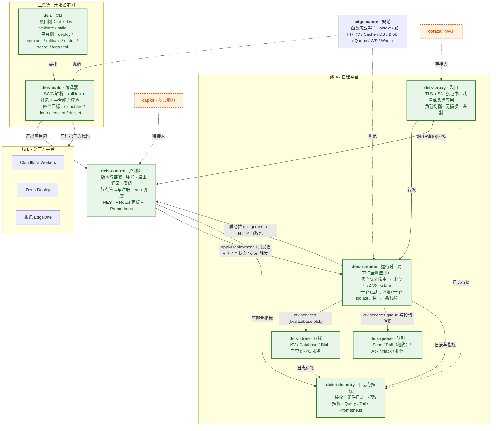
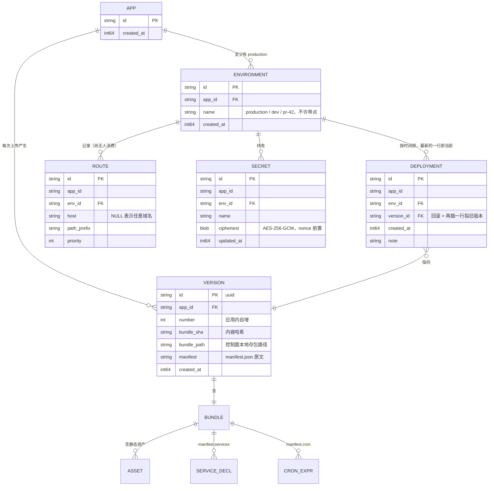
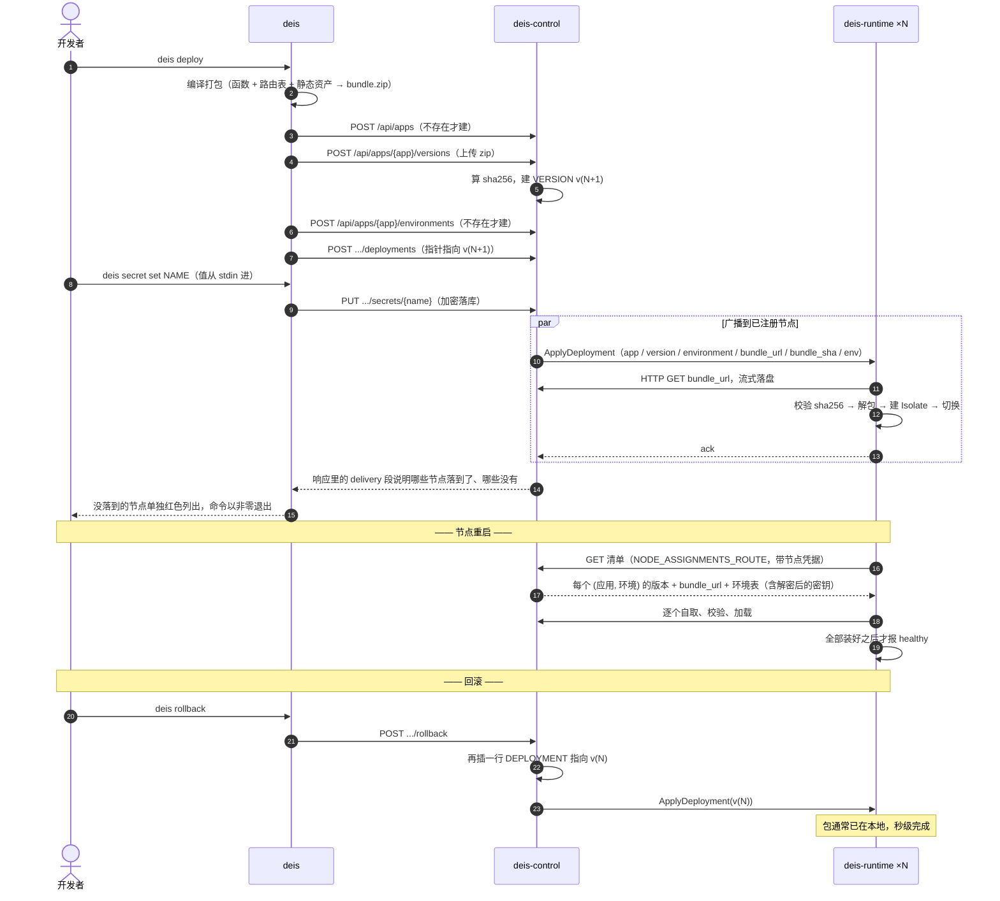
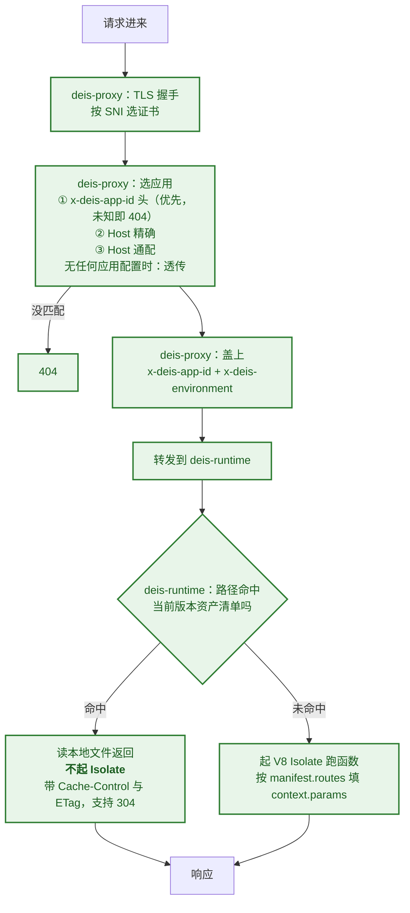
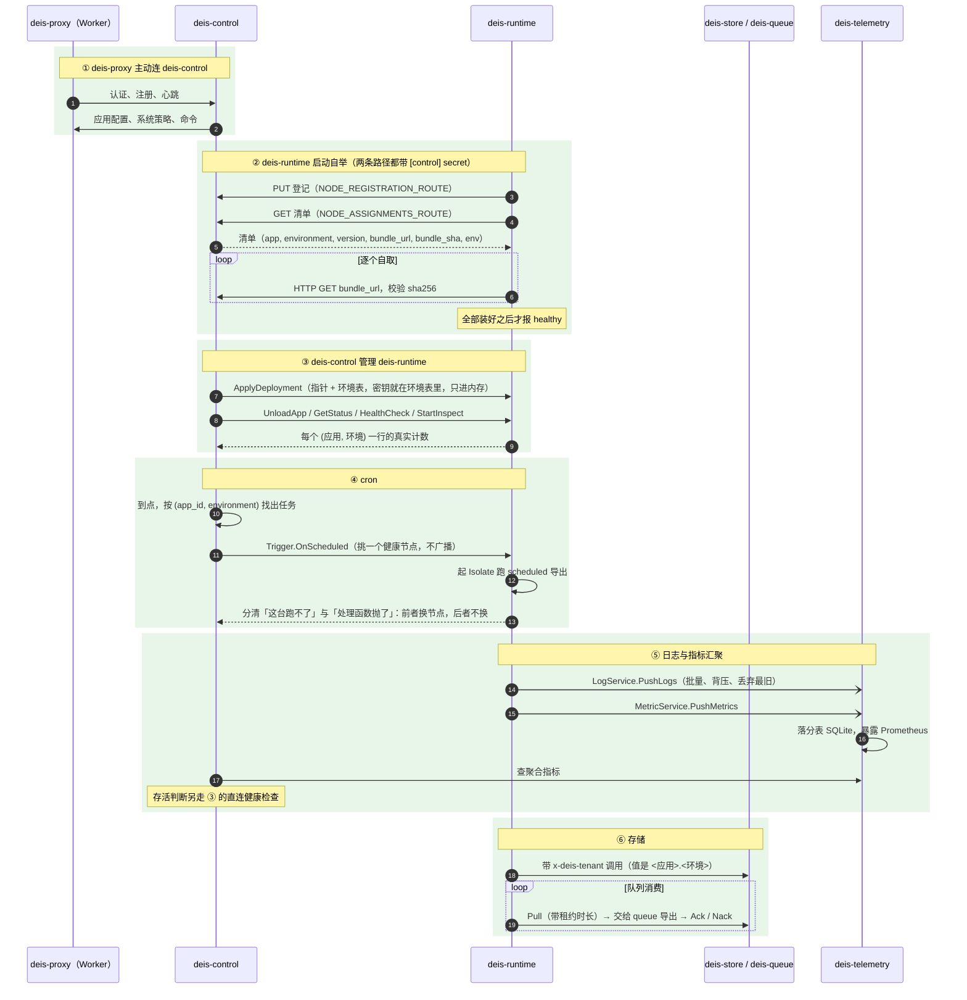
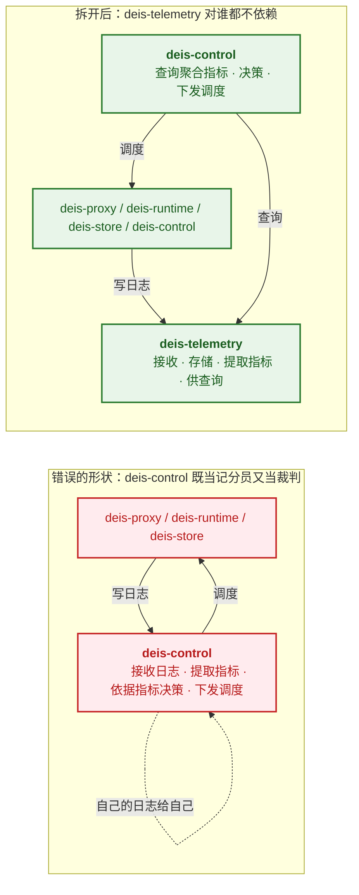

# Deislet 系统设计

> v0.4 · 2026-08-29
> 定位：**mini 版 Cloudflare Workers + Pages，执行引擎换成 Deno（deno_core）**，面向自己/团队内部使用。
> 配套 [`implementation-plan.zh.md`](implementation-plan.zh.md)：那份讲「照着写什么」，这份讲「为什么这么分」。

**现在这套东西是通的。** 波次 A 与波次 B 已经合入：`deis build --vendor deislet`
产出应用包，控制面把它存成不可变版本，环境指针指向版本，节点自己把包拉下来对外服务；
静态资产先于任何 Isolate 命中；`ctx.services.{kv,database,blob,queue}` 真的走到
deis-store 与 deis-queue；cron 到点在**一个**节点上执行；日志进 deis-telemetry；
回滚就是把指针挪回去。同一个应用的两个环境能在同一台节点上并行，各用各的版本与存储。
`scripts/demo.sh` 走完这一整条线，并逐项验证十二条性质。

下文每一节都标了**哪些已经成立、哪些还没有**。没有标注的段落是设计意图，与现状一致。

---

## 0. 已定的设计原则

这些是拍过板的前提，后面所有结构都从这里推出来：

| # | 原则 | 含义 | 现状 |
|---|---|---|---|
| 1 | **资产优先** | 静态文件先命中先返回，未命中才落到函数。Workers 和 Pages 两半都做 | 节点侧成立；deis-proxy 的资产缓存还没做 |
| 2 | **全量复制** | 每个 deis-runtime 节点都跑全部应用，与 CF 的边缘模型一致。不做按应用调度 | 成立 |
| 3 | **存储自建** | KV / DB / Blob 由 deis-store 提供、Queue 由 deis-queue 提供，不外接 Redis/PG/MinIO，也不塞进控制面 | 成立 |
| 4 | **版本不可变** | 每次部署产生不可变版本，部署是指向版本的指针，回滚即改指针 | 成立 |
| 5 | **资产随包走** | 静态资产打进版本包，由 deis-runtime 服务，deis-proxy 只做缓存。保证回滚天然覆盖资产 | 打包与服务成立；proxy 缓存未做 |
| 6 | **cron 归属应用** | 定时任务挂在应用上，由 deis-control 挑一个健康节点直连 deis-runtime 触发 | 成立 |
| 7 | **大对象流式传输** | 应用包走 HTTP 自取、Blob 走流式分块；KV/DB 保持一次性调用，消息上限提到 16MB | 成立 |
| 8 | **节点主动拉** | deis-runtime 启动时向 deis-control 拉取「我该跑哪些应用的哪个版本」，拉完才报健康 | 成立 |
| 9 | **队列轮询消费** | deis-runtime 定期向 deis-queue 拉自己该消费的消息，靠租约避免重复。deis-queue 保持无状态判断 | 成立 |
| 10 | **环境维度** | 每个应用有 production 与任意多个预览环境，各自独立的版本指针、服务声明与密钥 | 成立 |
| 11 | **观测独立** | 日志汇聚与指标提取由独立组件 deis-telemetry 承担，不放进控制面。存活判断走直连健康检查，质量判断才查 deis-telemetry | 成立 |

原则 3 与 9 的措辞改过：队列最初挂在 deis-store 名下，落地时拆成了独立的
deis-queue（理由见 §6）。

---

## 1. 组件全景



绿色是已经跑通的；虚线橙色是还没接进来的：只剩 coraza 与 capkit 两个外部件。

`deis` 也是绿的：它已经补全到平台侧（deploy / versions / rollback / status /
secret / logs / tail），`scripts/demo.sh` 的部署动作全部走 CLI，脚本里没有一处
对控制面 REST 的 `curl`。

### deis-runtime 的定位变化

原先 deis-runtime 是纯被动的自治节点：不主动连任何人，等 deis-control 调它的管理面。
现在**多了三条它主动发起的连接**：

- 启动时向 deis-control 拉应用清单，并逐个 HTTP 取包（原则 8）
- 日志与指标批量投递给 deis-telemetry
- 按 manifest 声明的队列，定期向 deis-queue 拉消息

自治性本身没变——拉完之后本地 SQLite 就能撑住，deis-control 挂了照常服务。但
「deis-runtime 从不外连」这条不再成立，配置里必须有 deis-control 的地址与节点凭据
（`[control] endpoint` 与 `[control] secret`）。

---

## 2. 数据模型



**环境是第二主键。** 部署指针、路由、密钥全部挂在「应用 + 环境」上，不挂在应用上。
预览环境用自己的存储租户，测试数据不会写脏生产。版本本身跨环境共享——同一个包可以先
部署到 dev 验证，再把 production 的指针指向它，不用重新上传。

**服务、cron、队列消费不在库里。** 它们是**包的属性**，写在 `manifest.services` /
`manifest.cron` / `manifest.queues` 里，随版本走。这是与早前设计的一处出入：原本
打算建一张 `bindings` 表把「代码里的名字 → namespace」映射存进控制面，落地时没有
建，理由见 §8。控制面读包内 manifest 来决定下发什么、调度什么。

**存储位置**：以上全部是 deis-control 的 SQLite，deis-control 是元数据的唯一权威。
deis-runtime 本地 SQLite 只缓存「本节点当前该跑哪些应用的哪个版本」，用于断网自治。

### 与现有代码的对照

| 对象 | 现状 |
|---|---|
| APP | 有。`apps` 表 + `/api/apps` |
| ENVIRONMENT | 有。`environments` 表；名字必须满足 `is_valid_tenant_part`（不许含 `.` `/` `\`，半边不超 64 字节），否则存储租户会被拆成三段而全废 |
| VERSION | 有。`versions` 表，写入后永不修改；包体存控制面本地，`bundle_sha` 是内容哈希 |
| DEPLOYMENT | 有。`deployments` 表只追加；某环境的当前版本 = 该 env 下最新一行 |
| ROUTE | **有表、有 REST，但没人消费**。`routes` 表存 host + path_prefix + priority，`GET /api/routes` 能读出来，deis-proxy 却仍然只按域名或 `x-deis-app-id` 选应用（见 §4） |
| SECRET | 有。AES-256-GCM 落库，主密钥从 `secret_key_file` 读；面板与 CLI 只能写和删，读不回来 |
| CRON | 有，且挂对了对象：调度器按 `(app_id, environment)` 维护，到点调某一个节点的 `Trigger.OnScheduled` |
| ASSET | 有。打进包里，节点建内存索引，命中直接返回并带 ETag |
| BINDING / NAMESPACE | **没建，也不打算建**。见 §8 |

---

## 3. 应用生命周期



- **包从不进 gRPC 消息**。控制面只发指针，节点自己 HTTP 取。早前的 `DeployApp`
  把整个 zip 塞进一次调用，撞 tonic 的消息上限，已删除。
- **去重**：`bundle_sha` 相同不新建版本。
- **部署失败不切指针**：任一节点没 ack，响应里 delivery 段会说明，指针语义由调用方
  决定是否回退。
- **不做百分比灰度**。全量复制下灰度需要 deis-runtime 同时驻留两个版本的 Isolate，
  本轮不做，但模型留了口子。
- **换版先装好再切**：`RuntimePool::stage_app` 在另一条线程上把新版本建好、预热完，
  `activate` 才把流量换过去，旧版本在这期间一直在应答。所以换版没有可用性空档。

---

## 4. 请求路径



**环境怎么定**：deis-proxy 从它自己的应用配置里读出该应用的 `environment`，原样盖成
`x-deis-environment`；客户端自己带的同名头会被覆盖，不能借它跳到别的环境。节点收到
不带这个头的请求时按 `production` 处理，所以早于环境模型的调用方仍然落到生产。

**还没做的两件事，都卡在同一处**：

- **路径级路由**。控制面已经有 `routes` 表（host + path_prefix + priority）和
  `GET /api/routes`，deis-proxy 却没有去读它——它的路由表只有域名维度。所以
  `example.com/api/*` 给 API 应用、`example.com/*` 给站点应用暂时共存不了。
- **预览子域**。预览环境本该靠 `<env>.<app>.<zone>` 自动子域访问，这依赖上面那条
  链路，也依赖一张泛域名证书（`*.<zone>`）或 ACME 自动签发。

**deis-proxy 的资产缓存也还没做**：原则 1 里「proxy 只做缓存」的那一半没有实现，
每个资产请求都会走到节点，由节点从内存索引里回。

---

## 5. 控制面



**cron 为什么这么改**：任务在概念上属于应用，不属于节点。全量复制下每个节点都有这个
应用，谁执行由 deis-control 决定——挑一个健康节点触发，天然避免重复。deis-control
本来就是单点，不需要 leader 选举。原先 `CronTask` 挂在 `node_id` 上，是挂错了对象。

**一次触发只跑一个节点**，失败换一个节点重试——但只在「这台跑不了」的时候换。处理
函数自己抛异常时不换：同一段代码在别处会以同样方式失败，而它在失败前可能已经产生了
副作用（发过队列、写过库），每换一个节点就重放一次。节点用
`deis_runtime::trigger::HANDLER_FAILED_PREFIX` 这个错误前缀表达这一区分，因为
`TriggerResponse` 里没有「处理函数已被调用」这一位。

**节点注册**：节点凭 `node_preshared_keys` 里的凭据向控制面登记自己，登记过期就要
再来一次。方法是 `PUT`：登记是在陈述「这个节点是什么」，不是请求创建一条记录，所以
掉线又回来的节点原样再说一遍就行；同一条路径上的 `DELETE` 是节点主动离场。注册不是
拿活的方式——没注册的节点照样自取并服务它拉到的每个应用，只是收不到推送、也不会被
选中跑 cron。

**这两条路径不在文档里写死。** 它们是
`deis_wire::conventions::{NODE_REGISTRATION_ROUTE, NODE_ASSIGNMENTS_ROUTE}`
（服务端注册路由用的 `:id` 模板）与 `node_registration_path` /
`node_assignments_path`（客户端拼一个具体节点的路径）。放进 deis-wire 是因为没有
任何东西会检查两个 crate 有没有把同一条 HTTP 路径拼成一样：节点请求 `/register`
而控制面提供 `/registration`，两边都编译得过，唯一的症状是一支永远学不会自己有哪些
节点的机队——这件事已经发生过一次。上面时序图里的中文标注是为了看得懂，真值以那两个
常量为准。

---

## 6. deis-store 与 deis-queue：存储与队列

两个独立组件（`crates/deis-store`、`crates/deis-queue`）。队列**没有**放进存储里——
队列不是存储，它的语义（租约、重投、死信）与键值/对象读写完全不同，混在一个组件里
名不副实。

| 组件 | 服务 | 底层 | proto |
|---|---|---|---|
| **deis-store** | KV | SQLite 表（tenant, key, value, metadata, expires_at） | `storage.proto` 的 `KvStore` |
| | Database | 每租户一个独立 SQLite 文件 `db/<tenant>.sqlite` | `storage.proto` 的 `Database` |
| | Blob | 内容寻址落盘 `blob/<tenant>/…` + SQLite 元数据 | `blob.proto`，Get/Put 流式分块 |
| **deis-queue** | Queue | SQLite 表做持久队列，另有死信表 | `queue.proto`：`Send` / `SendBatch` / `Pull` / `Ack` / `Nack` |

### 租户维度只有一个，值是「应用 + 环境」

两个组件都只认**一个**租户维度，**不认版本、不认部署，也不知道「环境」是什么**。
它们收到的租户 id 是一个不透明的字符串，走带外的 `x-deis-tenant` 头传递
（gRPC metadata），所以 proto 消息里没有租户字段。

这个串由调用方用 `deis_wire::conventions::tenant_id(app, environment)` 拼出来，形如
`demo.production`；服务端用同一个 crate 的 `split_tenant` 校验，只接受恰好两段合法
部分，因此没有哪个取值能拼出上级目录（租户 id 会变成磁盘路径 `db/<tenant>.sqlite`、
`blob/<tenant>/…`）。缺头、非可打印 ASCII、或校验不过（裸 app id、三段、空段、含
`.` `/` `\`、半边超 64 字节）一律回 `PermissionDenied`，绝不退回某个默认命名空间。

**为什么把环境揉进这把钥匙**：原则 10 说每个环境有自己的数据。如果预览环境和生产共用
一个命名空间，预览的一次写就能覆盖掉生产的键——而这是回滚救不回来的，回滚只换代码，
不还数据。所以这里宁可让钥匙长一点，也不让两个环境有机会撞在一起。

服务端刻意**不提供**拆开后两半的访问器：存储是按租户存的，不是按应用存的，代码里不该
有任何地方能因为「前缀一样」把两个租户当成一个。

`x-deis-app-id` 仍然存在，但只在数据面表示「这是哪个应用」（配合
`x-deis-environment`），不再是存储租户；只带它来调存储的调用会被拒绝。

### 队列语义

- **拉模式**：deis-runtime 定期 `Pull(queue, max, lease_secs)`，deis-queue 把消息标记
  为「租约中」并返回。
- **租约**：租约期内其他节点看不到这条消息。超时未 Ack 则重新可见。全量复制下多个
  节点拉同一队列，靠这个防重复消费。
- **至少一次**：Ack 之前的崩溃会导致重投，应用侧需要幂等。消息带 `attempts`，大于 1
  就意味着应用见过它。
- **租约令牌**：每条被领走的消息带一个 `lease_token`，租约每次续期都换新的。Ack 与
  Nack 必须原样带回来，所以租约过期、消息被别人领走之后，先前那个消费者的 Ack 不再
  作数——否则它会把别人正在处理的那条销掉。
- **死信**：重试超过阈值进死信表，不再投递。`ListDeadLetters` 与 `ReplayDeadLetters`
  两个 RPC 让人能看见它们、并把它们放回队列，不必直接读库。

不做成 deis-queue 主动推给节点——那需要队列知道哪个节点跑哪个应用，会破坏「哑服务」
这条边界。

### 授权：现阶段靠网络收敛，不是靠校验

**这里写清楚，免得被上面那段租户校验误导**：deis-store 校验 `x-deis-tenant` 的
**形状**，但不校验**身份**，也没有授权表。能连上端口的任何东西都能自称任何租户——
包括同一个应用的另一个环境——从而读写删它的数据。租户拆分挡不住这一层，它挡的是应用
自己写错租户。收敛手段仍是网络层：默认只监听回环地址，绑定非回环地址时启动会打 warn
说明后果。

这对「自己/团队内部用」是相称的：只有同机的 deis-runtime 需要连它。要把它暴露到本机
之外，**必须先有**这几样，缺一不可：

1. 每个调用方的身份（mTLS 客户端证书，或控制面签发的令牌）
2. 身份与所声明租户的核对
3. 拒绝要有可追查的日志
4. 健康端点同等对待——否则它成了免鉴权的存活探针

授权表列为未来工作。

### 其他取舍

- **先单机**。SQLite + 本地盘对内部规模够用。接口层不暴露单机假设，以后换后端不动
  proto。
- **不做跨节点复制**。deis-store 是全量复制模型下唯一的有状态点，也是单点。内部使用
  先接受。**备份是有的**：`deis-store snapshot` / `restore` 两个子命令做一致性快照，
  因为这些 SQLite 都开着 WAL，直接 `cp -r` 或 `rsync` 拷出来的目录可能缺最近的提交、
  也可能直接是坏的，而且打开时不会报错。做成子命令而不是 RPC，是因为它是运维动作，
  不该让任何能连到端口的人触发。
- **地址由 deis-control 下发**给 deis-runtime，不写死在 deis-runtime 配置里：控制面
  配 `store_endpoint` / `queue_endpoint`，随每次下发进环境表，节点在进 Isolate 之前
  把它们取走。所以应用的 `ctx.env` 里看不到这两个键，也无法用同名变量把存储客户端
  指到别处。

---

## 7. deis-telemetry：日志汇聚与指标

### 为什么必须独立成一个组件

本设计早前的版本把日志汇聚安在 deis-control 上，那是错的。deis-control 一旦既接收
全部日志、又依据日志做调度决策，就形成了闭环：



具体是三个问题，不只是形状难看：

1. **数据性质冲突**。日志是高频追加的时序数据，控制元数据是低频可变的关系数据。挤在
   同一个 SQLite 里会写竞争，一次日志洪峰能把部署操作拖慢甚至阻塞。
2. **自我观测盲区**。deis-control 自己出故障时，本该记录这次故障的东西正是出故障的
   东西。控制面是最需要事后追查的部分，却恰恰没有记录。
3. **故障放大**。日志处理的一个 bug 能拖垮控制面；反过来，重启 deis-control 做版本
   升级会中断整条日志管道。两件事的可用性要求完全不同——丢日志可以接受，丢部署元数据
   不行。

拆开之后 deis-telemetry **对任何组件都不依赖**，deis-control 退回成它的一个查询方。
这不是把环改成大环，是真的断开。

### 保持解耦的关键：deis-telemetry 必须是「哑」的

deis-telemetry 只做：接收带标签的日志条目、存储、按规则聚合、供查询。**它不认识应用
模型**——不知道什么是版本、环境、部署指针，也不做任何判断。所有解释工作在
deis-control。

一旦 deis-telemetry 开始理解应用语义（比如「这个应用错误率高，通知 deis-control
回滚」），依赖就又长回去了。

### 职责边界

| 能力 | 说明 | 现状 |
|---|---|---|
| **接收** | `LogService.PushLogs`，批量、幂等 | 有。节点已在投递 |
| **存储与保留** | 按天分表的 SQLite，按时间与总量双重上限淘汰 | 有 |
| **指标提取** | 从结构化字段里按规则提取计数、耗时分布、错误率 | 有。`MetricService.PushMetrics` + 本地聚合 |
| **查询 API** | `LogService.Query`，供控制面决策与面板展示 | 有 |
| **Prometheus** | 独立 HTTP 端口上的 `/metrics` | 有 |
| **实时 tail** | `LogService.Tail` 流式订阅 | 有，`deis tail` 是它的消费方 |

deis-telemetry 自己的日志只写 stderr，不自摄入，避免递归。

**目前只有 deis-runtime 在投递。** 设计里说「来源包括 deis-runtime、deis-proxy、
deis-store，以及 deis-control 自己」，实际接上的只有节点这一路：deis-proxy、
deis-store、deis-queue、deis-control 都还只把日志写自己的 stdout / 文件。后果是
访问量与耗时这两个本该由 deis-proxy 提供的主要指标，现在只能从节点侧的数字推算，
而被 deis-proxy 挡在门外的请求（404、证书不匹配）在 deis-telemetry 里完全看不见。

### 观测的维度：应用，环境只是一个字段

隔离是存储的事，观测不需要。能连到 deis-telemetry 端口的人本来就能读写任何应用的
日志，把租户串（`demo.production`）原样当 `app_id` 换不来隔离，却会毁掉唯一有人问的
那个问题——「把这个应用的日志给我看」，指的是它全部环境的。

所以节点在投递时把租户拆开：日志的 `app_id` 是应用、`fields.environment` 是环境；
指标的 `app_id` 是应用、`environment` 是普通标签。于是 `sum by (app_id)` 能把一个
应用的各环境加起来，也能单挑一个。

### 硬约束：两条观测路径必须分开

这是把日志用于决策时最容易踩的坑，写死在设计里：

- **存活判断走直连**：deis-control → deis-runtime / deis-proxy 的健康检查，不经过
  deis-telemetry。这条路必须快且可靠。
- **质量判断走 deis-telemetry**：错误率、耗时退化、自动回滚这类统计性决策，查
  deis-telemetry 的聚合指标。这条路慢、可降级。

如果存活判断依赖 deis-telemetry，那 deis-telemetry 一挂，整个集群会被误判成全部死亡，
然后触发一轮灾难性的调度。

---

## 8. 服务声明与密钥

### 服务：留在包里，没有 bindings 表

早前设计打算把 `AppManifest.resources: Vec<String>` 换成一张结构化的绑定表，
形如 `{ "name": "MY_KV", "kind": "kv", "namespace": "foo-prod" }`，存进控制面。
**落地时没有这么做**，因为 namespace 那一列没有内容可填：租户已经由
`(应用, 环境)` 唯一决定，一个应用的 KV 就是它自己那份，不需要再指一次。

现在的形状是：包的 manifest 里声明**用不用**某个服务，

```json
{ "services": { "kv": true, "database": true, "blob": false, "queue": true } }
```

节点按这份声明构造对应的客户端放进 Isolate 的 `OpState`；没声明的服务连接都不建，
`ctx.services.<那个>` 就是「不可用」。地址来自控制面下发的环境表里的保留键
（`DEIS_STORE_ENDPOINT` / `DEIS_QUEUE_ENDPOINT` / `DEIS_SERVICES` /
`DEIS_QUEUE_CONSUMERS`），这些键在进 Isolate 之前被取走。

**代价要说清楚**：应用不能给同一种服务开两个互不相通的命名空间——没有
`MY_KV` 与 `CACHE_KV` 之分，一个应用一个环境只有一份 KV。真需要多命名空间时，
再补一层映射，那时才需要 bindings 表。

### 密钥

- deis-control 用主密钥（从 `secret_key_file` 读，32 字节，不进代码不进库）
  AES-256-GCM 加密后存 SQLite，nonce 前置。
- 下发给 deis-runtime 时经 `ApplyDeployment` 的 `env` 表传明文，deis-runtime
  **只放内存**，不落本地 SQLite。节点重启后从 assignments 重新拿。
- 面板和 CLI 只能写和删，不能读回。
- 某个环境的密钥解不开时，该行被整条剔出 assignments 并打 error，而不是发一份残缺
  环境下去。
- **因此** 清单接口（`deis_wire::conventions::NODE_ASSIGNMENTS_ROUTE`）与 bundle
  下载挂在独立的 `node_auth` 上，凭据是 `node_preshared_keys`，不受面板的
  `api_auth_enabled` 影响，也不接受面板 API Key。这条路会把全部环境的明文密钥当 JSON 返回，早前它只挂在默认关闭的
  面板鉴权上，等于任何能连到控制面 HTTP 端口的人 curl 一次就能拿走整个平台的密钥。

---

## 9. 限额

原先全部写死在代码里。现在是两层：**平台默认**（deis-runtime 配置的
`[default_execution_limits]`，`timeout_ms` 与 `rate_limit_ops_per_sec`）→
**应用覆盖**（`AppConfig` 里的同名字段）。V8 堆上限也可配。

还缺的三项：

- **硬上限**。应用覆盖目前能突破平台默认，没有一个「怎么覆盖都不能超过」的天花板。
- **CPU 时间**。30 秒是墙钟，而且只约束「正在跑 JS」的那部分：一个卡在慢存储 await
  上的处理函数能无限占住它那条运行时线程，超时管不到它。
- **出网控制**。今天没有一条应用能自己发起的出网路径：`fetch` 根本不在 Isolate 的
  `globalThis` 上（§12 探针实测），应用能打出去的只有 `ctx.services.*`，而那几个
  地址是控制面随下发给定的、应用改不动。所以这一格现在不是漏洞而是空白——`fetch`
  一旦装上，函数就能打到任意地址（包括内网），到那时至少要能配黑名单（默认禁内网
  段）。**顺序上，出网控制要和 `fetch` 一起做，不能等它先上线再补。**

---

## 10. 落地顺序

| 阶段 | 内容 | 状态 |
|---|---|---|
| **一 · A** | deis-store / deis-queue / deis-telemetry 三个新组件；控制面的产品模型（catalog）与 REST | **完成** |
| **一 · B** | `Platform::Deislet` 与适配器：产出含函数入口、路由表、资产清单的应用包；`ctx.params` 随之成立 | **完成** |
| **二** | 版本、环境与部署模型：建表、ApplyDeployment 指针下发、节点自举拉取与自取包 | **完成** |
| **三** | 静态资产：包内带资产、节点资产优先命中 | **完成**（deis-proxy 的路径级路由与资产缓存、自动子域仍缺，见 §4） |
| **四** | 可观测：deis-telemetry；节点侧日志与指标投递；真实状态上报 | **完成**（`deis logs` / `deis tail` 已有；控制面面板的日志视图仍缺） |
| **五** | cron 修正、secrets、限额两层化 | **完成**；出网控制与硬上限仍缺（见 §9） |
| **六** | `deis` CLI 闭环：deploy / rollback / versions / tail / dev 接真运行时 | **完成**（`deis dev` 起的是真的 deis-runtime，走的是控制面同一个 `ApplyDeployment`） |

---

## 11. 尚未决定与仍然开着的

**边做边定**

- 证书自动签发（ACME）。自动子域需要泛域名证书，届时一并考虑。`examples/pingap` 有
  现成模块可参考。
- （已定）`deis dev` 怎么执行用户代码：起一个本地 `deis-runtime`，用控制面同一个
  `ApplyDeployment` 把包交给它。另外两条路——调 deno CLI、把 deno_core 嵌进 deis
  ——都不再考虑，因为它们跑的都不是线上那个引擎。
- deis-telemetry 的日志保留时长与总量上限的默认值。
- 出网控制用黑名单还是白名单。
- deis-store 的备份周期与保留策略。

**已知缺口（不阻塞现有功能，但都会被踩到）**

- **控制面的 routes 表没人消费**，deis-proxy 仍只按域名选应用（§4）。
- **只有 deis-runtime 在往 deis-telemetry 投递**，deis-proxy / deis-store /
  deis-queue / deis-control 都还只写自己的 stdout（§7）。
- **`UpdateApp` 仍带 `bytes package_data`**，和被删掉的 `DeployApp` 是同一个毛病。
  RPC 本身已改为 `Unimplemented` 并指向 `ApplyDeployment`，但消息里那个字段还在，
  删它要同时改 `crates/deis-runtime/proto/management.proto` 与
  `crates/deis-runtime/src/management/`。
- **请求与响应体是 `String`**：`JsRequest.body` / `JsResponse.body` 都是文本，二进制
  主体过不了 Isolate 边界。
- **Web 标准的全局大半没装上，`fetch` 也在其中**：`fetch`、`crypto`、
  `AbortController`、`ReadableStream`、客户端 `WebSocket`、`structuredClone` 等都不在
  Isolate 的 `globalThis` 上（§12）。edge-canon 把 `fetch` 列进基础特性，这是最直接的
  一处不达标。清单本身现在有一致性测试守着（§12），所以少的是实现，不再是发现手段。
- **执行超时管不住卡在 await 上的处理函数**（§9）。
- **`trigger.proto` 的 `QueueEvent` 还没有 `environment` 字段**（`ScheduledEvent`
  已经有了）。队列消费目前由节点自己按 `(应用, 环境)` 轮询，不经过这个消息，所以还没
  被踩到；一旦有别的调用方用它投递批次，就会指不准环境。
- **deis-store 是单点，也没有跨节点复制**（§6）。

**涉及对外承诺**

- **WebSocket 经 deis-proxy 的那一跳从未验证**。节点这一端现在有证据：
  `websocket_direct_test.rs` 在进程内验 Isolate 侧那一半，`websocket_bridging_test.rs`
  自己 bind 一个端口起 router，用真 WebSocket 客户端带 `x-deis-app-id` 连上去，断言
  101 与两轮 echo 往返（此前它是 POST 到写死的 localhost:8000，没服务就打印
  "Server not running, skipping test" 然后 return 当通过，而那个端点 dispatcher 早已
  不提供）。仍然没测的是 deis-proxy → deis-runtime 这一跳，以及二进制帧那条路。
- **deis-control 面板认证是 API Key 且默认关闭**（`api_auth_enabled` 默认 false），
  没有用户与角色概念。节点通道另有独立鉴权，不受它影响（§8）。

**明确推迟**

百分比灰度、Durable Objects、deis-store 多副本高可用、计费与配额、npm 包解析与框架级
SSR。

---

## 12. 能力矩阵对账

`edge-canon/PLATFORM_MATRIX.md` 是公开仓库里的那张表。下面是 2026-08-29 逐项核对的
结果——**核对的是代码本身，不是变更记录**；其中「有哪些全局」这一项另外起了一套
控制面 + 节点，用探针应用实测过（见下）。编译器侧的同一份判断写在
`crates/deis-build-core/src/platform_capabilities.rs`，`test_deislet_capabilities`
会在实现变化而没人改表时失败。

### 基础特性（规范要求全平台必须支持）

| 特性 | 实况 | 依据 |
|---|---|---|
| HTTP Handler | 成立 | `dispatcher` → `RuntimePool` → Isolate |
| Request / Response | **部分成立** | `JsRequest.body` / `JsResponse.body` 是 `Option<String>`，二进制主体不支持。JS 侧用的是 `runtime.js` 自带的最小 `Request` / `Response`，没有 `Response.json()`、`ok`、`redirect`、`arrayBuffer()` 与流式主体 |
| 环境变量 | 成立 | 控制面下发的 `env` 表注入 `context.env`，平台保留键先被取走 |
| 路由参数 | 成立 | `runtime/route_match.rs` 按 manifest 的 `routes[].pattern` 匹配，填 `JsRequest.params`；支持 `:name` 与 `*` 捕获 |
| KV 存储 | 成立 | `runtime/bindings.rs` 构造 `KvClient` → deis-store 的 `KvStore` 服务 |
| Cache API | 成立 | 标准入口是 `context.services.cache`，`globalThis.caches.default` 指向同一个实例；后端是 moka 进程内缓存，`Cache-Control` 的 `max-age` / `s-maxage` 决定过期。语义上是单 Isolate 缓存：换节点、换版本都读不到 |
| 生命周期 `waitUntil` | 成立 | `runtime.js` 的 `__deis_runtime_wait_until_all` |
| 结构化日志 | 成立 | 环形缓冲 + `LogShipper` → deis-telemetry，`Query` 能查回来 |
| Web 标准 | **比看上去少得多** | 见下方「Web 标准这一格的实情」 |

### Web 标准这一格的实情

这条值得单独写，因为它推翻了一个一直被当成成立的假设。

扩展确实注册了：`build_runtime_extensions()` 里有 `deno_web`、`deno_fetch`、
`deno_crypto`、`deno_websocket`、`deno_net`、`deno_tls`，它们的 op 都在。
但**注册扩展不等于装上全局**：

- 这些扩展的 JS 模块（`ext/web/08_text_encoding.js`、`ext/fetch/23_response.js` 等）
  只 `export`，没有一处往 `globalThis` 上赋值——Deno CLI 是在自己的
  `99_main.js` 里统一挂全局的，那个文件不在这里。
- `deno_core` 自己只挂一个 `globalThis.console`，另外挂的 `Deno` 被
  `runtime.js` 第一行删掉了。

**这是实测的，不是推断的。** 2026-08-29 起了一套控制面 + 节点，部署了一个只做
`typeof globalThis[name]` 的探针应用，逐个问了一遍：

| 有 | 没有 |
|---|---|
| `Headers`、`Request`、`Response`、`URL`、`URLSearchParams`、`EventTarget`、`setTimeout` / `clearTimeout`、`queueMicrotask`、`console`、`caches`、`WebSocketPair` / `WebSocketServer`、`TextEncoder` / `TextDecoder`、`atob` / `btoa` | `fetch`、`crypto`、`AbortController` / `AbortSignal`、`ReadableStream` / `WritableStream` / `TransformStream`、`Blob` / `File`、`FormData`、`URLPattern`、客户端 `WebSocket`、`BroadcastChannel`、`MessageChannel` / `MessagePort`、`structuredClone`、`Event`、`setInterval` / `clearInterval`、`performance`、`DOMException`、`CompressionStream` / `DecompressionStream`、`EventSource`、`FileReader`、`navigator`、`reportError` |

左边这一列的来路也要说清楚：`console` 与 `queueMicrotask` 是 deno_core 自己的
`01_core.js` 挂的，其余全部是 `src/runtime/js/runtime.js` 里手写的最小实现（`caches`
是进程内的 moka，`WebSocketPair` / `WebSocketServer` 是节点侧的桥接）。也就是说，
连「有」的那几个也不是 Deno 那一套。

`Response` 上也没有 `Response.json()` 这个静态方法，实例上没有 `arrayBuffer()`。

也就是说，一个应用能用的「Web 标准」就是左边那一列加上 V8 自带的。**没有 `fetch`**
这一条尤其要紧：edge-canon 把 `fetch()` 列进基础特性，而处理函数里调它会直接
`ReferenceError`。

这份清单现在有测试守着。`crates/deis-runtime/src/runtime/isolate_test.rs` 里的
`the_isolate_global_surface_is_the_one_the_documents_describe` 在真 Isolate 里
把上下两列逐个 `typeof`，**两个方向都断言**：该有的少一个红，不该有的多一个也红。
所以往 `globalThis` 上加或减一个全局，都会先把这条测试打红，逼着本节和
`crates/deis-runtime/README.md` 跟着改。此前这一格的每次结论都来自一次性探针，
验完就撤，没有任何东西能在下一次误加误删时报警——那正是它和文档反复走样的原因。

`TextEncoder` / `TextDecoder` / `atob` / `btoa` 是 2026-08-29 补上的，只做 UTF-8。
补它们不是为了把格子填满：运行时自己有四处代码在调它们（`request.arrayBuffer()`、
二进制请求体、`blob.put(key, "字符串")`、`blob.get(key).text()`，以及 WebSocket
的二进制帧解码），在它们缺席的那段时间里这几条路一律 `ReferenceError`。

### 扩展特性

| 特性 | 实况 | 依据 |
|---|---|---|
| SQL 数据库 | 成立 | deis-store 的 `Database` 服务，每租户一个 SQLite 文件；节点按 manifest 建 `DbClient` |
| 对象存储 | 成立 | deis-store 的 `BlobStore`，Put/Get 流式分块，内容寻址落盘；Isolate 侧 `context.services.blob` 收字符串 / `ArrayBuffer` / `ArrayBufferView`，有顶着真 deis-store 的端到端测试 |
| 消息队列 | 成立 | deis-queue 的 `Send`/`Pull`/`Ack`/`Nack` + 节点的 `queue_consumer` 轮询任务 |
| 定时任务 | 成立 | 控制面按 `(app, environment)` 调度 → 节点 `Trigger.OnScheduled` → 跑 `scheduled` 导出 |
| 静态资产 | 成立 | 包里带资产与清单，节点建索引，命中不起 Isolate，带 ETag 并支持 `If-None-Match` |
| WebAssembly | 成立 | V8 自带 |
| WebSocket | **未验证** | 节点侧代码齐全，进程内测过 Isolate 那一半；HTTP 升级与经过 deis-proxy 的链路没有有效测试（见 §11） |
| BroadcastChannel | **不成立** | `deno_web` 带着 `01_broadcast_channel.js` 被 import 进来了，但没有任何地方把 `BroadcastChannel` 装到 `globalThis` 上，`runtime.js` 也没有自己补一个。探针实测：`typeof BroadcastChannel === "undefined"` |
| Node.js 运行时 | 不成立（形态上没有） | `build_runtime_extensions()` 里没有 `deno_node`，只从中借了一个 TLS op。`require`、`Buffer`、`node:` 模块都不可用 |
| 服务端渲染 | 不成立（形态上没有） | 处理函数当然可以自己拼 HTML，但没有框架挂钩，也没有 npm 生态 |
| 增量静态再生 | 不成立（形态上没有） | 同上 |
| Durable Objects | 不成立（形态上没有） | 全量复制模型下没有「唯一可寻址实例」这回事 |
| Workers AI | 不成立 | 没有推理能力，也不打算有 |

### 两种「不支持」不是一回事

编译器把它们分开处理：

- **形态上没有**：构建**直接失败**。应用声明了它就一定会在线上炸，早失败比晚失败好。
- **暂缺**（`PendingFeature`）：构建**只告警**，声明照样进 manifest。

**目前 Deislet 一项 pending 都没有**——波次 B 把四个暂缺项（SQL、Blob、Queue、Cron）
全部转正了。这个机制留着，是给下一个半成品服务用的。

**但「直接失败」只覆盖编译器看得见的那几样**：`detect_required_features` 只认
`.config.json` 里的 `services.{database,blob,queue}`、`queues`、`cron`，以及
`runtime` 字段里带不带 `node`。SSR、ISR、Durable Objects、BroadcastChannel、
Workers AI 在项目配置里根本没有可声明的地方，所以编译器检不出来，代码里用了它们是
在运行时才炸。要把这几项也挡在构建期，得先做代码扫描（`detect_required_features`
里那条 TODO），或者在配置里给它们一个声明位。

### 与公开矩阵的差异

`PLATFORM_MATRIX.md` 的 Deislet 一列此前把未实现项降级成了 ⚠️ Planned。已按本节结论
改过（2026-08-29）：

- **转正**：路由参数、KV、SQL 数据库、对象存储、消息队列、定时任务。静态资产不在那张
  表的行里（edge-canon 规范没有这一条），写在 Deislet 那一节的散文里。
- **维持 ⚠️**：WebSocket，并写明未验证的是哪一段。
- **降级**：**BroadcastChannel 由 ✅ 改为 ❌**——那一格一直是错的，代码里从来没有把
  这个全局装上去过；Node.js Runtime / SSR / ISR / Durable Objects 由 ⚠️ Planned 改为
  ❌，它们不是排期问题。
- **加了保留**：Request/Response 与 Web 标准两格写清了实际能用什么（见上）。
